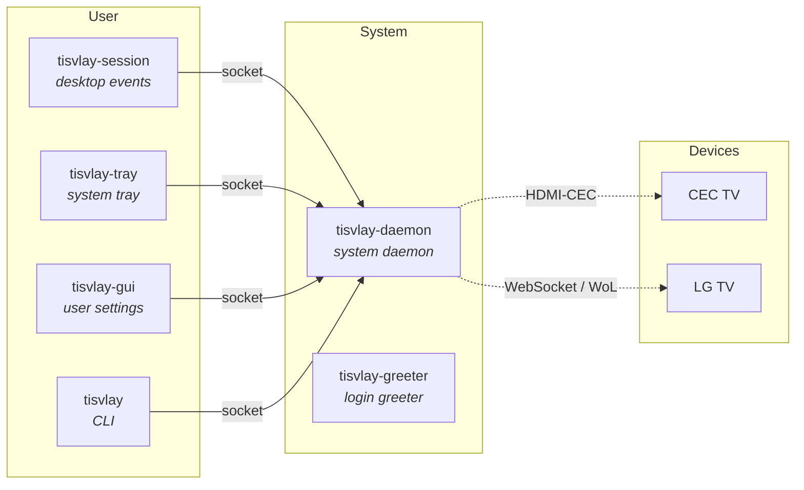

<!-- ANCHOR: overview -->

**TisVlay** brings TV Display control for Linux, including: power, volume, backlight, AV mute, input switching plus more, with per-device profile automation via desktop session integration (idle/lock, boot/suspend, remote login/streaming, etc), while supporting various vendor interface protocols for heterogeneous multi-display setups, mitigating energy usage and display burn-in.

## ✨ Features
- 📺 Control multiple TVs & projectors just like conventional displays
  - Power on/off with PC, Screen on/off with lock screen
  - Easily adjust backlight, volume, active input, and more
- 🤖 Event driven automation driven via system and user events
  - System boot, reboot, shutdown, suspend, wake, DPMS
  - User lock/unlock, idle, remote session connect/disconnect
- 🧰 Flexible profile customization and switching
  - System-wide and per-user profiles for per-device behavior
  - Unified API and CLI for further scripting and integrations
- 🧩 Vendor agnostic & modular architecture
  - Supports HDMI CEC, Network IP Control (LG WebOS SSAP)
  - Generalized for further interfaces, protocols, and transports
- 🩺 Self-healing connectivity
  - Interface status monitoring for automatic reconnect and retry
  - Per-NIC kernel carrier detection with route-aware failover
- 📡 Input-aware automation gating
  - Suppress automation when TV already in use via another input
  - Prevent PC from interrupting movie sessions or console gaming
- 🖱️ Graphical User Interfaces
  - GUI app for device pairing, profile editing, and user setting
  - System tray for quick access controls and device status

## 📸 Screenshots

| **TVs** — devices, status, profiles (dark theme) | **Controls** — picture, audio, input (light theme) |
|:---:|:---:|
|  |  |
| **Discovery** — local device detection | **Pairing** — auto populate configuration |
|  |  |
| **System profiles** — machine lifecycle events | **User profiles** — session events and idle timers |
|  |  |
| **Settings** — desktop notification preferences | **About** — components, their status and versions |
|  |  |
| **Tray menu** — per-TV quick control settings | **Tray tooltip** — at a glance or scroll to adjust |
|  |  |

## 🏛️ Architecture

TisVlay is comprised of a collection of cooperating components:

| Component | Description |
|-----------|-------------|
| `tisvlay` | CLI for direct TisVlay control and configuration |
| `tisvlay-daemon` | System profile actor and device interface driver |
| `tisvlay-session` | User profile actor and session event integration |
| `tisvlay-tray` | System tray for quick access and desktop notifications |
| `tisvlay-gui` | Device management, profile editor, settings panel |
| `tisvlay-greeter` |  Login greeter idle detection absent of active session |

<!-- ANCHOR_END: overview -->

## 📖 Documentation

The user guide is an [mdBook](https://rust-lang.github.io/mdBook/) in [`docs/book/`](docs/book/) (`just docs-serve` renders it locally):

- 🧭 New here? Start with [Installation](docs/book/src/getting-started/installation.md), then [Quick Start](docs/book/src/getting-started/quick-start.md).
- 🎛️ Already running? See the [CLI Reference](docs/book/src/guide/cli.md) and [Configuration](docs/book/src/guide/configuration.md).
- 🛰️ Streaming in remotely? See [Remote-Session Awareness](docs/book/src/guide/remote-sessions.md).
- 🔎 Discovery not finding your TV? See [Firewall & Discovery](docs/book/src/operations/firewall-discovery.md).
- 🔒 TV discovering too much about you? See [TVs on an Isolated Network](docs/book/src/operations/isolated-networks.md).
