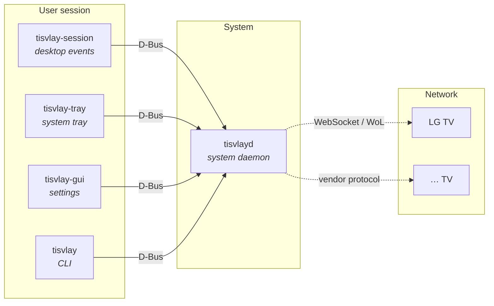

# tisvlay

**TV display control for Linux.**

tisvlay controls smart TVs from a Linux desktop over the network — power, screen blanking, HDMI input, volume, and backlight — and ties that control to your desktop session (lock/unlock, suspend/resume, idle, and display blanking). It's built for setups where the TV is driven over the network rather than HDMI-CEC (for example an Nvidia GPU, which has no CEC).

Today tisvlay supports **LG WebOS** TVs. The architecture is vendor- and transport-agnostic, so other backends (Samsung, Sony, …) can be added later.

## Features

- **Power** — turn the TV on (Wake-on-LAN) and off (standby).
- **Screen blanking** — OLED-safe screen on/off for burn-in protection, distinct from a full power-off.
- **HDMI input switching** — change inputs programmatically.
- **Volume & backlight** — adjust volume, mute, and OLED pixel brightness.
- **Desktop automation** — react to session lock/unlock, suspend/resume, idle timeout, and host-display DPMS blank/wake.
- **Multi-TV** — manage several TVs, each matched to its host display connector by EDID.

## Components

tisvlay is a small set of cooperating programs:

| Component | What it is |
|-----------|------------|
| `tisvlay` | Command-line tool for direct control and configuration |
| `tisvlayd` | System daemon that owns the TV connections and exposes a D-Bus interface |
| `tisvlay-session` | Per-user service that maps desktop events (lock, idle, …) to TV actions |
| `tisvlay-tray` | System-tray applet for quick control and status |
| `tisvlay-gui` | Settings window (pair TVs, edit profiles) |

The CLI and the desktop services all talk to `tisvlayd` over D-Bus; the daemon holds the persistent configuration and the live TV connections.

## Where to go next

- New here? Start with [Installation](./getting-started/installation.md), then [Quick Start](./getting-started/quick-start.md).
- Already running? See the [CLI Reference](./guide/cli.md) and [Configuration](./guide/configuration.md).
- Discovery not finding your TV? See [Firewall & Discovery](./operations/firewall-discovery.md).
