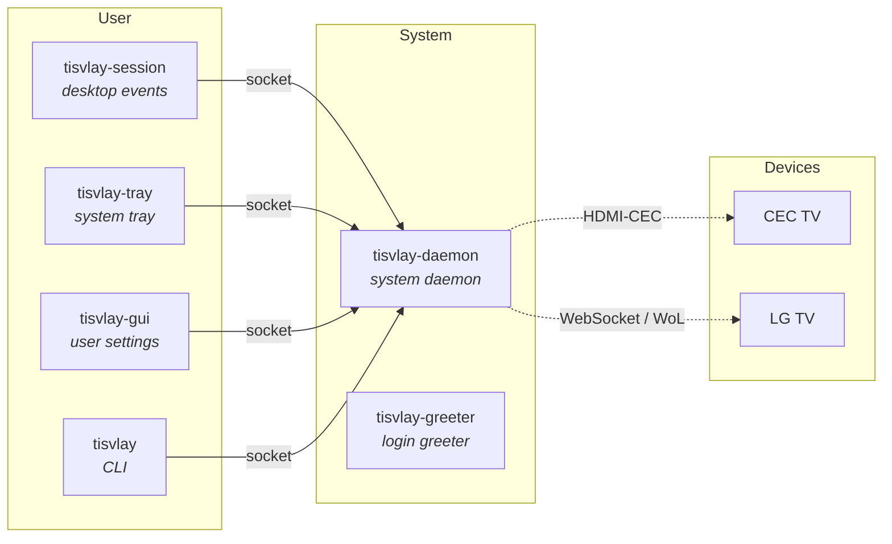

**TisVlay** brings TV Display control for Linux, including: power, volume, backlight, AV mute, input switching plus more, with per-device profile automation via desktop session integration (idle/lock, boot/suspend, remote login/streaming, etc), while supporting various vendor interface protocols for mixed multi-display setups, mitigating energy usage and display burn-in.

## ✨ Features
- 📺 Control multiple TVs & projectors just like conventional displays
  - Power on/off with PC, Screen on/off with lock screen
  - Easily adjust backlight, volume, ative input, and more
- 🤖 Event driven automation driven via system and user events
  - System boot, reboot, shutdown, suspend, wake, DPMS
  - User lock/unlock, idle, remote session connect/disconnect
- 🧰 Flexible profile customization and switching
  - System-wide and per-user profiles for per-device behavior
  - Unified API and CLI for further scripting and integrations
- 🧩 Vendor agnostic & modular architecture
  - Supports HDMI CEC, Network IP Control (LG WebOS SSAP)
  - Generalized for further interfaces, protocols, and transports
- 🩺 Self-healing connectivity
  - Interface status monitoring for automatic reconnect and retry
  - Per-NIC kernel carrier detection with route-aware failover
- 📡 Input-aware automation gating
  - Suppress automation when TV already in use via another input
  - Prevent PC from interrupting movie sessions or console gaming
- 🖱️ Graphical User Interfaces
  - GUI app for device pairing, profile editing, and user setting
  - System tray for quick access controls and device status

## 🏛️ Architecture

TisVlay is comprised of a collection of cooperating components:

| Component | Description |
|-----------|-------------|
| `tisvlay` | CLI for direct TisVlay control and configuration |
| `tisvlay-daemon` | System profile actor and device interface driver |
| `tisvlay-session` | User profile actor and session event integration |
| `tisvlay-tray` | System tray for quick access and desktop notifications |
| `tisvlay-gui` | Device management, profile editor, settings panel |
| `tisvlay-greeter` |  Login greeter idle detection absent of active session |

## Where to go next

- New here? Start with [Installation](./getting-started/installation.md), then [Quick Start](./getting-started/quick-start.md).
- Already running? See the [CLI Reference](./guide/cli.md) and [Configuration](./guide/configuration.md).
- Streaming in remotely? See [Remote-Session Awareness](./guide/remote-sessions.md).
- Discovery not finding your TV? See [Firewall & Discovery](./operations/firewall-discovery.md).
