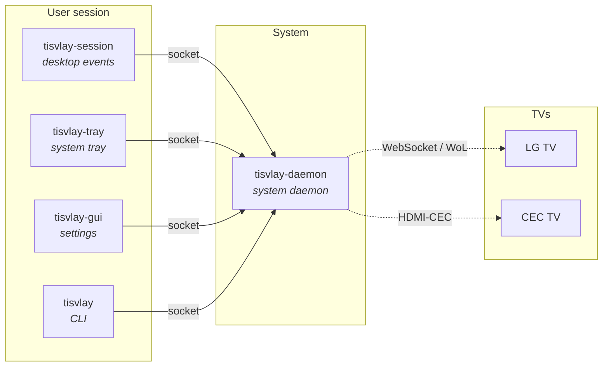

# tisvlay

**TV display control for Linux.**

tisvlay controls smart TVs from a Linux desktop — power, screen blanking, HDMI input, volume, and backlight — and ties that control to your desktop session (lock/unlock, suspend/resume, idle, and display blanking). It reaches a TV two ways: over the **network** (LG WebOS — no extra hardware, and it works even where the GPU exposes no HDMI-CEC, as on Nvidia) or over **HDMI-CEC** (the Linux CEC subsystem, through a USB CEC adapter or an amdgpu/i915 DisplayPort→HDMI adapter).

Today tisvlay supports **LG WebOS** TVs over the network, plus any TV that speaks **HDMI-CEC** (power and screen-blanking) through a CEC adapter. The architecture is vendor- and transport-agnostic, so other backends (Samsung, Sony, …) can be added later.

## Features

- **Power** — turn the TV on (Wake-on-LAN, or a CEC bus wake) and off (standby).
- **Screen blanking** — OLED-safe screen on/off for burn-in protection, distinct from a full power-off.
- **HDMI input switching** — change inputs programmatically, and restore your PC's input automatically on a wake.
- **Volume & backlight** — adjust volume, mute, and OLED pixel brightness.
- **Desktop automation** — react to session lock/unlock, suspend/resume, idle timeout, and host-display DPMS blank/wake.
- **Remote-session aware** — when you stream in remotely (Sunshine/Moonlight, RustDesk, RDP), tisvlay keeps the physical TV asleep instead of waking it for an empty room.
- **Reliable & network-aware** — screen commands are verified and retried, and a wake is held until the network route to the TV actually exists.
- **Multi-TV** — manage several TVs, each matched to its host display connector by EDID.

## Components

tisvlay is a small set of cooperating programs:

| Component | What it is |
|-----------|------------|
| `tisvlay` | Command-line tool for direct control and configuration |
| `tisvlay-daemon` | System daemon that owns the TV connections and the persistent configuration |
| `tisvlay-session` | Per-user service that maps desktop events (lock, idle, remote sessions, …) to TV actions |
| `tisvlay-tray` | System-tray applet for quick control and status |
| `tisvlay-gui` | Settings window (pair TVs, edit profiles) |
| `tisvlay-greeter` | Optional login-screen client that drives the TV before anyone logs in |

The CLI and the desktop services all reach `tisvlay-daemon` over a local IPC socket; the daemon holds the persistent configuration and the live TV connections. The user at the console can reach that socket **automatically** (the daemon grants the active seat's user access while they're at the machine); for SSH, remote, or headless use, membership in the **`tisvlay` group** is the durable grant — `tisvlay enable-access` sets it up with one click (see [Installation](./getting-started/installation.md)).

## Where to go next

- New here? Start with [Installation](./getting-started/installation.md), then [Quick Start](./getting-started/quick-start.md).
- Already running? See the [CLI Reference](./guide/cli.md) and [Configuration](./guide/configuration.md).
- Streaming in remotely? See [Remote-Session Awareness](./guide/remote-sessions.md).
- Discovery not finding your TV? See [Firewall & Discovery](./operations/firewall-discovery.md).
