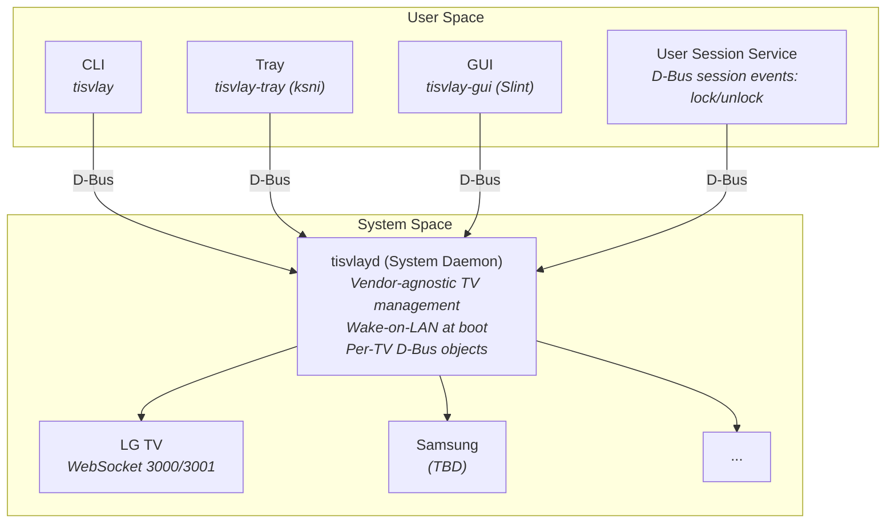
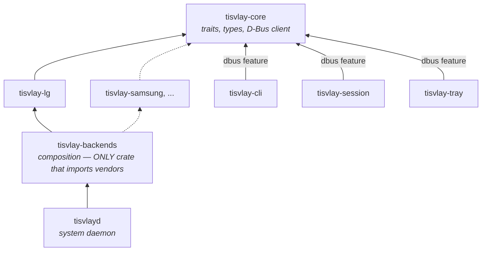
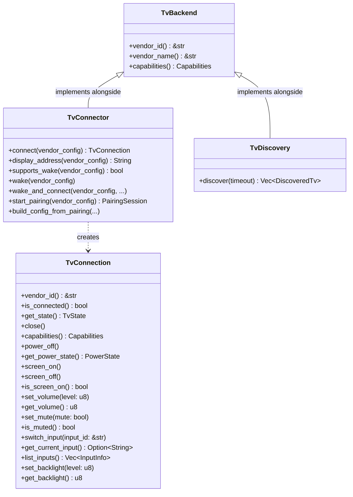
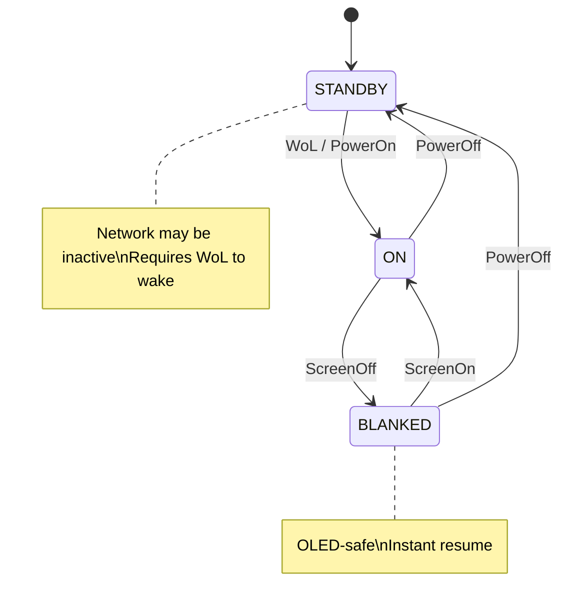

# tisvlay Design Document

## Overview

**tisvlay** is a Rust utility for controlling smart TVs from a Linux desktop connected via HDMI. It provides power management, HDMI input switching, screen blanking (OLED protection), and volume control through a vendor-agnostic architecture with pluggable backends (currently LG WebOS via SSAP over WebSocket).

---

## Architecture



### Components

| Component | Binary | Description |
|-----------|--------|-------------|
| **System Daemon** | `tisvlayd` | Systemd system service. Vendor-agnostic TV management, D-Bus API, WoL at boot. |
| **User Service** | `tisvlay-session` | Systemd user service. Monitors D-Bus session events (screen lock/unlock, idle, sleep). |
| **CLI** | `tisvlay` | Command-line interface. Communicates with daemon via D-Bus. |
| **Tray App** | `tisvlay-tray` | System tray icon using `ksni`. Per-TV power/screen/volume/backlight/input controls with scroll wheel support. |
| **GUI** | `tisvlay-gui` | Slint-based configuration window. (Not yet implemented) |

### Crate Structure

See `CLAUDE.md` for the full file tree. Key crates:

| Crate | Purpose |
|-------|---------|
| `tisvlay-core` | Core traits (`TvBackend`, `TvConnection`, `TvConnector`), types, config, D-Bus client |
| `tisvlay-lg` | LG WebOS backend (WebSocket, SSAP protocol, SSDP discovery) |
| `tisvlay-backends` | Composition crate — only place that imports vendor crates |
| `tisvlayd` | System daemon — vendor-agnostic TV management |
| `tisvlay-cli` | CLI tool — vendor-agnostic |
| `tisvlay-session` | User session service — vendor-agnostic |

### Dependency Graph



**Key principle**: Only `tisvlay-backends` knows about vendor crates. All binaries are vendor-agnostic. No `if vendor == "lg"` checks or downcasts in any binary code.

Adding a new vendor requires only:
1. Create `tisvlay-newvendor` crate implementing core traits
2. Add dependency to `tisvlay-backends/Cargo.toml`
3. Register backend in `tisvlay-backends/src/lib.rs`

No changes needed to daemon, CLI, or session service.

---

## Core Traits

### Trait Hierarchy



See `crates/tisvlay-core/src/traits.rs` for the full trait definitions.

### Transport Agnosticism

The `TvConnector` interface is fully transport-agnostic. All transport details (IP addresses, serial ports, CEC addresses, etc.) are encapsulated in the vendor config (`toml::Value`), which only the vendor crate knows how to interpret. The daemon and CLI never see transport-specific types.

Key `TvConnector` methods:
- `connect(vendor_config)` — create a connection using vendor-specific transport
- `display_address(vendor_config)` — human-readable address for logging/UI
- `supports_wake(vendor_config)` / `wake(vendor_config)` — abstract over WoL, CEC, etc.
- `start_pairing(vendor_config)` / `build_config_from_pairing(...)` — vendor-specific pairing

### TvConnection

`TvConnection` has all feature methods directly with default implementations returning `Error::NotSupported`. Backends only override the methods they support. Callers use `capabilities()` bitflags to check availability before calling.

Note: `power_on()` is not a `TvConnection` method — power-on is handled at the daemon level via `TvConnector::wake()` (WoL, CEC, etc.) since it requires a new connection to be established.

### Capabilities

Bitflags in `crates/tisvlay-core/src/capabilities.rs`: `POWER`, `SCREEN`, `VOLUME`, `MUTE`, `INPUT`, `BACKLIGHT`, `WOL`, `DISCOVERY`, `ALL`.

---

## D-Bus Interface

See `crates/tisvlayd/src/dbus/` for the implementation.

### Object Paths

```
/org/tisvlay                      # ObjectManager root (org.freedesktop.DBus.ObjectManager)
/org/tisvlay/Manager              # Manager interface
/org/tisvlay/Tv/{tv_id}           # Per-TV objects (e.g., /org/tisvlay/Tv/living_room)
```

`org.freedesktop.DBus.ObjectManager` is registered at `/org/tisvlay`. Clients use
`GetManagedObjects()` to retrieve all object paths and their interface properties in a
single round-trip — replacing the old `GetTvs` + per-property pattern.

### org.tisvlay.Manager1

Methods:
- `GetSupportedVendors() → a(ss)` — list `(vendor_id, vendor_name)` pairs
- `AddTv(name: s, vendor: s, config_json: s, managed: b) → o` — add and pair a TV; `config_json` contains vendor-specific connection params as JSON (e.g., `{"ip": "192.168.1.100", "mac": "AA:BB:CC:DD:EE:FF"}` for LG); `managed` controls automation participation
- `RemoveTv(tv_id: s)` — remove TV from config
- `ReloadConfig()` — reload config from disk
- `SetTvOption(tv_id: s, key: s, value: s)` — update a system-level TV field (`hdmi_input`, `only_when_active`, `managed`, `name`, `profile.system`); saves to disk and applies immediately
- `ListSystemProfiles() → a(ss)` — all system profiles as `(name, json)` pairs
- `GetUserProfileDefault() → s` — admin baseline user profile as JSON; used by session services to inherit defaults
- `ListUserProfiles() → a(ss)` — all user profiles (admin-defined) as `(name, json)` pairs
- `DiscoverTvs(timeout_ms: u) → a(sssss)` — SSDP discovery, returns `(id, name, address, hardware_id, vendor)` tuples. Only available when compiled with the `discovery` feature.

Signals: `TvAdded(tv_path: o)`, `TvRemoved(tv_path: o)`

### org.tisvlay.Session1 (Session Service)

Registered on the **session bus** by `tisvlay-session` under `org.tisvlay.Session`.

Methods:
- `ListUserProfiles() → a(ss)` — merged user profile list as `(name, json)` pairs; user-defined profiles take precedence over same-named admin profiles
- `GetTvUserProfile(tv_id: s) → s` — user profile name assigned to a TV (or `"default"` if unassigned)
- `SetTvUserProfile(tv_id: s, profile: s)` — assign a user profile; validates existence, saves to user config, live-reloads
- `GetEffectiveUserProfile(tv_id: s) → s` — fully resolved user profile as JSON (user + admin baseline inheritance applied)
- `ReloadConfig()` — re-query daemon for TV list and admin baseline, reload user config from disk

### org.tisvlay.Tv1 (Base Interface)

Properties: `Id`, `Name`, `Vendor`, `Address` (transport-agnostic display address), `Connected`, `Managed`, `SystemProfile`, `Capabilities`

Methods: `Reconnect()`, `GetState()`

Signals: `StateChanged`, `ConnectionChanged`

### Feature Interfaces

Each feature interface is implemented on per-TV objects based on the TV's capabilities:

- **org.tisvlay.Tv1.Power** — `PowerOn()`, `PowerOff()`, `PowerState` property
- **org.tisvlay.Tv1.Screen** — `ScreenOn()`, `ScreenOff()`, `ScreenOn` property
- **org.tisvlay.Tv1.Volume** — `SetVolume(level: y)`, `SetMute(mute: b)`, `Volume`/`Muted` properties
- **org.tisvlay.Tv1.Input** — `SwitchInput(input_id: s)`, `CurrentInput`/`AvailableInputs` properties
- **org.tisvlay.Tv1.Backlight** — `SetBacklight(level: y)`, `Backlight` property

---

## Configuration

Config is split between **system config** (daemon-owned) and **user config** (session-owned):

- **System config**: `/var/lib/tisvlay/config.toml` — TV definitions (with per-TV system profile assignment), credentials, system profiles (daemon lifecycle events), and admin baseline user profiles. Root-owned; only `tisvlayd` reads and writes this file.
- **User config**: `~/.config/tisvlay/config.toml` — user profile definitions and per-TV user profile assignments. User-owned; `tisvlay-session` reads this. Optional: if absent, the admin baseline `user.profiles.default` from system config is inherited via D-Bus.

Both accept `--config <PATH>` to override their respective path. `tisvlayd` defaults to `/var/lib/tisvlay/config.toml`; `--session` dev mode defaults to the XDG user path.

See `crates/tisvlay-core/src/config.rs` for the full schema.

### System Config Example

```toml
# /var/lib/tisvlay/config.toml  (daemon-owned)

# System profiles — daemon lifecycle events (per-TV via profile.system assignment)
[system.profiles.default]
on_startup = "power_on"          # action on system boot (default: power_on)
on_shutdown = "power_off"        # action on poweroff/halt (default: power_off)
on_reboot = "none"               # action on reboot/kexec (default: none)
on_no_session = "none"           # action when all user sessions end (login screen)

[system.profiles.guest]
on_startup = "none"
on_shutdown = "screen_off"

# Admin-set baseline for session behavior.
# Users without their own config inherit this.
[user.profiles.default]
on_screen_lock = "screen_off"    # screen_off | power_off | none
on_screen_unlock = "screen_on"   # screen_on | power_on | none
on_greeter_wake = "screen_on"    # unblank on lock screen interaction (Wayland only)
on_sleep = "power_off"
on_wake = "power_on"
idle_timeout_seconds = 0         # 0 to disable
on_idle_timeout = "none"
on_idle_resume = "screen_on"     # action when activity resumes after idle

[[tv]]
id = "living-room"
name = "Living Room G4"
vendor = "lg"
hdmi_input = "HDMI_1"            # which HDMI port this PC uses (vendor-agnostic)
only_when_active = true          # only control when TV is on this input
managed = true                   # participates in automation (boot WoL, session events, shutdown)
profile.system = "default"       # which system profile this TV uses

[[tv]]
id = "guest-room"
name = "Guest Room"
vendor = "lg"
managed = true
profile.system = "guest"         # different lifecycle behavior

# Vendor-specific config — connection params + vendor features.
# Core has zero knowledge of these fields; each vendor crate
# defines its own config struct and deserializes internally.
[tv.lg]
ip = "192.168.1.100"
mac = "AA:BB:CC:DD:EE:FF"
client_key = "abc123..."
```

### User Config Example

```toml
# ~/.config/tisvlay/config.toml  (session-owned, optional)

# User's own profiles (override or extend admin defaults)
[user.profiles.default]
idle_timeout_seconds = 300
on_idle_timeout = "screen_off"

[user.profiles.gaming]
on_screen_lock = "none"          # don't interrupt gameplay
idle_timeout_seconds = 0
on_idle_resume = "none"

# Per-TV user profile assignments (TV IDs from system config)
[[tv]]
id = "living-room"
profile.user = "gaming"

# guest-room inherits user.profiles.default (no override)
```

Both system and user configs use the same `[[tv]]` array-of-tables syntax. When using a single-file config, both parsers can read the same `[[tv]]` entries — each ignores fields it doesn't own (serde skips unknown fields by default).

Fields unspecified in a user profile inherit from the admin baseline `user.profiles.default` (system config), not hard-coded defaults. A user who only sets `idle_timeout_seconds = 600` in `[user.profiles.default]` gets all other settings from the system admin's defaults.

Key design: `TvConfig` uses `#[serde(flatten)]` to capture vendor-specific fields as raw `toml::Value`. Core has zero vendor knowledge — vendor crates define their own config structs and deserialize from the `toml::Value` internally.

---

## Power & Screen State Machine



### Event → Action Mapping

| Event | Default Action | Config | Notes |
|-------|---------------|--------|-------|
| System boot | Power on | `on_startup` (system profile) | WoL → connect → screen on → input switch |
| Screen lock | Screen off | `on_screen_lock` (user profile) | Instant resume on unlock |
| Greeter wake | Screen on | `on_greeter_wake` (user profile) | User interacted with lock screen (Wayland only) |
| Screen unlock | Screen on | `on_screen_unlock` (user profile) | Skipped if GreeterWake already unblanked |
| User idle timeout | Screen off | `on_idle_timeout` (user profile) | Fires at minimum across all TVs |
| Activity resumes | Screen on | `on_idle_resume` (user profile) | After idle timeout |
| System suspend | Power off | `on_sleep` (user profile) | Network unavailable during sleep |
| System resume | Power on | `on_wake` (user profile) | Backend handles WoL retry for lost packets |
| All sessions end | None | `on_no_session` (system profile) | Login screen / after logout |
| System shutdown | Power off | `on_shutdown` (system profile) | poweroff or halt |
| System reboot | None | `on_reboot` (system profile) | reboot or kexec; TV stays on for BIOS/TTY |

All lifecycle events accept any `SessionAction` value: `power_on`, `power_off`, `screen_on`, `screen_off`, or `none`. Different TVs can respond differently to the same event via per-TV profile assignments (e.g., gaming TV ignores screen lock via user profile; guest TV only blanks on shutdown via system profile).

---

## CLI Interface

```
tisvlay - Multi-Vendor TV Control

USAGE:
    tisvlay [OPTIONS] <COMMAND>

COMMANDS:
    power           Power control (on/off)
    screen          Screen control (blank/unblank)
    input           Switch HDMI input (lists inputs when no ID given)
    volume          Volume control
    mute            Mute/unmute (on/off/toggle, default: toggle)
    backlight       Backlight control
    status          Show TV status (includes managed flag)
    pair            Pair a new TV
    list            List configured TVs (shows [unmanaged] suffix)
    remove          Remove a TV
    manage          Show or set automated management for a TV (true/false)
    profile         Profile management
      user          User profile management (requires tisvlay-session)
        list        List available user profiles
        get         Show user profile assigned to a TV
        set <NAME>  Assign a user profile to a TV
      system        System profile management
        list        List available system profiles
        get         Show system profile assigned to a TV
        set <NAME>  Assign a system profile to a TV

OPTIONS:
    --tv <ID>       Target TV (default: first configured)
    --user          Use session bus (development mode)

EXAMPLES:
    tisvlay power on
    tisvlay screen off
    tisvlay --tv office input HDMI_2
    tisvlay input                                                   # list available inputs
    tisvlay pair 192.168.1.100 --name "Living Room" --vendor lg --wake-id AA:BB:CC:DD:EE:FF
    tisvlay pair 192.168.1.101 --name "Office" --vendor lg --unmanaged
    tisvlay volume 30
    tisvlay backlight 80
    tisvlay manage                                                      # show current
    tisvlay manage true
    tisvlay manage false --tv office
    tisvlay profile user list
    tisvlay profile user set gaming --tv living-room
    tisvlay profile system list
    tisvlay profile system set guest --tv guest-room
```

---

## System Tray Menu Structure

Icons convey managed state: `tvconnected` (managed + connected), `tvtrusted` (unmanaged + connected), `tvdisconnected` (disconnected regardless of managed state).

Connected TV submenu:
```
▶ Living Room G4  [tvconnected]
  ├─ Power Off
  ├─ Profile ▶ User: gaming ▶  (RadioGroup: gaming ✓, default)   [settings-configure]
  │            System: default ▶  (RadioGroup: default ✓, guest)   [settings-configure]
  ├─ Unmanage
  ├─ Input ▶  (RadioGroup: HDMI 1, HDMI 2 ✓, HDMI 3)   [input-tvremote-symbolic]
  ├─ Volume: 60
  │  ├─ Volume Up (+10)
  │  ├─ Volume Down (-10)
  │  └─ Mute / Unmute
  ├─ Backlight: 80
  │  ├─ Backlight Up (+10)
  │  └─ Backlight Down (-10)
  └─ Screen Off / Screen On
```

Disconnected TV submenu:
```
▶ Office C3  [tvdisconnected]
  ├─ Power On (Wake)
  ├─ Profile ▶ User: default ▶  (RadioGroup: default ✓)
  │            System: default ▶  (RadioGroup: default ✓)
  └─ Unmanage
```

Unmanaged connected TV submenu:
```
▶ Guest TV  [tvtrusted]
  ├─ Power Off
  ├─ Profile ▶ User: default ▶
  │            System: default ▶
  ├─ Manage
  ├─ Input ▶
  └─ ...
```

Bottom:
```
──────────
Refresh
──────────
Quit
```

Scroll wheel adjusts volume or backlight for the TV last interacted with via a volume/backlight control; falls back to the first connected TV.
Screen Off/On uses `backlight_item` (same as Backlight Up/Down) — clicking it contextualizes the scroll wheel to backlight, since screen off is the discrete pole of the backlight axis.

---

## Implementation Phases

### Phase 1: Core Library + CLI (MVP) - COMPLETE

**Goal**: Basic TV control from command line.


### Phase 2: System Daemon - COMPLETE

**Goal**: Background service with D-Bus API.


### Phase 3: User Session Integration - COMPLETE

**Goal**: React to desktop events.
### Phase 4a: CLI D-Bus Migration - COMPLETE

**Goal**: CLI communicates with daemon via D-Bus.

### Phase 4b: Tray App - COMPLETE

**Goal**: Quick access from system tray.

1. `tisvlay-tray`: ksni-based StatusNotifierItem with per-TV submenus
2. Power/screen/input/volume/backlight/mute controls
3. Scroll wheel adjusts volume or backlight (context-dependent)
4. Optimistic state caching, 5s polling, graceful daemon-offline handling

### Phase 4C: System vs User Config Split - COMPLETE

**Goal**: Separate daemon-owned and user-owned configuration.

1. `SystemConfig` (daemon) and `UserConfig` (session service) with separate ownership and paths
2. Profile field-level inheritance: user profile fields override admin defaults, unset fields fall through
3. `on_idle_resume` added to `UserProfileConfig` (action when activity resumes after idle)
4. `org.tisvlay.Session1` D-Bus interface on session bus: `ListUserProfiles`, `GetTvUserProfile`, `SetTvUserProfile`, `GetEffectiveUserProfile`, `ReloadConfig`
5. Daemon gains `org.freedesktop.login1` monitoring: `PrepareForShutdown` (inhibitor lock), `SessionNew`/`SessionRemoved` for `on_no_session`
6. Boot-wake refactored: retry-connect loop with WoL resend replaces blind sleep delay
7. Session service event replay after late daemon connect
8. Tray gains User Profile and System Profile submenus per TV
9. Manager1 additions: `SetTvOption`, `ListSystemProfiles`, `GetUserProfileDefault`, `ListUserProfiles`

### NixOS Packaging - COMPLETE

**Goal**: `services.tisvlay.enable = true` deploys the full stack.

1. `nix/package.nix`: `rustPlatform.buildRustPackage` for all four binaries
2. `nix/module.nix`: NixOS module — system daemon, user services, D-Bus policy, dedicated user/group
3. `flake.nix`: `nixosModules.default`, `overlays.default`, `packages.default`
4. `tisvlayd`/`tisvlay-session` `--config` flag for explicit config path
5. System daemon uses `StateDirectory` (`/var/lib/tisvlay/`) for writable config (supports `ProtectHome=true`)
6. D-Bus policy installed via `services.dbus.packages` (idiomatic NixOS)
7. User services auto-start on `graphical-session.target`

### Phase 5A: `managed` Flag + CLI Profile Parity - COMPLETE

**Goal**: Let users designate which TVs participate in automation without unpairing.

1. `managed: bool` added to `TvConfig` (required TOML field, no serde default) and `TvInfo`
2. `TvConfig::new(id, name, vendor, managed)` — all four required; UX default lives in CLI only
3. Daemon enforces `managed` in all automation paths: boot WoL, session events, shutdown
4. `TvEntry = (bool, Arc<Mutex<ManagedTv>>)` — managed flag stored outside per-TV mutex; `list_managed_tv_ids()` scans with only the outer read lock
5. `Managed` D-Bus property exposed on `org.tisvlay.Tv1`; `SetTvOption` handles `managed` key
6. `AddTv` D-Bus signature extended with `managed: b` parameter
7. Tray: icon reflects managed state (`tvconnected`/`tvtrusted`/`tvdisconnected`); Manage/Unmanage toggle in every TV submenu
8. CLI: `manage [true|false]` command (no arg shows current status); `list` shows `[unmanaged]` suffix; `pair --unmanaged` flag; `profile list/get/set` subcommands via `SessionClient`
9. Session service: profiles built for all paired TVs at load; event dispatch filtered live per-event

### Phase 5B: Session Service — Live `managed` Filtering - COMPLETE

**Goal**: Toggle managed at runtime without requiring a service reload.

1. `event_handler` queries `daemon.list_tvs()` before each dispatch to get the current managed set
2. Fallback on daemon unreachable: skip dispatch entirely (empty set) rather than leaking unmanaged TVs

### Phase 5C: `ObjectManager` for Bulk TV Discovery - COMPLETE

**Goal**: Replace 1 + 6N D-Bus round-trips with a single `GetManagedObjects` call.

1. `org.freedesktop.DBus.ObjectManager` registered at `/org/tisvlay` (ancestor of all tisvlay objects)
2. `GetTvs()` removed from `org.tisvlay.Manager1` — superseded by `GetManagedObjects`
3. `DaemonClient.list_tvs()` rewritten: single round-trip, no proxy objects created, O(1) D-Bus cost regardless of TV count
4. `get_bool(key, default)` uses explicit defaults: `Connected → false`, `Managed → true`
5. Diagnostic logging: `debug!` per entry on property fallbacks; `warn!` when `Id` is empty

### Per-TV System Profiles Refactor - COMPLETE

**Goal**: Per-TV daemon lifecycle behavior via system profiles, symmetric with user profiles.

1. Renamed `ProfileConfig` → `UserProfileConfig`, `ResolvedProfile` → `ResolvedUserProfile` across all crates
2. D-Bus renames: `GetSystemProfile` → `GetUserProfileDefault`, `GetSystemProfiles` → `ListUserProfiles`, `ListProfiles` → `ListUserProfiles`, `GetTvProfile` → `GetTvUserProfile`, `SetTvProfile` → `SetTvUserProfile`, `GetEffectiveProfile` → `GetEffectiveUserProfile`
3. Added `SystemProfileConfig` and `ResolvedSystemProfile` with fields: `on_startup`, `on_shutdown`, `on_reboot`, `on_no_session`
4. Config restructured: `[daemon]` → `[system.profiles.*]`, `[profiles.*]` → `[user.profiles.*]`, `profile = "name"` → `profile.user = "name"`, new `profile.system = "name"` on `TvConfig`
5. Removed `DaemonConfig` — replaced by per-TV system profile resolution
6. Daemon dispatches lifecycle events per-TV using each TV's resolved system profile
7. `SetDaemonOption` removed; system profile set via `SetTvOption` key `"profile.system"`
8. `ListSystemProfiles()` added to Manager1; `SystemProfile` property added to Tv1
9. Tray gains dual submenus: "User Profile" and "System Profile" per TV
10. CLI: `tisvlay profile user list/get/set` and `tisvlay profile system list/get/set`

### Phase 5: GUI Configuration

**Goal**: User-friendly setup and configuration.

1. `tisvlay-gui`: Slint-based settings window
2. TV discovery and pairing wizard with managed checkbox
3. Per-TV configuration
4. Session behavior settings

---

## Known Challenges & Mitigations

| Challenge | Mitigation |
|-----------|------------|
| TV ignores WoL during pixel refresh | Retry WoL with backoff; inform user if TV unresponsive |
| Newer firmware requires TLS (wss://) | Default to port 3001; fallback to 3000; accept self-signed certs |
| WebSocket closed on TV idle (~1-2 min) | LG backend auto-reconnects transparently before each command |
| WoL lost after system resume | Backend resends WoL between connect retries |
| PowerOff + ScreenLocked race on sleep | Daemon `powered_off` flag prevents blocking connect to dead TV |
| Screen on/off returns 500 when idempotent | LG backend treats application errors as success for screen commands |
| DHCP IP changes | Use MAC for WoL; re-discover via SSDP |
| Greeter wake unavailable on X11 | Wayland `ext-idle-notify-v1` only; falls back gracefully |

---

## References

- [Firewall Configuration](firewall.md) - SSDP discovery firewall setup
- [LG WebOS API](https://github.com/chros73/bscpylgtv/tree/master/docs)
- [zbus Documentation](https://docs.rs/zbus)
- [ksni Documentation](https://docs.rs/ksni)
- [Slint Documentation](https://docs.slint.dev)
