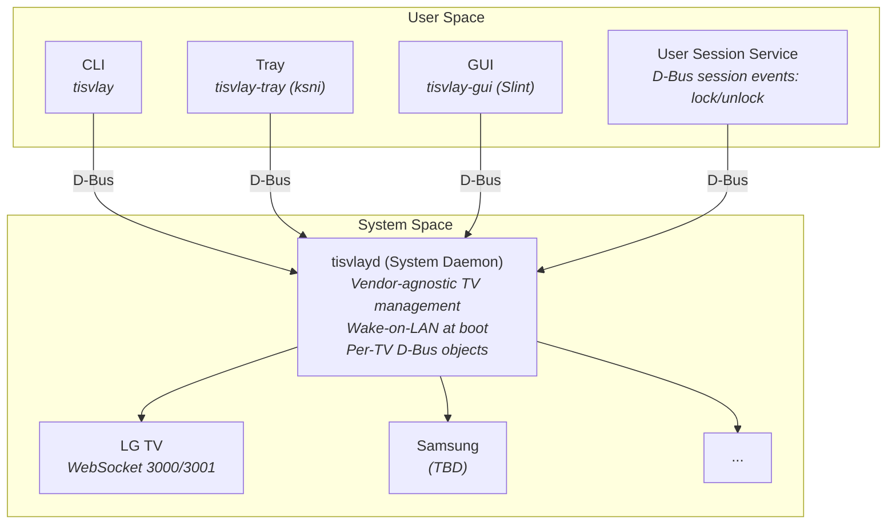
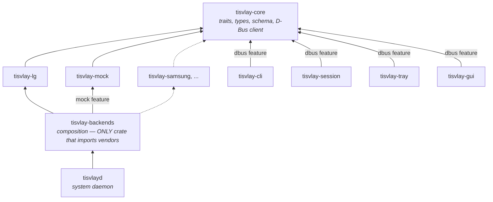
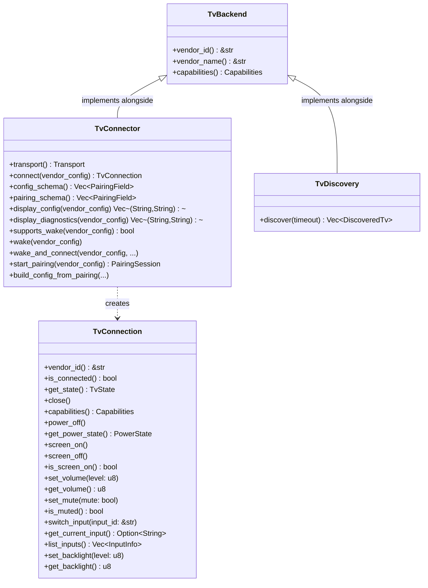
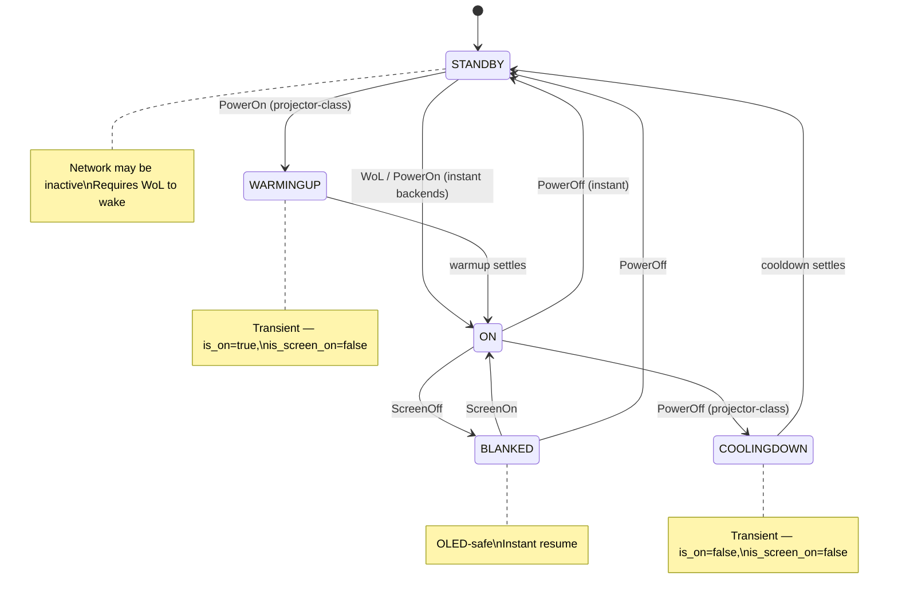

# tisvlay Design Document

## Overview

**tisvlay** is a Rust utility for controlling smart TVs from a Linux desktop connected via HDMI. It provides power management, HDMI input switching, screen blanking (OLED protection), and volume control through a vendor-agnostic architecture with pluggable backends (currently LG WebOS via SSAP over WebSocket).

---

## Architecture



### Components

| Component | Binary | Description |
|-----------|--------|-------------|
| **System Daemon** | `tisvlayd` | Systemd system service. Vendor-agnostic TV management, D-Bus API, WoL at boot. |
| **User Service** | `tisvlay-session` | Systemd user service. Monitors D-Bus session events (session lock/unlock, idle); reactively prunes orphan user-config `[[tv]]` assignments via `ObjectManager.InterfacesRemoved`. |
| **CLI** | `tisvlay` | Command-line interface. Communicates with daemon via D-Bus. |
| **Tray App** | `tisvlay-tray` | System tray icon using `ksni`. Subscribes to daemon D-Bus signals for real-time state updates (30s fallback poll). Per-TV power/screen/volume/backlight/input controls with scroll wheel support. |
| **GUI** | `tisvlay-gui` | Slint-based configuration window. TVs pane with master/detail layout, per-TV editor (live state controls + edit-mode pencil for config edits), pairing wizard with discovery streaming. Profiles pane with master/detail layout, two-sub-tab system/user profile editor, inheritance with locally-set indicators + per-field reset glyph + reset-all, rename/duplicate/delete flows. About and Settings panes built. |

### Crate Structure

See `CLAUDE.md` for the full file tree. Key crates:

| Crate | Purpose |
|-------|---------|
| `tisvlay-core` | Core traits (`TvBackend`, `TvConnection`, `TvConnector`), types, config, schema (`PairingField`, `FieldVisibility`), D-Bus client |
| `tisvlay-lg` | LG WebOS backend (WebSocket, SSAP protocol, SSDP discovery) |
| `tisvlay-mock` | In-memory mock backend (dev/tests, optional via `mock` feature) |
| `tisvlay-test` | OS-environment fakes — private `dbus-daemon`, fake logind, fake screensaver |
| `tisvlay-backends` | Composition crate — only place that imports vendor crates |
| `tisvlay-harness` | Binary-lifecycle test fixtures (`TestDaemon`, `TestSession`, `TestTray`) |
| `tisvlayd` | System daemon — vendor-agnostic TV management |
| `tisvlay-cli` | CLI tool — vendor-agnostic |
| `tisvlay` | Client SDK — Rust re-export of core's D-Bus client, for external consumers |
| `tisvlay-session` | User session service — vendor-agnostic |
| `tisvlay-tray` | System-tray app (ksni) — vendor-agnostic |
| `tisvlay-gui` | Slint-based settings window — vendor-agnostic |

### Dependency Graph



**Key principle**: Only `tisvlay-backends` knows about vendor crates. All binaries are vendor-agnostic. No `if vendor == "lg"` checks or downcasts in any binary code.

Adding a new vendor requires only:
1. Create `tisvlay-newvendor` crate implementing core traits
2. Add dependency to `tisvlay-backends/Cargo.toml`
3. Register backend in `tisvlay-backends/src/lib.rs`

No changes needed to daemon, CLI, or session service.

---

## Core Traits

### Trait Hierarchy



See `crates/tisvlay-core/src/traits.rs` for the full trait definitions.

### Transport Agnosticism

The `TvConnector` interface is fully transport-agnostic. All transport details (IP addresses, serial ports, CEC addresses, etc.) are encapsulated in the vendor config (`toml::Value`), which only the vendor crate knows how to interpret. The daemon and CLI never see transport-specific types.

Each connector declares its `Transport` type (`Network`, `Serial`, `Usb`, `Cec`). The daemon uses `Transport::is_network_dependent()` to scope system events — only network-dependent connections are affected by NetworkManager events. Non-network backends (serial, USB, CEC) are unaffected by network loss.

Key `TvConnector` methods:
- `transport()` — communication transport used by this connector
- `connect(vendor_config)` — create a connection using vendor-specific transport
- `config_schema()` — declarative `Vec<PairingField>` describing the persisted-config shape with `FieldVisibility` (`UserInput` / `Diagnostic` / `Secret`) per field. Drives the pairing wizard, the GUI's edit pane, and the daemon's `Tv1.{VendorConfig,VendorInfo}` projections — backends declare schema once and the framework projects per-use-case.
- `display_config(vendor_config)` / `display_diagnostics(vendor_config)` — `(label, value)` projection of `UserInput` / `Diagnostic` fields respectively, default-implemented via `config_schema`. `Secret` fields are excluded from both.
- `supports_wake(vendor_config)` / `wake(vendor_config)` — abstract over WoL, CEC, etc.
- `start_pairing(vendor_config)` / `build_config_from_pairing(...)` — vendor-specific pairing

### TvConnection

`TvConnection` has all feature methods directly with default implementations returning `Error::NotSupported`. Backends only override the methods they support. Callers use `capabilities()` bitflags to check availability before calling.

Note: `power_on()` is not a `TvConnection` method — power-on is handled at the daemon level via `TvConnector::wake()` (WoL, CEC, etc.) since it requires a new connection to be established.

### Capabilities

Bitflags in `crates/tisvlay-core/src/capabilities.rs`. Two axes:

- **Feature bits** — `POWER`, `SCREEN`, `VOLUME`, `MUTE`, `INPUT`, `BACKLIGHT`, `WOL`, `DISCOVERY`. Folded into `STOCK` for convenience (the conventional baseline a typical TV backend is expected to expose). Future feature bits (`RECORD`, `EPG`, `MEDIA_PLAYBACK`, …) will *not* auto-fold — vendors opt in explicitly, same reason as the transport bits below.
- **Transport-family bits** — `IPV4`, `IPV6`. Per-vendor declaration of which IP families the vendor's transport has been verified against. Deliberately *not* part of `STOCK`, so vendors that use `STOCK` for the feature set don't silently auto-claim a transport family they haven't tested. Consumed by the GUI wizard (form-build-time field gating + placeholder selection) and the daemon (`EnrichManualEntry` family gate). Wake-on-LAN availability is *derived* (`WOL && IPV4`-locally-reachable), not stored as a separate bit — stored derivations are how flag sets rot. Architectural rationale + the rejected alternatives are in [docs/discovery.md § Per-vendor transport family](discovery.md#per-vendor-transport-family).

---

## D-Bus Interface

See `crates/tisvlayd/src/dbus/` for the implementation.

### Service overview

```
org.tisvlay.Daemon  (system bus; session bus in dev)
├── /org/tisvlay                    ObjectManager
├── /org/tisvlay/Manager            org.tisvlay.Manager1
│   ├── Methods:  GetSupportedVendors, GetPairingSchema, AddTv, CancelPair,
│   │             ReloadConfig, DiscoverTvs,
│   │             ListSystemProfiles, GetSystemProfile, UpdateSystemProfile,
│   │             CreateSystemProfile, DuplicateSystemProfile, DeleteSystemProfile,
│   │             GetResolvedSystemProfileDefaults, GetEffectiveSystemProfile
│   └── Signals:  PairingProgress, DiscoveryFound,
│                 SystemProfileChanged, SystemProfileAdded, SystemProfileRemoved
└── /org/tisvlay/Tv/{uuid_underscored}   org.tisvlay.Tv1, Tv1.Power, Tv1.Screen,
    │                                    Tv1.Volume, Tv1.Backlight, Tv1.Input
    ├── Properties (rw): Name, Managed, SystemProfile, PrimaryInput,
    │                     IsScreenOn, Volume, Muted, Backlight
    ├── Properties (ro): Uuid, Vendor, Connected, Capabilities,
    │                     VendorInfo, AutomateWhen, Automated,
    │                     PowerState, CurrentInput, AvailableInputs
    ├── Methods:  Reconnect, RePair, Remove, GetConfig, UpdateConfig,
    │             PowerOn, PowerOff, SwitchInput
    └── Signals:  (standard PropertiesChanged only)

org.tisvlay.Session  (session bus)
└── /org/tisvlay/Session            org.tisvlay.Session1
    ├── Methods:  GetTvUserProfile, SetTvUserProfile, ReloadConfig,
    │             ListUserProfiles, GetUserProfile, UpdateUserProfile,
    │             CreateUserProfile, DuplicateUserProfile, DeleteUserProfile,
    │             GetResolvedUserProfileDefaults, GetEffectiveUserProfile
    └── Signals:  TvUserProfileChanged,
                  UserProfileChanged, UserProfileAdded, UserProfileRemoved

org.tisvlay.Tray  (session bus)
└── /org/tisvlay/Tray               org.tisvlay.Tray1
    ├── Properties (ro):  Version, ConfigPath
    ├── Properties (rw):  NotificationSettings (a{sv})
    ├── Methods:  UpdateNotificationSettings, ReloadConfig, SendTestNotification
    └── Signals:  (standard PropertiesChanged only)
```

### Clients and signal flow

| Client | Calls | Subscribes to |
|--------|-------|---------------|
| **tisvlay CLI** | Manager1 (profiles, config), Tv1.* (properties + commands), Session1 (user profiles) | — |
| **tisvlay-tray** | Manager1 (profiles), Tv1.* (properties + commands), Session1 (user profiles); owns Tray1 | `PropertiesChanged` on Tv paths; per-TV `Tv1.Power.PowerCycleProgress`; `Manager1.PairingProgress`; `InterfacesAdded`/`InterfacesRemoved` (ObjectManager); Manager1: `SystemProfileAdded`/`Changed`/`Removed`; Session1: `TvUserProfileChanged`, `UserProfileAdded`/`Changed`/`Removed`; DBus: `NameOwnerChanged` (service discovery) |
| **tisvlay-gui** | Manager1 (system-profile CRUD, config), Tv1.* (properties + commands), Session1 (user-profile CRUD + assignment) | Same as tray plus the body-mutation signals (`SystemProfileChanged(uuid)`, `UserProfileChanged(uuid)`) drive the editor's per-row refresh. The GUI subscribes to both buses directly — no cross-bus signal re-fire on the session daemon, since the only client that needs cross-bus body-change notifications is the GUI and it already does. |
| **tisvlay-session** | Manager1 (admin defaults), Tv1.* (session actions via writable properties) | — |

`org.freedesktop.DBus.ObjectManager` at `/org/tisvlay` provides `GetManagedObjects()` — a single round-trip returning all TV object paths and their interface properties.

### org.tisvlay.Manager1

Methods:
- `GetSupportedVendors() → a(ss)` — list `(vendor_id, vendor_name)` pairs
- `GetPairingSchema(vendor: s) → s` — JSON-serialized `Vec<PairingField>` describing the pairing-form fields the GUI should render for the given vendor
- `AddTv(name: s, vendor: s, config_json: s, managed: b) → (os)` — reserve a TV id and start pairing. **Returns immediately** after sync validation (unknown-vendor / `ConfigInvalidVendorConfig` surface as RPC errors); the handshake itself runs in a daemon-side spawned task. Outcome is reported via `Manager1.PairingProgress` filtered on the returned `tv_uuid` to a terminal phase (`complete` or `failed`). `complete` only fires after the per-TV `Tv1.*` interfaces are registered, so clients observing it can immediately call into the new TV without racing the registration. `config_json` carries vendor-specific connection params as JSON (e.g. `{"ip": "192.168.1.100", "mac": "AA:BB:CC:DD:EE:FF"}` for LG); `managed` controls automation participation. Per-TV lifecycle (`Remove`, `RePair`, `GetConfig`, `UpdateConfig`) lives on `Tv1` after pair.
- `ReloadConfig()` — reload config from disk
- `CancelPair(tv_id: s)` — cancel an in-flight pairing handshake. Works for both `AddTv` and `Tv1.RePair` via the daemon-side `pairing_sessions` registry. Returns `NotPairing` (typed) if the tv_id isn't currently pairing — matches the BlueZ `Adapter.RemoveDevice`-on-unknown-device convention.
- `DiscoverTvs(timeout_ms: u) → a(sssss)` — SSDP discovery, returns `(id, name, address, hardware_id, vendor)` tuples. Bounded one-shot scan; used by `tisvlay list` and scripted callers that want a single return value.
- `StartDiscovery(timeout_ms: u) → s` / `StopDiscovery(session_id: s)` — streaming discovery for interactive flows (the pairing wizard). Spawns a daemon-side task that loops M-SEARCH bursts at the configured `[discovery] poll_interval_ms` and emits the existing `DiscoveryFound` signal incrementally. See [docs/discovery.md § Streaming discovery](discovery.md#streaming-discovery-manager1startdiscovery).
- `EnrichManualEntry(vendor: s, address: s) → a{ss}` — autofill helper for the wizard's manual-entry path: returns the same `vendor_data`-shaped map that `DiscoveryFound` carries. Always succeeds; empty map means "nothing to autofill" (invalid IP, IPv6 input, unknown vendor, ARP chain found nothing). See [docs/discovery.md § Manual-entry MAC enrichment](discovery.md#manual-entry-mac-enrichment).

System-profile catalog (see [Profile catalog](#profile-catalog) for the full architecture):
- `ListSystemProfiles() → a{sa{sv}}` — map from `uuid` to body dict (typed `SystemProfileBody`)
- `GetSystemProfile(uuid: s) → a{sv}` — fetch one body by UUID
- `UpdateSystemProfile(uuid: s, body: a{sv})` — atomic full-body replace (rename is `Update` with a new `name` in the body); validates uniqueness + reserved-name rules under one write lock; persists via atomic-rename; rolls back the in-memory swap and returns `IoError` on persistence failure
- `CreateSystemProfile(name: s) → s` — mints a UUID, persists, returns it
- `DuplicateSystemProfile(source_uuid: s, new_name: s) → s` — clones an existing body under a new UUID
- `DeleteSystemProfile(uuid: s)` — rejects the reserved-default UUID outright; rejects when any TV references it (via `references_of` against in-memory TV assignments)
- `GetResolvedSystemProfileDefaults() → a{sv}` — hard-coded baseline body (the ancestor every profile inherits from)
- `GetEffectiveSystemProfile(tv_id: s) → a{sv}` — fully resolved body for one TV (walks profile → default → baseline)

The legacy `ListSystemProfilesJson() → a(ss)` slot stays on the wire (back-compat for tray + CLI consumers that haven't migrated to the v3 surface). The Rust wrapper signature is unchanged; only the wire-method name moved via `#[zbus(name = ...)]`.

Signals:
- `PairingProgress`, `DiscoveryFound` (lifecycle).
- `SystemProfileChanged(uuid: s)` — body mutation (including rename). Fires once after persistence under the same write lock as the body commit, so a client receiving the signal can immediately `GetSystemProfile(uuid)` and get the body.
- `SystemProfileAdded(uuid: s)` — fires once after persistence for both `Create` and `Duplicate`.
- `SystemProfileRemoved(uuid: s)` — fires after `Delete` persists.

`ReloadConfig` is observationally identical to an external client performing equivalent `Update` / `Create` / `Delete` calls: the daemon computes a three-way diff against the prior in-memory catalog and emits the matching `Added` / `Changed` / `Removed` signals so client caches invalidate through the same path. (Per-TV add/remove fires standard `ObjectManager.InterfacesAdded` / `InterfacesRemoved` from `/org/tisvlay`.)

`PairingProgress(tv_id: s, phase: s, message: s)` is bus-wide — any client may be running a concurrent pairing. Clients filter on the `tv_id` they got from `Manager1.AddTv` (or passed to `Tv1.RePair`) and drain to a terminal phase (`complete` or `failed`). Non-terminal phases are `awaiting_tv` and `awaiting_input`. `tisvlay-core` exposes `DaemonClient::drain_pair_to_terminal(stream, target_tv_id, on_progress) -> Result<PairTerminal>` as the canonical client-side drain — used by the GUI wizard, the `tisvlay pair` / `tisvlay re-pair` CLI subcommands, and the integration test suite.

### org.tisvlay.Tv1 (per-TV lifecycle)

The per-TV `Tv1` interface owns the methods that take a TV identifier — they read `&self.tv_id` directly from the interface impl rather than decoding it from a path argument, which avoided a class of `tv_path()` round-trip bugs around UUID hyphens.

Methods:
- `Reconnect()` — drop and re-establish the connection
- `RePair()` — refresh vendor credentials by re-running the backend's pairing handshake against the existing `vendor_config`. Top-level fields (`name`, `profile`, `managed`, `primary_input`) stay intact; only the per-vendor credentialing fields (e.g. LG's `client_key`) get replaced. **Returns immediately** after sync validation (TV not found / already pairing surface as RPC errors); the handshake itself runs in a daemon-side spawned task. Outcome via `Manager1.PairingProgress` filtered on this TV's `tv_id` to a terminal phase. Cancel an in-flight re-pair via `Manager1.CancelPair(tv_id)`. Concurrent re-pair against the same TV is rejected synchronously with `PairingFailed("already pairing")`.
- `Remove()` — drop the TV from in-memory + on-disk config and unregister every `Tv1.*` interface at this path (fires `ObjectManager.InterfacesRemoved`)
- `GetConfig() → s` — return current config (top-level + non-`Secret` vendor fields) as a JSON object suitable for prefilling an edit form
- `UpdateConfig(json_patch: s)` — atomic batch edit. Top-level keys (`name`, `managed`, `system_profile`, `primary_input`) plus any `UserInput`-visibility vendor schema field. Server-side schema-validated; vendor-field changes drop and reconnect. `Diagnostic`/`Secret` keys are rejected.

Single-field edits also flow through the per-property `Properties.Set` path — `Tv1.Name`, `Tv1.Managed`, `Tv1.SystemProfile`, `Tv1.PrimaryInput`, `Tv1.IsScreenOn`, `Tv1.Volume`, `Tv1.Muted`, `Tv1.Backlight` — which routes through the same internal helpers as `UpdateConfig` for top-level fields.

### org.tisvlay.Session1 (Session Service)

Registered on the **session bus** by `tisvlay-session` under `org.tisvlay.Session`.

Per-TV assignment methods (a TV's user profile is one of the catalog UUIDs; UUIDs are immutable across renames):
- `GetTvUserProfile(tv_id: s) → s` — UUID of the user profile assigned to a TV (the reserved-default UUID if unassigned)
- `SetTvUserProfile(tv_id: s, profile_uuid: s)` — assign a user profile by UUID; validates the UUID exists in the catalog, persists, live-reloads
- `ReloadConfig()` — re-query daemon for TV list and admin baseline, reload user config from disk

User-profile catalog (mirror of Manager1's system-profile surface; see [Profile catalog](#profile-catalog) for the full architecture):
- `ListUserProfiles() → a{sa{sv}}` — map from `uuid` to body dict (typed `UserProfileBody`)
- `GetUserProfile(uuid: s) → a{sv}`
- `UpdateUserProfile(uuid: s, body: a{sv})` — atomic full-body replace
- `CreateUserProfile(name: s) → s`
- `DuplicateUserProfile(source_uuid: s, new_name: s) → s`
- `DeleteUserProfile(uuid: s)` — rejects the reserved-default UUID; rejects when any TV references it (via `user_references_of` — the fan-out variant that counts unassigned TVs as implicit references to the reserved-default)
- `GetResolvedUserProfileDefaults() → a{sv}` — hard-coded baseline body
- `GetEffectiveUserProfile(tv_id: s) → a{sv}` — fully resolved body for one TV (walks user-profile → user-default → admin-baseline → admin-user-default → hardcoded-baseline)

The legacy `ListUserProfilesJson()` + `GetEffectiveUserProfileJson()` slots stay on the wire (back-compat for tray + CLI consumers).

Signals:
- `TvUserProfileChanged(tv_id: s, profile_uuid: s)` — assignment change (a TV's `user_profile` field was rewritten). Pre-existing signal; the `Tv` prefix added during the v3 cleanup so reader convention becomes "methods + signals starting with `Tv` operate on a TV's assignment; without `Tv` they operate on the catalog."
- `UserProfileChanged(uuid: s)` — body mutation. Mirrors `Manager1.SystemProfileChanged(uuid)`.
- `UserProfileAdded(uuid: s)` — fires after `Create` or `Duplicate` persists.
- `UserProfileRemoved(uuid: s)` — fires after `Delete` persists.

`Session1.ReloadConfig` mirrors `Manager1.ReloadConfig`'s diff-and-emit shape: a config-file edit fires the same per-profile signals an external client would, so the GUI's editor cache invalidates through the single code path.

Manager1 didn't face the assignment-vs-body naming collision because per-TV system-profile assignment writes through the standard `Tv1.SystemProfile` property surface (firing `PropertiesChanged`), not a custom signal.

### org.tisvlay.Tray1 (desktop notifications)

The tray owns desktop notifications — not the session service. The tray already has every moving piece: a `StateWatcher` subscription seeing every relevant transition, the gettext catalog + icon-name plumbing, and a graphical-session lifecycle (the right surface for talking to `org.freedesktop.Notifications`, itself a graphical-session bus name). The session service is the wrong home because it owns `UserConfig` as a single writer with rollback semantics; a separate `tray.toml` keeps the two single-writer invariants independent.

Settings are mutable both via D-Bus (`UpdateNotificationSettings`) and via hand-editing `~/.config/tisvlay/tray.toml` + `ReloadConfig`; both paths surface as `org.freedesktop.DBus.Properties.PropertiesChanged` for `NotificationSettings` so the GUI stays in sync. The mutation flow mirrors the `Session1` user-profile shape: validate → snapshot → mutate → persist → roll back on IO failure → publish. `NotificationSettingsBody` (the `a{sv}` wire dict) lives in `tisvlay-core` so the GUI client and tray server speak the same vocabulary; `SendTestNotification` bypasses the category gate so users can verify their DE's notification stack regardless of which categories are on.

**Categories** (one switch each, all default-on, persisted in `tray.toml`):

| Key | Trigger | Urgency | Source |
|---|---|---|---|
| `tv_connection` | TV `connected` true ↔ false | Low | `refresh_state` diff |
| `tv_pairing` | terminal pairing phase `complete` / `failed` | Normal | `Manager1.PairingProgress` |
| `tv_wake` | `wol_sent → connected` / `failed` for a power cycle | Low (ok) / Normal (fail) | per-TV `Tv1.Power.PowerCycleProgress` |
| `daemon_offline` | `StateEvent::DaemonDisappeared` | Critical (resident) | existing tray arm |

`NotificationCategory` (in `tisvlay-core`) is the single source of truth for the category vocabulary: its `#[repr(u8)]` discriminant *is* the bit position, `ALL` lists every variant, and `key` / `from_key` / `get` / `set` are exhaustive matches, so adding a category is a compile error until every site handles it. On-disk `tray.toml` stays hand-editable named bools.

The on-disk `NotificationSettings` (named `bool`s) and the wire `NotificationSettingsBody` (`Option<bool>`) are kept as **two distinct types on purpose** — not accidental duplication. The `Option` tri-state is load-bearing: it lets `UpdateNotificationSettings` be a partial patch ("change only `tv_wake`"), while the on-disk form wants concrete bools for a hand-editable file. Collapsing them would force one representation to carry semantics it doesn't want. (Reviewers periodically propose merging them; this is the standing answer.)

**Correctness lessons** (each was a bug fixed during this work — kept here so the next maintainer doesn't reintroduce them):

- **The client proxy is uncached (`CacheProperties::No`).** `NotificationSettings` is a mutable `#[zbus(property)]` consumed by an independent `PropertiesChanged` consumer (`StateWatcher` → GUI refresh). zbus's default property cache is updated by zbus's *own* internal `PropertiesChanged` task, which races the GUI's consumer of the same signal — a stale cached read then clobbers the settings pane. An uncached `Get` is always the live value. General rule: a mutable property consumed via an independent `PropertiesChanged` signal must be read uncached.
- **Notification emits are serialized through one background worker** (`mpsc` queue). The emit-site does the category gate synchronously (a lock-free `AtomicU8` bit test) and hands off; the worker runs `show_async` round-trips one at a time, recording the failure timestamp *before* it pulls the next request. This is what makes the failure backoff actually suppress a flap-storm at early login (when `org.freedesktop.Notifications` isn't claimed yet and each `show_async` stalls for the full ~25 s D-Bus timeout): the storm collapses to one stalled round-trip plus suppressed retries, not N concurrent stalls. Spawning each emit detached defeats the backoff — every concurrent caller passes the gate before any records a failure.
- **The `refresh_state` connection-diff lives *inside* the `handle.update()` closure**, where the prior cached `tvs` is the authoritative baseline. `DaemonDisappeared` clears the cache outside the trigger path; diffing after the closure would see "all TVs reappeared" and storm `tv_connection` toasts on a daemon flap. The transient-fetch-error arm likewise leaves the cache intact (only flips `daemon_available`), so a one-off timeout isn't read as a mass disconnect.
- **The tray claims `org.tisvlay.Tray` with `DoNotQueue`** and exits if another instance owns it — otherwise a second instance silently queues and serves a second `TrayService` with an independent settings cache the GUI would never see.
- **Power-cycle wake attribution uses a per-cycle flag, not a wall clock.** Each per-TV `PowerCycleProgress` stream carries phases from only one in-flight cycle; a `waking` flag (set by `WolSent`, reset at each `DirectConnect`) attributes the terminal phase exactly, with no timeout window to misfire on a slow wake or an unrelated reconnect.

Two categories were tried and removed before merge — both shared the smell *"default-off and duplicative with existing state-change notifications."* `config_reloaded` (almost every reload is self-initiated, so the toast told the user what they just did) and `automation_fired` (system-tier events fire when no human is at the desk; user-tier events overlap with `tv_connection` / `tv_wake`). Both retirements dropped their external D-Bus signals; the underlying work (the daemon's internal per-UUID cache refresh on reload, and all automation *execution*) stayed intact. The lesson: a new notification category should clear the "is it visible, and is it non-duplicative?" bar before shipping.

### Profile catalog

The system-profile and user-profile catalogs share an architecture: a property-bag wire surface, immutable UUID identity, three-layer client cache, atomic full-body replace, and a body-mutation/topology signal trio per bus. The two halves are symmetric but live on different buses (Manager1 = system bus = `/var/lib/tisvlay/config.toml`; Session1 = session bus = `~/.config/tisvlay/session.toml`).

**Why property-bag, not typed-property-per-object.** Configuration over D-Bus is property-bag-shaped — `NetworkManager.Settings.Connection`, `systemd-homed.Home`, `org.freedesktop.PowerProfiles` all use `a{sv}` bodies, not per-field typed properties. BlueZ-style typed properties fit *operational* state (a device's current connection state, a battery's current charge); they don't fit configuration. The v2 attempt at typed-property-per-object ballooned to +12 646 LoC because every field needed its own wire property + state-forwarder fan-out + `PropertiesChanged` plumbing; v3's property-bag shape collapses that to one dict-derive struct per kind.

**Why UUID identity.** Profile names are mutable (rename is a feature) and localized (`"default"` displays through `gettext`). Anchoring TV assignments on names creates rename races + i18n collisions + cross-catalog ambiguity. UUIDs decouple identity from display: rename mutates `body.name`, TV references stay valid, and the reserved-default profile keeps its `name` field locked to the literal `"default"` so the daemon's inheritance walker has a stable wire-recognizable ancestor while the GUI renders the displayed label through `gettext("default")`.

#### Body types

`tisvlay-core` exports two structs feature-gated under `dbus`:

```rust
#[derive(Type, SerializeDict, DeserializeDict, Default, Clone, Debug)]
#[zvariant(signature = "a{sv}", deny_unknown_fields)]
pub struct SystemProfileBody {
    pub name:          String,                  // mandatory; mutable display label
    pub on_startup:    Option<SessionAction>,
    pub on_shutdown:   Option<SessionAction>,
    pub on_reboot:     Option<SessionAction>,
    pub on_no_session: Option<SessionAction>,
    pub on_sleep:      Option<SessionAction>,
    pub on_wake:       Option<SessionAction>,
    pub on_dpms_off:   Option<SessionAction>,
    pub on_dpms_on:    Option<SessionAction>,
    pub automate_when: Option<AutomateWhen>,
}

#[derive(Type, SerializeDict, DeserializeDict, Default, Clone, Debug)]
#[zvariant(signature = "a{sv}", deny_unknown_fields)]
pub struct UserProfileBody {
    pub name:                 String,
    pub on_session_lock:      Option<SessionAction>,
    pub on_session_unlock:    Option<SessionAction>,
    pub on_greeter_wake:      Option<SessionAction>,
    pub on_idle_timeout:      Option<SessionAction>,
    pub on_idle_resume:       Option<SessionAction>,
    pub idle_timeout_seconds: Option<u64>,
}
```

`name` is mandatory because every profile has one. Every other field is `Option<T>`; the dict-derive's skip-if-`None` semantic means absent-key on the wire ⇔ `None` in Rust ⇔ "inherits from the chain below." Same present-vs-absent semantic the GUI's locally-set indicator + per-field reset reads, without a separate `LocallySetFields` companion property.

**`deny_unknown_fields` is load-bearing.** Without it the dict-derive silently absorbs misspelled client keys as `None`, defeating the present-vs-absent semantic the design rides on (a misspelled `"on_session_locked"` would look identical on the wire to "inherit this field"). With it, the deserializer rejects unknown keys at the dict boundary and the daemon returns `InvalidArgs` — clients get a loud rejection at edit time, not silent data loss.

**`SessionAction` + `AutomateWhen` carry a `Type` derive + `#[zvariant(signature = "s")]` attribute** so the dict-derive macro can compute the body's enum-field variant signature. The signature attribute is a unit-variant-only promise; adding a struct variant would silently diverge declared signature from emitted serde shape with no compile error, so each enum carries a `// SAFETY:` invariant comment locking the contract.

#### Inheritance chain

Three layers per kind:

1. **Baseline** — hard-coded body returned by `GetResolvedSystemProfileDefaults` / `GetResolvedUserProfileDefaults`. Fetched once at GUI start.
2. **Default body** — the reserved-default profile's catalog body (UUIDs `…5159` for system, `…515A` for user). Refreshed on its own `Changed` signal.
3. **Per-profile body** — the profile's catalog body, refreshed on `Changed(uuid)`.

For user profiles the chain extends across buses: `user → user-default → admin-baseline → admin-user-default → hardcoded-baseline`. The GUI subscribes to both Manager1 and Session1 signals directly; the session daemon does **not** re-fire `Session1.UserProfileChanged` when an admin-baseline body mutates. The two-bus client-side subscription is the cross-bus resolution path.

**`references_of` fan-out.** The TV-to-profile reference rule has one non-trivial case: an unassigned TV implicitly references the reserved-default profile. So deleting the default would orphan every unassigned TV. The shared helper `tisvlay_core::references_of(profile_uuid, &[TvAssignment]) -> Vec<Uuid>` (and `user_references_of` for the user variant) encodes the rule; daemon and clients both call it, single-sourcing the fan-out semantic. The daemon's `Delete` is authoritative; the GUI's client-side check is advisory.

#### Editor instant-commit model

The GUI keeps a three-layer `ProfileLayers` cache (`baseline` / `default_body` / `bodies: HashMap<Uuid, _>`) per kind. Edits commit atomically:

1. Clone the cached body.
2. Patch one field (or zero many, for `reset-all`).
3. `Manager1.UpdateSystemProfile(uuid, body)` — the daemon validates uniqueness + reserved-name rules under one write lock, persists via atomic-rename, emits `SystemProfileChanged(uuid)`, and rolls back the in-memory swap (no signal fires) on persistence failure.
4. The GUI's signal handler re-fetches the body and refreshes the field rows.

One D-Bus round-trip per edit. The wire format (`Option<T>` + skip-if-`None`) has only two states per key — present or absent — so it can't express "leave this field alone." `Update` is full-body atomic replace; that's the same shape `NetworkManager.Settings.Connection.Update` uses. Concurrent body updates are last-write-wins; the realistic loss scenario is a scripted CLI loop interleaved with an open GUI session whose cached body is seconds-stale. ETag-style optimistic concurrency is deferred to a future `UpdateSystemProfileChecked(uuid, body, expected_version: t)` method when multi-client editing becomes a real workflow.

Per-kind `AtomicU64` generation counters protect against stale callbacks during reselection — a click on the master list bumps the counter, captured by the in-flight `select` task; if the user picks a different profile before the body fetch returns, the prior task no-ops on its closing `on_ui` callback.

#### Live-refresh signal contract

Three signals per kind per bus, each carrying just a UUID:

- `Changed(uuid)` — body mutation (including rename).
- `Added(uuid)` — `Create` or `Duplicate`.
- `Removed(uuid)` — `Delete`.

Both `Create` + `Duplicate` commit body + emit `Added` under the same write lock, so a client receiving `Added` can immediately fetch the body without waiting for a separate `Changed`. `Update` re-resolves every TV's cached `system_profile` / `user_profile` after success so default-body edits propagate to inheriting TVs without an explicit reload.

`ReloadConfig` emits the same per-UUID signals: the daemon snapshots the prior in-memory catalog under the write lock via `std::mem::take`, applies the new on-disk config, computes a three-way diff (added / removed / changed by body-content `PartialEq`), and emits the matching signals after the lock is dropped. Architectural lesson: a config-file edit should be observationally identical to an external client mutation — same signals, same client cache invalidation. A coarse top-level "config reloaded" event is not enough; the editor's per-UUID cache would stay stale until the user clicked away and back.

### org.tisvlay.Tv1 (Base Interface)

Properties (read-only): `Id` (const), `Vendor` (const), `Address` (const), `Connected`, `Capabilities` (invalidates)

Properties (read-write): `Name`, `Managed`, `SystemProfile`, `PrimaryInput`

Properties (read-only, computed): `AutomateWhen` (from resolved system profile), `Automated` (computed gate: `managed && automate_when.should_automate(primary_input, current_input)`)

Methods: `Reconnect()`, `RePair()`, `Remove()`, `GetConfig()`, `UpdateConfig(json_patch: s)` — see the section above for full signatures.

No custom signals — uses standard `org.freedesktop.DBus.Properties.PropertiesChanged` for all state notifications. TV state is cached in the D-Bus interface structs and updated by backend subscription pushes via `InterfaceRef::get_mut()`.

### Feature Interfaces

Each feature interface is implemented on per-TV objects. Controllable state is exposed as **read-only** properties driven by backend subscription pushes — `state_forwarder` is the single emit path for `PropertiesChanged`. Writes go through explicit Set methods, matching the conventional D-Bus pattern (UPower, GNOME, BlueZ, NetworkManager). This avoids the auto-emit-vs-subscription race that affects ramping properties (notably backlight on LG OLEDs, which transitions over hundreds of ms via subscription pushes).

- **org.tisvlay.Tv1.Power** — `PowerOn()`, `PowerOff()` methods; `PowerState` (ro) property
- **org.tisvlay.Tv1.Screen** — `SetScreen(b)` method; `IsScreenOn` (ro) property
- **org.tisvlay.Tv1.Volume** — `SetVolume(y)`, `SetMuted(b)` methods; `Volume` (ro, 0-100), `Muted` (ro) properties
- **org.tisvlay.Tv1.Input** — `SwitchInput(input_id: s)` method; `CurrentInput` (ro), `AvailableInputs` (ro, invalidates) properties
- **org.tisvlay.Tv1.Backlight** — `SetBacklight(y)` method; `Backlight` (ro, 0-100) property

---

## Discovery

The discovery subsystem (SSDP transport ownership, streaming-discovery RPC lifecycle, manual-entry MAC enrichment, connector probe hook, schema-form trust signal, deployment-knob CLI pattern) lives in its own doc: [docs/discovery.md](discovery.md). Firewall-rule recipes that pair with the `bind_port` story are in [docs/firewall.md](firewall.md).

---

## Configuration

Config is split between **system config** (daemon-owned) and **user config** (session-owned):

- **System config**: `/var/lib/tisvlay/config.toml` — TV definitions (with per-TV system profile assignment), credentials, system profiles (daemon lifecycle events), and admin baseline user profiles. Root-owned; only `tisvlayd` reads and writes this file.
- **User config**: `~/.config/tisvlay/session.toml` — user profile definitions and per-TV user profile assignments. User-owned; `tisvlay-session` reads this. Optional: if absent, the admin baseline `user.profiles.default` from system config is inherited via D-Bus.

Both accept `--config <PATH>` to override their respective path. `tisvlayd` defaults to `/var/lib/tisvlay/config.toml`; `--session` dev mode defaults to the XDG user path.

See `crates/tisvlay-core/src/config.rs` for the full schema.

### Schema-driven vendor config

Top-level `TvConfig` fields (`name`, `managed`, `system_profile`, `primary_input`) are uniform across vendors. Vendor-specific fields (LG: `ip`, `mac`, `client_key`, `scheme`) live under `[tv.<vendor>]` and are described declaratively by the vendor's `TvConnector::config_schema()` — a `Vec<PairingField>` where each field carries a `FieldVisibility`:

| Visibility | Where it surfaces | Editable? |
|---|---|---|
| `UserInput` | `Tv1.VendorConfig`, GUI's CONFIG group, pairing wizard form, edit-mode form | yes (via `Tv1.UpdateConfig` or pairing) |
| `Diagnostic` | `Tv1.VendorInfo`, GUI's INFO group | no — backend-discovered, refresh via re-pair |
| `Secret` | nowhere (filtered out of every projection) | n/a |

Adding an editable field is a one-row schema entry — no D-Bus method changes, no CLI dispatch arms, no GUI form-rendering code. The framework projects the right view per use case.

### System Config Example

```toml
# /var/lib/tisvlay/config.toml  (daemon-owned)

# System profiles — daemon lifecycle events (per-TV via profile.system assignment).
# Sections are keyed by UUID (immutable identity); `name` is a mutable display
# label in the body. The all-zero-prefix `…5159` UUID is the reserved-default
# profile every other profile inherits from — its `name` field is locked to
# the literal `"default"`. Clients render the displayed label through
# gettext("default"); wire identity is the UUID.
[system.profiles.00000000-0000-0000-0000-000000005159]
name = "default"
on_startup = "power_on"          # action on system boot (default: power_on)
on_shutdown = "power_off"        # action on poweroff/halt (default: power_off)
on_reboot = "none"               # action on reboot/kexec (default: none)
on_no_session = "none"           # action when all user sessions end (login screen)
on_sleep = "power_off"           # action on system suspend/hibernate (default: power_off)
on_wake = "power_on"             # action on system resume from sleep (default: power_on)
on_dpms_off = "none"             # action when the matched host display's DPMS leaves On (default: none)
on_dpms_on = "none"              # action when the matched host display's DPMS returns to On (default: none)
automate_when = "always"         # always | on_primary | off_primary (default: always)

[system.profiles.a1b2c3d4-0000-0000-0000-00000000a000]
name = "shared"
automate_when = "on_primary"     # only automate when showing the PC input

[system.profiles.a1b2c3d4-0000-0000-0000-00000000b000]
name = "guest"
on_startup = "none"
on_shutdown = "screen_off"

# Admin-set baseline for session behavior.
# Users without their own config inherit this.
[user.profiles.00000000-0000-0000-0000-00000000515a]
name = "default"
on_session_lock = "screen_off"   # screen_off | power_off | none
on_session_unlock = "screen_on"  # screen_on | power_on | none
on_greeter_wake = "screen_on"    # unblank on lock screen interaction (Wayland only)
idle_timeout_seconds = 0         # 0 to disable
on_idle_timeout = "none"
on_idle_resume = "screen_on"     # action when activity resumes after idle

[[tv]]
uuid = "11111111-1111-4111-8111-111111111111"  # RFC 4122 v4, opaque, immutable
name = "Living Room G4"
vendor = "lg"
primary_input = "HDMI_1"         # which input this PC uses (vendor-agnostic)
managed = true                   # participates in automation (boot WoL, session events, shutdown)
profile.system = "00000000-0000-0000-0000-000000005159"  # UUID of assigned system profile

[[tv]]
uuid = "22222222-2222-4222-8222-222222222222"
name = "Guest Room"
vendor = "lg"
managed = true
profile.system = "a1b2c3d4-0000-0000-0000-00000000b000"  # "guest" profile

# Vendor-specific config — connection params + vendor features.
# Core has zero knowledge of these fields; each vendor crate
# defines its own config struct and deserializes internally.
[tv.lg]
ip = "192.168.1.100"
mac = "AA:BB:CC:DD:EE:FF"
client_key = "abc123..."
```

### User Config Example

```toml
# ~/.config/tisvlay/session.toml  (session-owned, optional)

# User's own profiles. Keyed by UUID; `name` is a body field.
[user.profiles.00000000-0000-0000-0000-00000000515a]
name = "default"
idle_timeout_seconds = 300
on_idle_timeout = "screen_off"

[user.profiles.a1b2c3d4-0000-0000-0000-00000000f000]
name = "gaming"
on_session_lock = "none"          # don't interrupt gameplay
idle_timeout_seconds = 0
on_idle_resume = "none"

# Per-TV user profile assignments — `uuid` matches the system config;
# `profile.user` is the UUID of the assigned user profile.
[[tv]]
uuid = "11111111-1111-4111-8111-111111111111"
profile.user = "a1b2c3d4-0000-0000-0000-00000000f000"  # "gaming"

# guest-room inherits user.profiles.default (no override)
```

### Per-peer config-file naming convention

Each peer owns its own file in the default conventional layout — single writer per file, no cross-process coordination needed:

| Peer | User-domain file | System-domain file |
|---|---|---|
| `tisvlayd` | `~/.config/tisvlay/config.toml` (with `--session`) | `/var/lib/tisvlay/config.toml` |
| `tisvlay-session` | `~/.config/tisvlay/session.toml` | n/a |
| `tisvlay-tray` | `~/.config/tisvlay/tray.toml` | n/a |

### Where types live in the workspace

`tisvlay-core` holds types that need to be shared across crates: **wire vocabulary** (anything crossing a D-Bus boundary, e.g. `UserProfileBody`, `SystemProfileBody`, `NotificationSettingsBody`) and types with **cross-crate schema references** (`SystemConfig` and `UserConfig` both contain `[[tv]]` so the two parsers can read the same TOML file — that's why they're co-located in core). On-disk container types with no cross-crate dependency stay with their owner (`TrayConfig` lives in `tisvlay-tray/src/config.rs`).

### Single-file config (read-only / declarative deployments)

Both `SystemConfig` and `UserConfig` use the same `[[tv]]` array-of-tables syntax. **Under the read-only constraint** (Nix store, ostree, etcd-pushed configs, etc. — nobody writes the file), all peers can be pointed at a single shared file via the existing `--config <path>` flags. Each parser ignores fields it doesn't own (serde skips unknowns by default), so a unified file just looks like an extra-large config to each peer.

This property holds **only** when nobody writes. The save side is not symmetric: each peer's `save_to` serializes its own struct via `toml::to_string_pretty(self)`, which silently drops fields the writer doesn't model. In a writable shared-file deployment, the first save from any peer would clobber the others' sections. The read-only/declarative pattern is the supported single-file mode; conventional read-write deployments use the per-peer files above.

Fields unspecified in a user profile inherit from the admin baseline `user.profiles.default` (system config), not hard-coded defaults. A user who only sets `idle_timeout_seconds = 600` in `[user.profiles.default]` gets all other settings from the system admin's defaults.

Key design: `TvConfig` uses `#[serde(flatten)]` to capture vendor-specific fields as raw `toml::Value`. Core has zero vendor knowledge — vendor crates define their own config structs and deserialize from the `toml::Value` internally.

---

## Power & Screen State Machine



**Transient power substates.** `PowerState::WarmingUp` / `CoolingDown` model the multi-second laser/lamp warmup and cooldown of projector-class backends; instant-power TVs skip them and go `STANDBY → ON` directly. `WarmingUp` is `is_on=true, is_screen_on=false` (powering up, no usable image yet); `CoolingDown` is `is_on=false, is_screen_on=false` (powering down). The daemon gives each its own `Tv1.Power.PowerState` wire string (`warming_up` / `cooling_down`) so GUIs can show staged feedback, and both sit in the [`needs_wake_preflight`](#reliable-screen-state-actions) set — a screen action waits for the transition to settle rather than racing it. They complement the [`PowerCyclePhase`](../crates/tisvlay-core/src/state.rs) progress signal, which narrates a *daemon-driven* power-on; these substates are the steady state a *passively* warming/cooling device sits in (e.g. powered on by its own remote).

### Event → Action Mapping

| Event | Default Action | Config | Notes |
|-------|---------------|--------|-------|
| System boot | Power on | `on_startup` (system profile) | WoL → connect → screen on → input switch |
| Session lock | Screen off | `on_session_lock` (user profile) | Instant resume on unlock |
| Greeter wake | Screen on | `on_greeter_wake` (user profile) | User interacted with lock screen (Wayland only) |
| Session unlock | Screen on | `on_session_unlock` (user profile) | Skipped if GreeterWake already unblanked |
| User idle timeout | Screen off | `on_idle_timeout` (user profile) | Fires at minimum across all TVs |
| Activity resumes | Screen on | `on_idle_resume` (user profile) | After idle timeout |
| System suspend | Power off | `on_sleep` (system profile) | Network unavailable during sleep |
| System resume | Power on | `on_wake` (system profile) | Backend handles WoL retry for lost packets |
| All sessions end | None | `on_no_session` (system profile) | Login screen / after logout |
| System shutdown | Power off | `on_shutdown` (system profile) | poweroff or halt |
| System reboot | None | `on_reboot` (system profile) | reboot or kexec; TV stays on for BIOS/TTY |
| Display DPMS off | None | `on_dpms_off` (system profile) | EDID-matched connector leaves DPMS On; opt-in (default none) to avoid double-dispatch with the user-profile idle/lock path |
| Display DPMS on | None | `on_dpms_on` (system profile) | Connector returns to DPMS On; opt-in. `screen_on` escalates to power-on/WoL for an off-but-live TV |

All lifecycle events accept any `SessionAction` value: `power_on`, `power_off`, `screen_on`, `screen_off`, or `none`. Different TVs can respond differently to the same event via per-TV profile assignments (e.g., gaming TV ignores session lock via user profile; guest TV only blanks on shutdown via system profile).

All automation (both daemon system events and session user events) is gated by the `Automated` property, which composes `managed`, `automate_when` (from system profile), `primary_input` (from config), and the TV's current input. When `automate_when = on_primary` and the TV is showing a game console, automation is skipped. Manual actions from the tray and CLI always execute regardless of the gate.

| `managed` | `automate_when` | TV on primary? | `Automated` |
|:---------:|:---------------:|:--------------:|:-----------:|
| false | any | any | **false** |
| true | always | any | **true** |
| true | on_primary | yes | **true** |
| true | on_primary | no | **false** |
| true | on_primary | unknown (TV off) | **true** (benefit of doubt) |
| true | off_primary | yes | **false** |
| true | off_primary | no | **true** |

### Reliable screen-state actions

`tv_manager::screen_on` and `tv_manager::screen_off` are **inherently reliable**. Both dispatch through a verify-retry-escalate loop rather than fire-and-forget. The reliability is not a per-event opt-in or QoS tier; it's the only behavior the methods have.

**Verify-retry-escalate per direction:**

| Direction   | Pre-flight wake gate                  | Verify target          | On retry exhaustion       |
|-------------|---------------------------------------|------------------------|---------------------------|
| `screen_on` | `power_on` if cached in wake-preflight set | `Active` / `ScreenSaver` | Escalate to `power_on`    |
| `screen_off`| `power_on` if cached in wake-preflight set, then settle | `ScreenOff`           | Warn + accept (TV reachable, panel refused — no power-cycle) |

Cached state is `ManagedTv::last_known_power_state` (raw [`PowerState`](../crates/tisvlay-core/src/state.rs) enum, populated by subscription pushes and live `getPowerState` queries). The pre-flight wake set is defined by [`crate::power_state::needs_wake_preflight`](../crates/tisvlayd/src/power_state.rs):

- `Standby` / `Suspend` — TV is deeply off; in-band `screen_on` would stall on the half-asleep WS.
- `ActiveStandby` — transient substate after a remote-press power-off; LG firmware ACKs `screen_*` but won't actually transition.
- `Unknown` — no subscription push received yet; safest to assume off.
- `WarmingUp` / `CoolingDown` — projector-class transients; a screen action waits for the warmup/cooldown to settle rather than racing it.
- (`ScreenOff` deliberately **excluded** — it's the target state for `screen_off`, and `screen_on` from `ScreenOff` is exactly the lockscreen-wake fast path the `with_retry` "knock" mechanism is tuned for.)

**Per-backend tuning.** Verify-delay and max-attempts come from `TvBackend::verify_retry_config() -> RetryConfig`, defaulted to `{ verify_delay: 300ms, max_attempts: 2 }` (LG-tuned). Future USB-CEC / RS-232 backends are expected to override for their different latency characteristics.

**Event-driven waits, not sleep-poll.** Each `ManagedTv` owns a `tokio::sync::watch::Sender<PowerState>` fired by every cached-state writer (subscription task + live `getPowerState` refresh). The verify-retry loops route through `TvManager::await_power_state(tv_id, timeout, predicate)`, which subscribes to the watch and returns the first matching transition (or the last seen value on timeout). The retry budget becomes an upper bound, not a guaranteed wait — fast TVs return immediately on the subscription push.

**LG firmware quirk fallback.** If `screen_off`'s post-wake settle phase times out (LG firmware honored a very recent remote-off and refused to fully wake), the TV is sitting in `ActiveStandby` with the panel already dark. The user's screen-off intent is functionally satisfied, so accept with an info log rather than burning more retries on `turnOffScreen` rejections. See [`docs/lg/firmware-quirks.md`](lg/firmware-quirks.md) for the full diagnosis.

**D-Bus surface.** Unchanged from pre-reliability work: `Tv1.Power.PowerOn` / `PowerOff`, `Tv1.Screen.SetScreen(b)`. Reliability is implementation-side; clients (tray, GUI, CLI, session service) get reliable dispatch implicitly without negotiating tiers.

### Host display DPMS watcher

[`tisvlayd/src/dpms.rs`](../crates/tisvlayd/src/dpms.rs) drives the `on_dpms_off` / `on_dpms_on` system-profile actions (the last two rows of the [Event → Action Mapping](#event--action-mapping)). It mirrors a host display's power state onto the TV that shares its connector — the narrow, daemon-only, opt-in first slice of the [Event-Driven Power Management](#event-driven-power-management) redesign. No prior Linux project bridges DPMS to a *networked* TV (the established pattern is an idle daemon or CEC bridge running a script); this reuses tisvlay's existing EDID→connector matching instead.

**Polling, not events.** No event-driven primitive exists for the connector DPMS state — udev DRM uevents fire on hotplug, not DPMS property changes — so the watcher polls each EDID-matched connector's legacy sysfs attribute `/sys/class/drm/<card>-<conn>/dpms` at 1 Hz (`MissedTickBehavior::Skip`). ~1 s wake latency is imperceptible against the TV's own screen-on ramp; the sub-100 ms lockscreen-snap-back budget belongs to the session path, not this one. The `dpms` directory is scanned once per tick (not once per TV).

**State model — On / Blanked only.** VESA defines four states (On / Standby / Suspend / Off), but Standby/Suspend are dead on modern Linux: KDE removed the intermediate modes driver-side (`kscreen-doctor --dpms` exposes only `on`/`off`), wlroots/Mutter emit only On/Off, and modern LCD/OLED collapse all off-states into one. `parse_dpms` maps any non-`On` value to `Blanked`, so the watcher is robust to a stray `Standby`. Per-state events would be config surface that never fires; the "light blank vs deep off" tiering is instead served by `on_dpms_off` (display off) + `on_sleep` (system suspend via logind). Field names follow the ecosystem-consensus `on`/`off` vocabulary (`xset`, `kscreen-doctor`, `swaymsg`, `wlopm`, the wlr/KDE protocols, and the sysfs values).

**Dispatch & gates.** Per-connector edge detection (first observation primes without firing); `On→Blanked` fires `DpmsOff`, `Blanked→On` fires `DpmsOn`, scoped to the one TV whose connector changed (`execute_system_event_for_tv`). Dispatch is spawned off the poll tick so a slow `screen_on` (which may escalate to a WoL power-cycle) can't stall polling of other connectors. Two safety gates: only connectors whose sysfs `status == connected` are watched (a powered-off TV that drops its EDID link reads `disconnected` and is skipped), and dispatch is deferred while a TV is `reconnecting` (so a poll edge can't stack a second `power_on`). It composes with the reliable `screen_on`/`screen_off` escalation above: `on_dpms_on = screen_on` on an off-but-live TV escalates to `power_on`/WoL, so "wake the TV with my display" works without a dedicated action — at the cost that a remote-turned-off TV can be re-woken by a panel off→on cycle when this is enabled (opt-in; default `none`).

**Verified platform fact.** KWin on Wayland writes its DPMS-off through to the legacy sysfs attribute (`On → Off → On`), so the daemon-only approach needs no compositor protocol. Known edges: confirm the attribute flips on a *real idle-timeout* blank (the spike used the explicit `kscreen-doctor` command, which shares KWin's DPMS path); a blank that lands before the connector first appears in the mapping is swallowed until the next wake; and a multi-GPU host exposing the same bare connector name on two cards resolves to one arbitrarily (first match wins).

---

## CLI Interface

```
tisvlay - Multi-Vendor TV Control

USAGE:
    tisvlay [OPTIONS] <COMMAND>

COMMANDS:
    power           Power control (on/off)
    screen          Screen control (blank/unblank)
    input           Switch HDMI input (lists inputs when no ID given)
    volume          Volume control
    mute            Mute/unmute (on/off/toggle, default: toggle)
    backlight       Backlight control
    status          Show TV status (includes managed flag)
    pair            Pair a new TV
    re-pair <ID>    Refresh vendor credentials in place (preserves name, profile, etc.)
    list            List configured TVs (shows [unmanaged] suffix)
    remove          Remove a TV
    manage          Show or set automated management for a TV (true/false)
    profile         Profile management
      user          User profile management (requires tisvlay-session)
        list        List available user profiles
        get         Show user profile assigned to a TV
        set <NAME>  Assign a user profile to a TV
      system        System profile management
        list        List available system profiles
        get         Show system profile assigned to a TV
        set <NAME>  Assign a system profile to a TV

OPTIONS:
    --tv <ID>       Target TV (default: first configured)
    --user          Use session bus (development mode)

EXAMPLES:
    tisvlay power on
    tisvlay screen off
    tisvlay --tv office input HDMI_2
    tisvlay input                                                   # list available inputs
    tisvlay pair 192.168.1.100 --name "Living Room" --vendor lg --wake-id AA:BB:CC:DD:EE:FF
    tisvlay pair 192.168.1.101 --name "Office" --vendor lg --unmanaged
    tisvlay re-pair living-room                                     # refresh expired credentials
    tisvlay volume 30
    tisvlay backlight 80
    tisvlay manage                                                      # show current
    tisvlay manage true
    tisvlay manage false --tv office
    tisvlay profile user list
    tisvlay profile user set gaming --tv living-room
    tisvlay profile system list
    tisvlay profile system set guest --tv guest-room
```

---

## System Tray Menu Structure

Icons convey managed state: `tvconnected` (managed + connected), `tvtrusted` (unmanaged + connected), `tvdisconnected` (disconnected regardless of managed state).

Connected TV submenu:
```
▶ Living Room G4  [tvconnected]
  ├─ Power Off
  ├─ Profile ▶ User: gaming ▶  (RadioGroup: gaming ✓, default)   [settings-configure]
  │            System: default ▶  (RadioGroup: default ✓, guest)   [settings-configure]
  ├─ Unmanage
  ├─ Input ▶  (RadioGroup: HDMI 1, HDMI 2 ✓, HDMI 3)   [input-tvremote-symbolic]
  ├─ Volume: 60
  │  ├─ Volume Up (+10)
  │  ├─ Volume Down (-10)
  │  └─ Mute / Unmute
  ├─ Backlight: 80
  │  ├─ Backlight Up (+10)
  │  └─ Backlight Down (-10)
  └─ Screen Off / Screen On
```

Disconnected TV submenu:
```
▶ Office C3  [tvdisconnected]
  ├─ Power On (Wake)
  ├─ Profile ▶ User: default ▶  (RadioGroup: default ✓)
  │            System: default ▶  (RadioGroup: default ✓)
  └─ Unmanage
```

Unmanaged connected TV submenu:
```
▶ Guest TV  [tvtrusted]
  ├─ Power Off
  ├─ Profile ▶ User: default ▶
  │            System: default ▶
  ├─ Manage
  ├─ Input ▶
  └─ ...
```

Bottom:
```
──────────
Refresh
──────────
Quit
```

Scroll wheel adjusts volume or backlight for the TV last interacted with via a volume/backlight control; falls back to the first connected TV.
Screen Off/On uses `backlight_item` (same as Backlight Up/Down) — clicking it contextualizes the scroll wheel to backlight, since screen off is the discrete pole of the backlight axis.

---

## Implementation Phases

### Phase 1: Core Library + CLI (MVP) - COMPLETE

**Goal**: Basic TV control from command line.


### Phase 2: System Daemon - COMPLETE

**Goal**: Background service with D-Bus API.


### Phase 3: User Session Integration - COMPLETE

**Goal**: React to desktop events.
### Phase 4a: CLI D-Bus Migration - COMPLETE

**Goal**: CLI communicates with daemon via D-Bus.

### Phase 4b: Tray App - COMPLETE

**Goal**: Quick access from system tray.

1. `tisvlay-tray`: ksni-based StatusNotifierItem with per-TV submenus
2. Power/screen/input/volume/backlight/mute controls
3. Scroll wheel adjusts volume or backlight (context-dependent)
4. Signal-driven updates via `PropertiesChanged`/`InterfacesAdded`/`InterfacesRemoved` signals with 100ms debounce and 30s fallback poll

### Phase 4C: System vs User Config Split - COMPLETE

**Goal**: Separate daemon-owned and user-owned configuration.

1. `SystemConfig` (daemon) and `UserConfig` (session service) with separate ownership and paths
2. Profile field-level inheritance: user profile fields override admin defaults, unset fields fall through
3. `on_idle_resume` added to `UserProfileConfig` (action when activity resumes after idle)
4. `org.tisvlay.Session1` D-Bus interface on session bus: `ListUserProfiles`, `GetTvUserProfile`, `SetTvUserProfile`, `GetEffectiveUserProfile`, `ReloadConfig`
5. Daemon gains `org.freedesktop.login1` monitoring: `PrepareForShutdown` (inhibitor lock), `SessionNew`/`SessionRemoved` for `on_no_session`
6. Boot-wake refactored: retry-connect loop with WoL resend replaces blind sleep delay
7. Session service event replay after late daemon connect
8. Tray gains User Profile and System Profile submenus per TV
9. Manager1 additions: `SetTvOption`, `ListSystemProfiles`, `GetUserProfileDefault`, `ListUserProfiles`

### Packaging - COMPLETE

**Goal**: Install the full stack on any distro.

**NixOS** (`services.tisvlay.enable = true`) — see [packaging/nix/README.md](../packaging/nix/README.md).

**Multi-distro** — see [packaging/README.md](../packaging/README.md).

**GitHub releases** ([`.github/workflows/release.yml`](../.github/workflows/release.yml)) — a `v*` tag builds the distro packages into a *draft* release; promoting the verified draft to a full release publishes the crates to crates.io. crates.io is irreversible (yank only rolls forward), so it intentionally comes **last**, after the artifacts are verified. release-plz opens the version-bump + CHANGELOG PR on `main` ([`release-plz.toml`](../release-plz.toml)); the publish runs from `release.yml` on release-finalize, in topological order. A deferred CI-side smoke-test would automate that artifact verification — [docs/ideas/ci-artifact-smoke-test.md](ideas/ci-artifact-smoke-test.md).

**crates.io** — 11 crates publish; `tisvlay-test` / `tisvlay-harness` stay `publish = false` (dev-only). Publishing reserves those names plus their `-`/`_`/case variants as namespace defense (arbitrary typos aren't covered). The prime `tisvlay` crate is a thin **client-SDK facade**: it re-exports tisvlay-core's D-Bus *client* (`DaemonClient`, `SessionClient`, `StateWatcher`, state/error types) for external Rust consumers — e.g. a desktop-environment applet driving the stack — deliberately **not** the vendor-backend traits, which are for adding TV hardware, not consuming the daemon. The CLI stays `tisvlay-cli` (its binary is still `tisvlay`); `cargo install` provides binaries only (no service files). Two orthogonal lists govern scope — `workspace.default-members` (the 5 shipping binaries; what a bare build compiles) and per-crate `publish` (the 11 registry crates) — both documented in the root [`Cargo.toml`](../Cargo.toml).

**Mock backend as a field-debug aid** — release builds enable `tisvlayd`'s `mock` feature, so the shipped daemon registers the `"Mock (testing)"` vendor. A user (or a bug report) can add a mock TV to confirm the daemon / D-Bus / desktop stack works without real hardware, isolating a tisvlay issue from a TV/network one.

**Common**:
- `tisvlayd`/`tisvlay-session` `--config` flag for explicit config path
- System daemon uses `StateDirectory` (`/var/lib/tisvlay/`) for writable config (supports `ProtectHome=true`)
- D-Bus policy in `packaging/systemd/org.tisvlay.Daemon.conf`
- User services auto-start on `graphical-session.target`

### Phase 5A: `managed` Flag + CLI Profile Parity - COMPLETE

**Goal**: Let users designate which TVs participate in automation without unpairing.

1. `managed: bool` added to `TvConfig` (required TOML field, no serde default) and `TvInfo`
2. `TvConfig::new(id, name, vendor, managed)` — all four required; UX default lives in CLI only
3. Daemon enforces `managed` in all automation paths: boot WoL, session events, shutdown
4. `TvEntry = (bool, Arc<Mutex<ManagedTv>>)` — managed flag stored outside per-TV mutex; `list_managed_tv_ids()` scans with only the outer read lock
5. `Managed` D-Bus property exposed on `org.tisvlay.Tv1`; `SetTvOption` handles `managed` key
6. `AddTv` D-Bus signature extended with `managed: b` parameter
7. Tray: icon reflects managed state (`tvconnected`/`tvtrusted`/`tvdisconnected`); Manage/Unmanage toggle in every TV submenu
8. CLI: `manage [true|false]` command (no arg shows current status); `list` shows `[unmanaged]` suffix; `pair --unmanaged` flag; `profile list/get/set` subcommands via `SessionClient`
9. Session service: profiles built for all paired TVs at load; event dispatch filtered live per-event

### Phase 5B: Session Service — Live `managed` Filtering - COMPLETE

**Goal**: Toggle managed at runtime without requiring a service reload.

1. `event_handler` queries `daemon.list_tvs()` before each dispatch to get the current managed set
2. Fallback on daemon unreachable: skip dispatch entirely (empty set) rather than leaking unmanaged TVs

### Phase 5C: `ObjectManager` for Bulk TV Discovery - COMPLETE

**Goal**: Replace 1 + 6N D-Bus round-trips with a single `GetManagedObjects` call.

1. `org.freedesktop.DBus.ObjectManager` registered at `/org/tisvlay` (ancestor of all tisvlay objects)
2. `GetTvs()` removed from `org.tisvlay.Manager1` — superseded by `GetManagedObjects`
3. `DaemonClient.list_tvs()` rewritten: single round-trip, no proxy objects created, O(1) D-Bus cost regardless of TV count
4. `get_bool(key, default)` uses explicit defaults: `Connected → false`, `Managed → true`
5. Diagnostic logging: `debug!` per entry on property fallbacks; `warn!` when `Id` is empty

### Per-TV System Profiles Refactor - COMPLETE

**Goal**: Per-TV daemon lifecycle behavior via system profiles, symmetric with user profiles.

1. Renamed `ProfileConfig` → `UserProfileConfig`, `ResolvedProfile` → `ResolvedUserProfile` across all crates
2. D-Bus renames: `GetSystemProfile` → `GetUserProfileDefault`, `GetSystemProfiles` → `ListUserProfiles`, `ListProfiles` → `ListUserProfiles`, `GetTvProfile` → `GetTvUserProfile`, `SetTvProfile` → `SetTvUserProfile`, `GetEffectiveProfile` → `GetEffectiveUserProfile`
3. Added `SystemProfileConfig` and `ResolvedSystemProfile` with fields: `on_startup`, `on_shutdown`, `on_reboot`, `on_no_session`
4. Config restructured: `[daemon]` → `[system.profiles.*]`, `[profiles.*]` → `[user.profiles.*]`, `profile = "name"` → `profile.user = "name"`, new `profile.system = "name"` on `TvConfig`
5. Removed `DaemonConfig` — replaced by per-TV system profile resolution
6. Daemon dispatches lifecycle events per-TV using each TV's resolved system profile
7. `SetDaemonOption` removed; system profile set via `SetTvOption` key `"profile.system"`
8. `ListSystemProfiles()` added to Manager1; `SystemProfile` property added to Tv1
9. Tray gains dual submenus: "User Profile" and "System Profile" per TV
10. CLI: `tisvlay profile user list/get/set` and `tisvlay profile system list/get/set`

### Per-TV Profile Catalog v3 - COMPLETE

**Goal**: Property-bag CRUD surface for system + user profiles over D-Bus; a Profiles pane in the GUI for create/rename/delete/duplicate/per-field-edit with live cross-client refresh.

See [Profile catalog](#profile-catalog) for the durable architecture (body types, inheritance chain, instant-commit model, signal contract). Notable shape decisions:

1. Property-bag `a{sv}` body dicts via `#[derive(SerializeDict, DeserializeDict)]`, not typed-property-per-object — drops ~3 600 LoC of per-property fan-out infrastructure against the v2 typed-property attempt.
2. Identity decouples from display: TV references migrate to immutable UUIDs (`TvProfileAssignment.system: Uuid`, `UserTvProfileAssignment.user: Uuid`); `name` is a mutable field of the body. Reserved-default UUIDs `…5159` / `…515A` anchor the inheritance ancestor.
3. `Update` is atomic full-body replace, not partial patch — wire format has only present/absent per key. GUI clones the cached body, patches one field, sends the whole thing back.
4. `references_of` / `user_references_of` helpers single-source the fan-out rule (unassigned TV implicitly references the reserved-default). Daemon delete is authoritative; client checks are advisory.
5. `ReloadConfig` emits the same per-UUID signals an external client would, so config-file edits are observationally identical to client mutations. Required a `ReloadDiff` extension on both `tv_manager::reload_config` and `Session1::reload_config`.
6. Session1 signal naming aligned with Manager1: body mutation is `UserProfileChanged(uuid)` (mirrors `SystemProfileChanged(uuid)`); assignment change is `TvUserProfileChanged(tv_id, profile_uuid)`. Convention: methods + signals starting with `Tv` operate on a TV's assignment, without `Tv` they operate on the catalog.

The GUI editor uses a three-layer `ProfileLayers` cache (baseline / default_body / per-profile bodies) refreshed on the daemon's `Changed(uuid)` signals; field rows render through a `resolve_field` walker that distinguishes `LocallySet` from `Inheriting`. Per-kind `AtomicU64` generation counters protect against stale callbacks during reselection.

### Brightness / Volume Sync (researched and scrapped)

[PR #34](https://github.com/ruffsl/TisVlay/pull/34) carried experimental volume sync via PipeWire and brightness sync via KWin Wayland + PowerDevil D-Bus + a virtual backlight kernel module that ultimately did not merge to main. PowerDevil binary patches against Plasma's release cadence, the non-bidirectional `kde_external_brightness_v1` protocol, HDR-vs-SDR code-path divergence, and gain-stage chaining in PipeWire mirror sinks made the maintenance burden outweigh the capability. The granular commit history is preserved in that PR; see [docs/ideas.md](ideas.md) for the rationale and the event-driven power-management direction the next merge cycle is taking.

## Future Work

Forward-looking work that hasn't shipped yet. No fixed sequencing — entries land in whichever order makes sense.

### GUI Configuration

`tisvlay-gui` is largely built and packaged — see [packaging/README.md](../packaging/README.md) for the shipping channels. The TVs pane (master/detail with live-state controls + edit-mode pencil), pairing wizard (discovery streaming + schema-driven step-2 form), Profiles pane (master/detail catalog editor with inheritance + per-field reset — see [Profile catalog](#profile-catalog)), Settings pane (notification preferences), and About pane have all shipped. The NixOS module's `enableGui` flag and the XDG `.desktop` entry remain as packaging follow-ups.

### Event-Driven Power Management

Today's `tisvlay-session` listener path drives `Tv1.Power.SetIsScreenOn` / `PowerOff` from session-bus events (screensaver, Wayland idle, logind, idle timer). A follow-up merge replaces this with per-DE adapters (KWin idle/DPMS, wlroots output management, X11 XScreenSaver, logind fallback) that emit a unified `ScreenBlank` / `ScreenWake` / `Sleep` / `Wake` event surface the daemon dispatches to `Tv1.Power.*`. Hard requirements (sub-100 ms lockscreen-snap-back, blank-vs-off distinction, multi-TV per-EDID-connector, detached-TV idle-timer fallback) and the "what NOT to do" gotchas are captured in [docs/ideas.md](ideas.md).

A narrow, daemon-only first slice has **shipped**: the [Host display DPMS watcher](#host-display-dpms-watcher) (`on_dpms_off` / `on_dpms_on`). It is opt-in and reads the connector DPMS state directly via sysfs polling, deliberately scoped to *not* touch the fast lockscreen path — see [docs/ideas/event-driven-power-management.md](ideas/event-driven-power-management.md) for how the prohibition on sysfs-DPMS polling is scoped to the primary path only.

---

## Known Challenges & Mitigations

| Challenge | Mitigation |
|-----------|------------|
| TV ignores WoL during pixel refresh | Retry WoL with backoff; inform user if TV unresponsive |
| Newer firmware requires TLS (wss://) | Default to port 3001; fallback to 3000; accept self-signed certs |
| WebSocket closed on TV idle (~1-2 min) | LG backend auto-reconnects transparently before each command |
| WoL lost after system resume | Backend resends WoL between connect retries |
| PowerOff + SessionLocked race on sleep | Daemon `powered_off` flag prevents blocking connect to dead TV |
| Screen on/off returns 500 when idempotent | LG backend treats application errors as success for screen commands |
| DHCP IP changes | Use MAC for WoL; re-discover via SSDP |
| Greeter wake unavailable on X11 | Wayland `ext-idle-notify-v1` only; falls back gracefully |
| GUI is Wayland-only | `tisvlay-gui` builds against `slint = ["backend-winit-wayland"]` and `wl-clipboard-rs`; X11 sessions run the daemon, CLI, and tray (ksni) but the settings window doesn't launch. Aligns with `tisvlay-session`'s Wayland-best-effort posture above and trims `x11rb` from the dep graph. See [build.md](build.md). |
| Backlight write requires workaround | SSAP subscriptions work for reading; writing requires Luna `createAlert` workaround (direct setSystemSettings returns 401) |

---

## Push-Based State Pipeline

State updates flow end-to-end without polling:

```
TV remote/app → WebSocket push → LG backend → daemon StateChangeEvent
    → InterfaceRef cached property update → PropertiesChanged signal
    → tray handle.update()
```

### LG Backend SSAP Subscriptions

The LG SSAP protocol supports `subscribe` requests on the same URIs used for `request` (GET). The TV pushes updates over the existing multiplexed WebSocket whenever a value changes. Subscribed endpoints:

- `ssap://com.webos.service.tvpower/power/getPowerState` (power state)
- `ssap://audio/getVolume` (volume level)
- `ssap://audio/getMute` (mute state)
- `ssap://tv/getExternalInputList` (available inputs)
- `ssap://com.webos.applicationManager/getForegroundAppInfo` (current input/app)
- `ssap://settings/getSystemSettings` with `category: "picture", keys: ["backlight"]` (backlight level)

See [docs/lg/webos.md](lg/webos.md) for full SSAP probe results and subscription behavior details.

After connecting and registering, the LG backend sends subscribe requests for all of the above. A background reader task on the multiplexed WebSocket routes subscription updates (identified by request ID, not URI) to a state change channel and command responses to their respective callers via oneshot channels.

### Vendor-Agnostic Design

The `TvConnection` trait provides an optional `subscribe_state()` method with a default not-supported implementation. Backends that support push (LG) override it to return an `mpsc::UnboundedReceiver<TvState>`. The daemon checks at connection time: if subscriptions are available, use them; otherwise, the 30s fallback poll in the tray provides resilience. This keeps the tray always signal-driven regardless of backend capability.

### Daemon Layer

After establishing a connection, the daemon calls `subscribe_state()` on the `TvConnection`. If the backend supports push (LG does), a spawned task forwards received `TvState` snapshots as `StateChangeEvent::SubscriptionUpdate`s through an internal channel. The `state_change_forwarder` task receives these and updates cached property fields on all per-TV D-Bus interface structs via `InterfaceRef::get_mut()`, emitting standard `PropertiesChanged` signals only for properties that actually changed.

Write commands go through explicit Set methods (`SetVolume`, `SetMuted`, `SetBacklight`, `SetScreen`) which dispatch to `TvManager` and return after the backend acknowledges. The cached property field is **not** mutated by the method — `state_forwarder` updates it and emits `PropertiesChanged` only when the TV's subscription confirms the new value. Single emit path, no auto-emit-vs-subscription race; convergence-gating clients (the GUI's `OptimisticSlider`, the tray's `Reconciler`) see exactly one stream of authoritative state changes per property.

### Per-Device Network Monitoring

The daemon uses kernel netlink to detect network state changes per TV, scoped to the exact NIC carrying traffic. No NetworkManager dependency.

A single `rtnetlink` multicast connection subscribes to link, route, and address events. Carrier up/down fires within milliseconds of a cable pull or NM software disconnect. Route/address changes are coalesced and trigger re-resolution of all TV → NIC mappings.

When a network-transport TV connects, the daemon resolves its IP to a NIC via `RTM_GETROUTE` (equivalent to `ip route get`) and stores the result on `ManagedTv::monitored_interface`. Carrier events are then scoped to only the TVs routed through the affected NIC — virtual bridges (virbr0, docker0) don't mask real disconnects.

When a route shifts to a different NIC (e.g., wired → Wi-Fi failover), the daemon checks `TvConnector::survives_source_ip_change()`. TCP/TLS-based protocols (WebSocket) return `false` — the connection is bound to a source IP and must be closed and re-established via the new interface. Future QUIC-based backends could return `true`.

All checks use `Transport::is_network_dependent()` — non-network transports (serial, USB, CEC) are unaffected. A per-TV `reconnecting` flag prevents carrier/route events from racing with in-flight WoL retry loops during system wake.

See [docs/watchers/network.md](watchers/network.md) for the full architecture, pitfalls discovered (RTM_F_LOOKUP_TABLE, IPv6 link-local persistence, NM watcher removal), and failover behavior.

See [docs/lg/benchmarks/wake-reconnect.md](lg/benchmarks/wake-reconnect.md) for measured timing data.

### Daemon Lifecycle

On **shutdown** (SIGINT/SIGTERM), the daemon closes all TV WebSocket sessions gracefully before releasing the D-Bus name. This ensures TVs drop their protocol sessions immediately — without it, the TV holds the stale session until TCP keepalive timeout, causing "Connection reset" on the next daemon start.

On **warm restart** (process restart, not system boot), the daemon proactively connects to all configured TVs. A boot marker in `/run/tisvlay/` (tmpfs, cleared every boot) distinguishes system boot from service restart. No WoL or startup actions are fired — the TVs are already on. Connection retry for stale sessions is handled internally by the vendor backend (e.g., LG retries up to 5 times with 1s interval).

### Tray / GUI Layer

D-Bus signal subscription, service lifecycle watching (daemon + session), signal debouncing, and fallback polling are encapsulated in `StateWatcher` (`tisvlay-core`, behind the `dbus` feature gate). The watcher emits a `StateEvent` enum — consumers provide only the UI-specific response.

The tray's event loop is ~45 lines: create a `StateWatcher`, match on events, and call `refresh_state()` or handle service appear/disappear. The future GUI will use the same `StateWatcher` with its own event handler.

Signals within a 100ms window are coalesced before the watcher emits `DaemonStateChanged`. A 30s fallback poll provides resilience. `NameOwnerChanged` detects services appearing/disappearing on the bus for sub-second discovery.

---

## References

- [Testing Guide](testing.md) - Mock backend, test harnesses, coverage, observability
- [Firewall Configuration](firewall.md) - SSDP discovery firewall setup
- [LG WebOS API](https://github.com/chros73/bscpylgtv/tree/master/docs)
- [zbus Documentation](https://docs.rs/zbus)
- [ksni Documentation](https://docs.rs/ksni)
- [Slint Documentation](https://docs.slint.dev)
