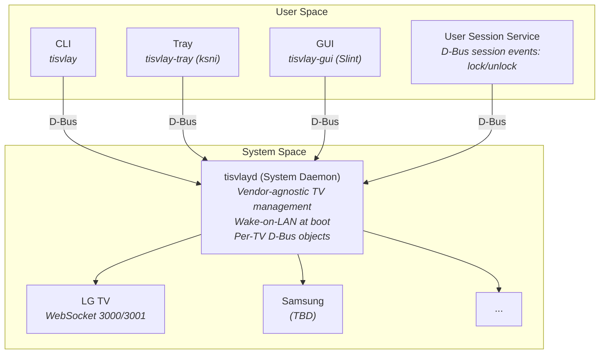
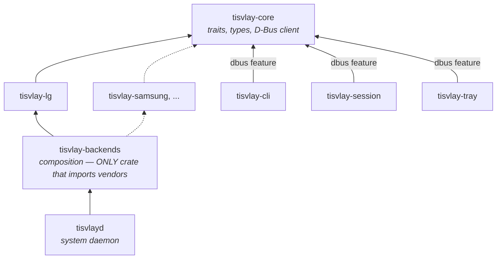
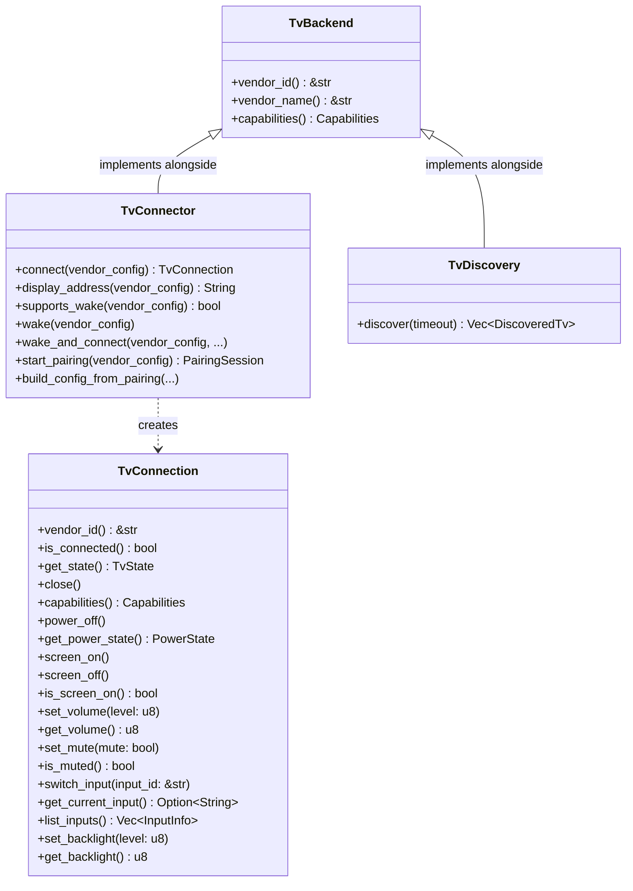
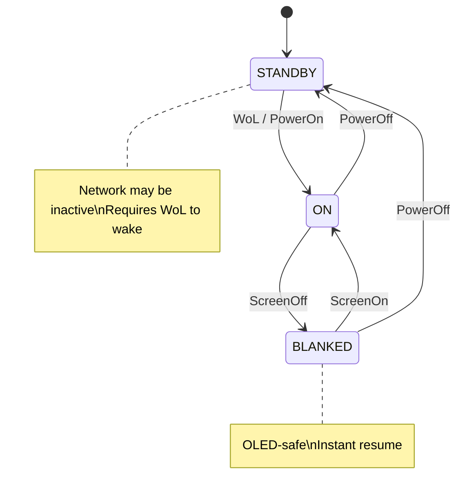

# tisvlay Design Document

## Overview

**tisvlay** is a Rust utility for controlling smart TVs from a Linux desktop connected via HDMI. It provides power management, HDMI input switching, screen blanking (OLED protection), and volume control through a vendor-agnostic architecture with pluggable backends (currently LG WebOS via SSAP over WebSocket).

---

## Architecture



### Components

| Component | Binary | Description |
|-----------|--------|-------------|
| **System Daemon** | `tisvlayd` | Systemd system service. Vendor-agnostic TV management, D-Bus API, WoL at boot. |
| **User Service** | `tisvlay-session` | Systemd user service. Monitors D-Bus session events (screen lock/unlock, idle, sleep). |
| **CLI** | `tisvlay` | Command-line interface. Communicates with daemon via D-Bus. |
| **Tray App** | `tisvlay-tray` | System tray icon using `ksni`. Per-TV power/screen/volume/backlight/input controls with scroll wheel support. |
| **GUI** | `tisvlay-gui` | Slint-based configuration window. (Not yet implemented) |

### Crate Structure

See `CLAUDE.md` for the full file tree. Key crates:

| Crate | Purpose |
|-------|---------|
| `tisvlay-core` | Core traits (`TvBackend`, `TvConnection`, `TvConnector`), types, config, D-Bus client |
| `tisvlay-lg` | LG WebOS backend (WebSocket, SSAP protocol, SSDP discovery) |
| `tisvlay-backends` | Composition crate — only place that imports vendor crates |
| `tisvlayd` | System daemon — vendor-agnostic TV management |
| `tisvlay-cli` | CLI tool — vendor-agnostic |
| `tisvlay-session` | User session service — vendor-agnostic |

### Dependency Graph



**Key principle**: Only `tisvlay-backends` knows about vendor crates. All binaries are vendor-agnostic. No `if vendor == "lg"` checks or downcasts in any binary code.

Adding a new vendor requires only:
1. Create `tisvlay-newvendor` crate implementing core traits
2. Add dependency to `tisvlay-backends/Cargo.toml`
3. Register backend in `tisvlay-backends/src/lib.rs`

No changes needed to daemon, CLI, or session service.

---

## Core Traits

### Trait Hierarchy



See `crates/tisvlay-core/src/traits.rs` for the full trait definitions.

### Transport Agnosticism

The `TvConnector` interface is fully transport-agnostic. All transport details (IP addresses, serial ports, CEC addresses, etc.) are encapsulated in the vendor config (`toml::Value`), which only the vendor crate knows how to interpret. The daemon and CLI never see transport-specific types.

Key `TvConnector` methods:
- `connect(vendor_config)` — create a connection using vendor-specific transport
- `display_address(vendor_config)` — human-readable address for logging/UI
- `supports_wake(vendor_config)` / `wake(vendor_config)` — abstract over WoL, CEC, etc.
- `start_pairing(vendor_config)` / `build_config_from_pairing(...)` — vendor-specific pairing

### TvConnection

`TvConnection` has all feature methods directly with default implementations returning `Error::NotSupported`. Backends only override the methods they support. Callers use `capabilities()` bitflags to check availability before calling.

Note: `power_on()` is not a `TvConnection` method — power-on is handled at the daemon level via `TvConnector::wake()` (WoL, CEC, etc.) since it requires a new connection to be established.

### Capabilities

Bitflags in `crates/tisvlay-core/src/capabilities.rs`: `POWER`, `SCREEN`, `VOLUME`, `MUTE`, `INPUT`, `BACKLIGHT`, `WOL`, `DISCOVERY`, `ALL`.

---

## D-Bus Interface

See `crates/tisvlayd/src/dbus/` for the implementation.

### Object Paths

```
/org/tisvlay/Manager              # Manager interface
/org/tisvlay/Tv/{tv_id}           # Per-TV objects (e.g., /org/tisvlay/Tv/living_room)
```

### org.tisvlay.Manager1

Methods:
- `GetTvs() → ao` — list per-TV object paths
- `GetSupportedVendors() → a(ss)` — list `(vendor_id, vendor_name)` pairs
- `AddTv(name: s, vendor: s, config_json: s) → o` — add and pair a TV; `config_json` contains vendor-specific connection params as JSON (e.g., `{"ip": "192.168.1.100", "mac": "AA:BB:CC:DD:EE:FF"}` for LG)
- `ReloadConfig()` — reload config from disk
- `DiscoverTvs(timeout_ms: u) → a(sssss)` — SSDP discovery, returns `(id, name, address, hardware_id, vendor)` tuples. Only available when compiled with the `discovery` feature.

Signals: `TvAdded(tv_path: o)`, `TvRemoved(tv_path: o)`

### org.tisvlay.Tv1 (Base Interface)

Properties: `Id`, `Name`, `Vendor`, `Address` (transport-agnostic display address), `Connected`, `Capabilities`

Methods: `Reconnect()`, `GetState()`

Signals: `StateChanged`, `ConnectionChanged`

### Feature Interfaces

Each feature interface is implemented on per-TV objects based on the TV's capabilities:

- **org.tisvlay.Tv1.Power** — `PowerOn()`, `PowerOff()`, `PowerState` property
- **org.tisvlay.Tv1.Screen** — `ScreenOn()`, `ScreenOff()`, `ScreenOn` property
- **org.tisvlay.Tv1.Volume** — `SetVolume(level: y)`, `SetMute(mute: b)`, `Volume`/`Muted` properties
- **org.tisvlay.Tv1.Input** — `SwitchInput(input_id: s)`, `CurrentInput`/`AvailableInputs` properties
- **org.tisvlay.Tv1.Backlight** — `SetBacklight(level: y)`, `Backlight` property

---

## Configuration

Config file: `~/.config/tisvlay/config.toml` (user) or `/etc/tisvlay/config.toml` (system).

See `crates/tisvlay-core/src/config.rs` for the full schema.

### Example

```toml
[daemon]
wake_on_boot = true
wake_delay_ms = 3000
[profiles.default]
on_screen_lock = "screen_off"    # screen_off | power_off | none
on_screen_unlock = "screen_on"   # screen_on | power_on | none
on_greeter_wake = "screen_on"    # unblank on lock screen interaction (Wayland only)
on_sleep = "power_off"
on_wake = "power_on"
idle_timeout_seconds = 0         # 0 to disable
on_idle_timeout = "none"

[profiles.gaming]
on_screen_lock = "none"          # don't interrupt gameplay
idle_timeout_seconds = 0

[[tv]]
id = "living-room"
name = "Living Room G4"
vendor = "lg"
profile = "gaming"               # references profiles map; defaults to "default"
hdmi_input = "HDMI_1"            # which HDMI port this PC uses (vendor-agnostic)
only_when_active = true          # only control when TV is on this input

# Vendor-specific config — connection params + vendor features.
# Core has zero knowledge of these fields; each vendor crate
# defines its own config struct and deserializes internally.
[tv.lg]
ip = "192.168.1.100"
mac = "AA:BB:CC:DD:EE:FF"
client_key = "abc123..."
default_input = "HDMI_1"         # LG-specific: input to switch to on wake
```

Key design: `TvConfig` uses `#[serde(flatten)]` to capture vendor-specific fields as raw `toml::Value`. Core has zero vendor knowledge — vendor crates define their own config structs and deserialize from the `toml::Value` internally.

---

## Power & Screen State Machine



### Event → Action Mapping

| Event | Default Action | Notes |
|-------|---------------|-------|
| System boot | WoL → wait → switch input | Get TV ready for login screen |
| Screen lock | Screen off (blank) | Instant resume on unlock |
| Greeter wake | Screen on | User interacted with lock screen (Wayland only) |
| Screen unlock | Screen on | Skipped if GreeterWake already unblanked (redundant-action tracking) |
| User idle timeout | Screen off | Configurable per-profile |
| System suspend | Power off | Network unavailable during sleep |
| System resume | WoL → wait → power on | Backend handles WoL retry for lost packets |

All actions are configurable per-TV via profiles. Different TVs can respond differently to the same event (e.g., gaming TV ignores screen lock).

---

## CLI Interface

```
tisvlay - Multi-Vendor TV Control

USAGE:
    tisvlay [OPTIONS] <COMMAND>

COMMANDS:
    power           Power control (on/off)
    screen          Screen control (blank/unblank)
    input           Switch HDMI input
    volume          Volume control
    mute            Mute/unmute
    backlight       Backlight control
    status          Show TV status
    pair            Pair a new TV
    list            List configured TVs
    remove          Remove a TV

OPTIONS:
    --tv <ID>       Target TV (default: first configured)
    --user          Use session bus (development mode)

EXAMPLES:
    tisvlay power on
    tisvlay screen off
    tisvlay --tv office input HDMI_2
    tisvlay pair 192.168.1.100 --name "Living Room" --vendor lg --wake-id AA:BB:CC:DD:EE:FF
    tisvlay volume 30
    tisvlay backlight 80
```

---

## System Tray Menu Structure

Connected TV submenu:
```
▶ Living Room G4  [network-connect]
  ├─ Power Off
  ├─ Input ▶  (RadioGroup: HDMI 1, HDMI 2 ✓, HDMI 3)
  ├─ Volume: 60
  │  ├─ Volume Up (+5)
  │  ├─ Volume Down (-5)
  │  └─ Mute / Unmute
  ├─ Backlight: 80
  │  ├─ Backlight Up (+10)
  │  └─ Backlight Down (-10)
  └─ Screen Off / Screen On
```

Disconnected TV submenu:
```
▶ Office C3  [network-disconnect]
  └─ Power On (Wake)
```

Bottom:
```
──────────
Refresh
──────────
Quit
```

Scroll on tray icon adjusts volume or backlight on first connected TV (context-dependent on last interaction).
Tooltip shows per-TV state summary (volume, muted, backlight).

---

## Implementation Phases

### Phase 1: Core Library + CLI (MVP) - COMPLETE

**Goal**: Basic TV control from command line.


### Phase 2: System Daemon - COMPLETE

**Goal**: Background service with D-Bus API.


### Phase 3: User Session Integration - COMPLETE

**Goal**: React to desktop events.
### Phase 4: Tray App - COMPLETE

**Goal**: Quick access from system tray.

1. `tisvlay-tray`: ksni-based StatusNotifierItem with per-TV submenus
2. Power/screen/input/volume/backlight/mute controls
3. Scroll wheel adjusts volume or backlight (context-dependent)
4. Optimistic state caching, 5s polling, graceful daemon-offline handling

### Phase 5: GUI Configuration

**Goal**: User-friendly setup and configuration.

1. `tisvlay-gui`: Slint-based settings window
2. TV discovery and pairing wizard
3. Per-TV configuration
4. Session behavior settings

---

## Known Challenges & Mitigations

| Challenge | Mitigation |
|-----------|------------|
| TV ignores WoL during pixel refresh | Retry WoL with backoff; inform user if TV unresponsive |
| Newer firmware requires TLS (wss://) | Default to port 3001; fallback to 3000; accept self-signed certs |
| WebSocket closed on TV idle (~1-2 min) | LG backend auto-reconnects transparently before each command |
| WoL lost after system resume | Backend resends WoL between connect retries |
| PowerOff + ScreenLocked race on sleep | Daemon `powered_off` flag prevents blocking connect to dead TV |
| Screen on/off returns 500 when idempotent | LG backend treats application errors as success for screen commands |
| DHCP IP changes | Use MAC for WoL; re-discover via SSDP |
| Greeter wake unavailable on X11 | Wayland `ext-idle-notify-v1` only; falls back gracefully |

---

## References

- [Firewall Configuration](firewall.md) - SSDP discovery firewall setup
- [Code Review](review.md) - Architecture review findings and responses
- [LG WebOS API](https://github.com/chros73/bscpylgtv/tree/master/docs)
- [zbus Documentation](https://docs.rs/zbus)
- [ksni Documentation](https://docs.rs/ksni)
- [Slint Documentation](https://docs.slint.dev)
