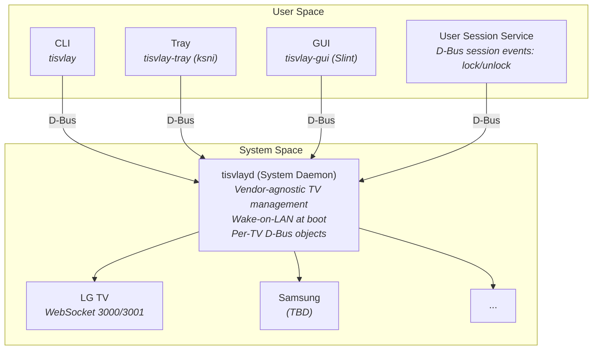
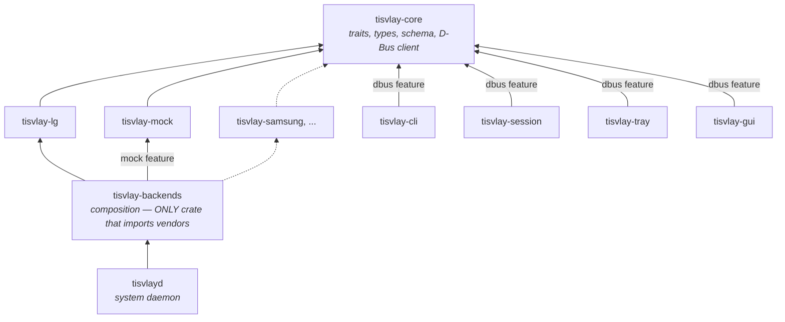
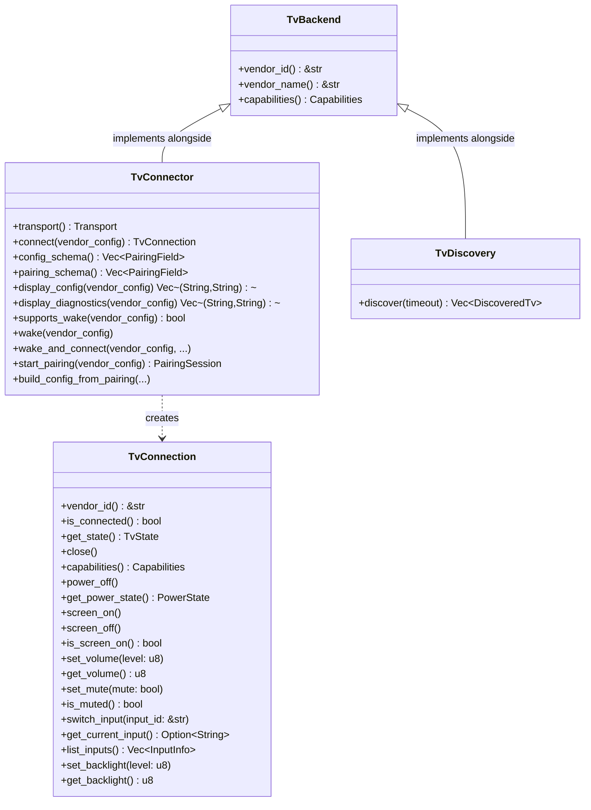
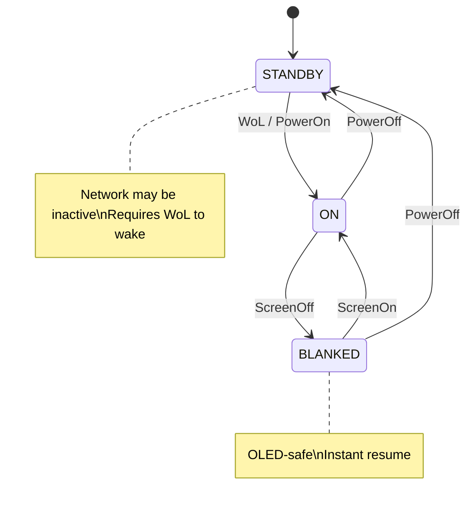

# tisvlay Design Document

## Overview

**tisvlay** is a Rust utility for controlling smart TVs from a Linux desktop connected via HDMI. It provides power management, HDMI input switching, screen blanking (OLED protection), and volume control through a vendor-agnostic architecture with pluggable backends (currently LG WebOS via SSAP over WebSocket).

---

## Architecture



### Components

| Component | Binary | Description |
|-----------|--------|-------------|
| **System Daemon** | `tisvlayd` | Systemd system service. Vendor-agnostic TV management, D-Bus API, WoL at boot. |
| **User Service** | `tisvlay-session` | Systemd user service. Monitors D-Bus session events (session lock/unlock, idle); reactively prunes orphan user-config `[[tv]]` assignments via `ObjectManager.InterfacesRemoved`. |
| **CLI** | `tisvlay` | Command-line interface. Communicates with daemon via D-Bus. |
| **Tray App** | `tisvlay-tray` | System tray icon using `ksni`. Subscribes to daemon D-Bus signals for real-time state updates (30s fallback poll). Per-TV power/screen/volume/backlight/input controls with scroll wheel support. |
| **GUI** | `tisvlay-gui` | Slint-based configuration window. TVs pane with master/detail layout, per-TV editor (live state controls + edit-mode pencil for config edits), pairing wizard with discovery streaming. About pane built; Profiles / Session panes are placeholders pending the M3.5 / M4 / M5 work in [docs/plan.md](plan.md). |

### Crate Structure

See `CLAUDE.md` for the full file tree. Key crates:

| Crate | Purpose |
|-------|---------|
| `tisvlay-core` | Core traits (`TvBackend`, `TvConnection`, `TvConnector`), types, config, schema (`PairingField`, `FieldVisibility`), D-Bus client |
| `tisvlay-lg` | LG WebOS backend (WebSocket, SSAP protocol, SSDP discovery) |
| `tisvlay-mock` | In-memory mock backend (dev/tests, optional via `mock` feature) |
| `tisvlay-test` | OS-environment fakes — private `dbus-daemon`, fake logind, fake screensaver |
| `tisvlay-backends` | Composition crate — only place that imports vendor crates |
| `tisvlay-harness` | Binary-lifecycle test fixtures (`TestDaemon`, `TestSession`, `TestTray`) |
| `tisvlayd` | System daemon — vendor-agnostic TV management |
| `tisvlay-cli` | CLI tool — vendor-agnostic |
| `tisvlay-session` | User session service — vendor-agnostic |
| `tisvlay-tray` | System-tray app (ksni) — vendor-agnostic |
| `tisvlay-gui` | Slint-based settings window — vendor-agnostic; status in [plan.md](plan.md) |

### Dependency Graph



**Key principle**: Only `tisvlay-backends` knows about vendor crates. All binaries are vendor-agnostic. No `if vendor == "lg"` checks or downcasts in any binary code.

Adding a new vendor requires only:
1. Create `tisvlay-newvendor` crate implementing core traits
2. Add dependency to `tisvlay-backends/Cargo.toml`
3. Register backend in `tisvlay-backends/src/lib.rs`

No changes needed to daemon, CLI, or session service.

---

## Core Traits

### Trait Hierarchy



See `crates/tisvlay-core/src/traits.rs` for the full trait definitions.

### Transport Agnosticism

The `TvConnector` interface is fully transport-agnostic. All transport details (IP addresses, serial ports, CEC addresses, etc.) are encapsulated in the vendor config (`toml::Value`), which only the vendor crate knows how to interpret. The daemon and CLI never see transport-specific types.

Each connector declares its `Transport` type (`Network`, `Serial`, `Usb`, `Cec`). The daemon uses `Transport::is_network_dependent()` to scope system events — only network-dependent connections are affected by NetworkManager events. Non-network backends (serial, USB, CEC) are unaffected by network loss.

Key `TvConnector` methods:
- `transport()` — communication transport used by this connector
- `connect(vendor_config)` — create a connection using vendor-specific transport
- `config_schema()` — declarative `Vec<PairingField>` describing the persisted-config shape with `FieldVisibility` (`UserInput` / `Diagnostic` / `Secret`) per field. Drives the pairing wizard, the GUI's edit pane, and the daemon's `Tv1.{VendorConfig,VendorInfo}` projections — backends declare schema once and the framework projects per-use-case.
- `display_config(vendor_config)` / `display_diagnostics(vendor_config)` — `(label, value)` projection of `UserInput` / `Diagnostic` fields respectively, default-implemented via `config_schema`. `Secret` fields are excluded from both.
- `supports_wake(vendor_config)` / `wake(vendor_config)` — abstract over WoL, CEC, etc.
- `start_pairing(vendor_config)` / `build_config_from_pairing(...)` — vendor-specific pairing

### TvConnection

`TvConnection` has all feature methods directly with default implementations returning `Error::NotSupported`. Backends only override the methods they support. Callers use `capabilities()` bitflags to check availability before calling.

Note: `power_on()` is not a `TvConnection` method — power-on is handled at the daemon level via `TvConnector::wake()` (WoL, CEC, etc.) since it requires a new connection to be established.

### Capabilities

Bitflags in `crates/tisvlay-core/src/capabilities.rs`: `POWER`, `SCREEN`, `VOLUME`, `MUTE`, `INPUT`, `BACKLIGHT`, `WOL`, `DISCOVERY`, `ALL`.

---

## D-Bus Interface

See `crates/tisvlayd/src/dbus/` for the implementation.

### Service overview

```
org.tisvlay.Daemon  (system bus; session bus in dev)
├── /org/tisvlay                    ObjectManager
├── /org/tisvlay/Manager            org.tisvlay.Manager1
│   ├── Methods:  GetSupportedVendors, GetPairingSchema, AddTv,
│   │             CancelPair, ReloadConfig, ListSystemProfiles,
│   │             GetUserProfileDefault, ListUserProfiles, DiscoverTvs
│   └── Signals:  ConfigReloaded
└── /org/tisvlay/Tv/{uuid_underscored}   org.tisvlay.Tv1, Tv1.Power, Tv1.Screen,
    │                                    Tv1.Volume, Tv1.Backlight, Tv1.Input
    ├── Properties (rw): Name, Managed, SystemProfile, PrimaryInput,
    │                     IsScreenOn, Volume, Muted, Backlight
    ├── Properties (ro): Uuid, Vendor, Connected, Capabilities,
    │                     VendorInfo, AutomateWhen, Automated,
    │                     PowerState, CurrentInput, AvailableInputs
    ├── Methods:  Reconnect, RePair, Remove, GetConfig, UpdateConfig,
    │             PowerOn, PowerOff, SwitchInput
    └── Signals:  (standard PropertiesChanged only)

org.tisvlay.Session  (session bus)
└── /org/tisvlay/Session            org.tisvlay.Session1
    ├── Methods:  ListUserProfiles, GetTvUserProfile, SetTvUserProfile,
    │             GetEffectiveUserProfile, ReloadConfig
    └── Signals:  UserProfileChanged
```

### Clients and signal flow

| Client | Calls | Subscribes to |
|--------|-------|---------------|
| **tisvlay CLI** | Manager1 (profiles, config), Tv1.* (properties + commands), Session1 (user profiles) | — |
| **tisvlay-tray** | Manager1 (profiles), Tv1.* (properties + commands), Session1 (user profiles) | `PropertiesChanged` on Tv paths; `InterfacesAdded`/`InterfacesRemoved` (ObjectManager); Manager1: `ConfigReloaded`; Session1: `UserProfileChanged`; DBus: `NameOwnerChanged` (service discovery) |
| **tisvlay-session** | Manager1 (admin defaults), Tv1.* (session actions via writable properties) | — |

`org.freedesktop.DBus.ObjectManager` at `/org/tisvlay` provides `GetManagedObjects()` — a single round-trip returning all TV object paths and their interface properties.

### org.tisvlay.Manager1

Methods:
- `GetSupportedVendors() → a(ss)` — list `(vendor_id, vendor_name)` pairs
- `GetPairingSchema(vendor: s) → s` — JSON-serialized `Vec<PairingField>` describing the pairing-form fields the GUI should render for the given vendor
- `AddTv(name: s, vendor: s, config_json: s, managed: b) → (os)` — reserve a TV id and start pairing. **Returns immediately** after sync validation (unknown-vendor / `ConfigInvalidVendorConfig` surface as RPC errors); the handshake itself runs in a daemon-side spawned task. Outcome is reported via `Manager1.PairingProgress` filtered on the returned `tv_uuid` to a terminal phase (`complete` or `failed`). `complete` only fires after the per-TV `Tv1.*` interfaces are registered, so clients observing it can immediately call into the new TV without racing the registration. `config_json` carries vendor-specific connection params as JSON (e.g. `{"ip": "192.168.1.100", "mac": "AA:BB:CC:DD:EE:FF"}` for LG); `managed` controls automation participation. Per-TV lifecycle (`Remove`, `RePair`, `GetConfig`, `UpdateConfig`) lives on `Tv1` after pair.
- `ReloadConfig()` — reload config from disk
- `CancelPair(tv_id: s)` — cancel an in-flight pairing handshake. Works for both `AddTv` and `Tv1.RePair` via the daemon-side `pairing_sessions` registry. Returns `NotPairing` (typed) if the tv_id isn't currently pairing — matches the BlueZ `Adapter.RemoveDevice`-on-unknown-device convention.
- `ListSystemProfiles() → a(ss)` — all system profiles as `(name, json)` pairs
- `GetUserProfileDefault() → s` — admin baseline user profile as JSON; used by session services to inherit defaults
- `ListUserProfiles() → a(ss)` — all user profiles (admin-defined) as `(name, json)` pairs
- `DiscoverTvs(timeout_ms: u) → a(sssss)` — SSDP discovery, returns `(id, name, address, hardware_id, vendor)` tuples. Only available when compiled with the `discovery` feature.

Signals: `ConfigReloaded`, `PairingProgress`, `DiscoveryFound`. (Per-TV add/remove fires standard `ObjectManager.InterfacesAdded` / `InterfacesRemoved` from `/org/tisvlay`.)

`PairingProgress(tv_id: s, phase: s, message: s)` is bus-wide — any client may be running a concurrent pairing. Clients filter on the `tv_id` they got from `Manager1.AddTv` (or passed to `Tv1.RePair`) and drain to a terminal phase (`complete` or `failed`). Non-terminal phases are `awaiting_tv` and `awaiting_input`. `tisvlay-core` exposes `DaemonClient::drain_pair_to_terminal(stream, target_tv_id, on_progress) -> Result<PairTerminal>` as the canonical client-side drain — used by the GUI wizard, the `tisvlay pair` / `tisvlay re-pair` CLI subcommands, and the integration test suite.

### org.tisvlay.Tv1 (per-TV lifecycle)

The per-TV `Tv1` interface owns the methods that take a TV identifier — they read `&self.tv_id` directly from the interface impl rather than decoding it from a path argument, which avoided a class of `tv_path()` round-trip bugs around UUID hyphens.

Methods:
- `Reconnect()` — drop and re-establish the connection
- `RePair()` — refresh vendor credentials by re-running the backend's pairing handshake against the existing `vendor_config`. Top-level fields (`name`, `profile`, `managed`, `primary_input`) stay intact; only the per-vendor credentialing fields (e.g. LG's `client_key`) get replaced. **Returns immediately** after sync validation (TV not found / already pairing surface as RPC errors); the handshake itself runs in a daemon-side spawned task. Outcome via `Manager1.PairingProgress` filtered on this TV's `tv_id` to a terminal phase. Cancel an in-flight re-pair via `Manager1.CancelPair(tv_id)`. Concurrent re-pair against the same TV is rejected synchronously with `PairingFailed("already pairing")`.
- `Remove()` — drop the TV from in-memory + on-disk config and unregister every `Tv1.*` interface at this path (fires `ObjectManager.InterfacesRemoved`)
- `GetConfig() → s` — return current config (top-level + non-`Secret` vendor fields) as a JSON object suitable for prefilling an edit form
- `UpdateConfig(json_patch: s)` — atomic batch edit. Top-level keys (`name`, `managed`, `system_profile`, `primary_input`) plus any `UserInput`-visibility vendor schema field. Server-side schema-validated; vendor-field changes drop and reconnect. `Diagnostic`/`Secret` keys are rejected.

Single-field edits also flow through the per-property `Properties.Set` path — `Tv1.Name`, `Tv1.Managed`, `Tv1.SystemProfile`, `Tv1.PrimaryInput`, `Tv1.IsScreenOn`, `Tv1.Volume`, `Tv1.Muted`, `Tv1.Backlight` — which routes through the same internal helpers as `UpdateConfig` for top-level fields.

### org.tisvlay.Session1 (Session Service)

Registered on the **session bus** by `tisvlay-session` under `org.tisvlay.Session`.

Methods:
- `ListUserProfiles() → a(ss)` — merged user profile list as `(name, json)` pairs; user-defined profiles take precedence over same-named admin profiles
- `GetTvUserProfile(tv_id: s) → s` — user profile name assigned to a TV (or `"default"` if unassigned)
- `SetTvUserProfile(tv_id: s, profile: s)` — assign a user profile; validates existence, saves to user config, live-reloads
- `GetEffectiveUserProfile(tv_id: s) → s` — fully resolved user profile as JSON (user + admin baseline inheritance applied)
- `ReloadConfig()` — re-query daemon for TV list and admin baseline, reload user config from disk

### org.tisvlay.Tv1 (Base Interface)

Properties (read-only): `Id` (const), `Vendor` (const), `Address` (const), `Connected`, `Capabilities` (invalidates)

Properties (read-write): `Name`, `Managed`, `SystemProfile`, `PrimaryInput`

Properties (read-only, computed): `AutomateWhen` (from resolved system profile), `Automated` (computed gate: `managed && automate_when.should_automate(primary_input, current_input)`)

Methods: `Reconnect()`, `RePair()`, `Remove()`, `GetConfig()`, `UpdateConfig(json_patch: s)` — see the section above for full signatures.

No custom signals — uses standard `org.freedesktop.DBus.Properties.PropertiesChanged` for all state notifications. TV state is cached in the D-Bus interface structs and updated by backend subscription pushes via `InterfaceRef::get_mut()`.

### Feature Interfaces

Each feature interface is implemented on per-TV objects. Controllable state is exposed as **read-only** properties driven by backend subscription pushes — `state_forwarder` is the single emit path for `PropertiesChanged`. Writes go through explicit Set methods, matching the conventional D-Bus pattern (UPower, GNOME, BlueZ, NetworkManager). This avoids the auto-emit-vs-subscription race that affects ramping properties (notably backlight on LG OLEDs, which transitions over hundreds of ms via subscription pushes).

- **org.tisvlay.Tv1.Power** — `PowerOn()`, `PowerOff()` methods; `PowerState` (ro) property
- **org.tisvlay.Tv1.Screen** — `SetScreen(b)` method; `IsScreenOn` (ro) property
- **org.tisvlay.Tv1.Volume** — `SetVolume(y)`, `SetMuted(b)` methods; `Volume` (ro, 0-100), `Muted` (ro) properties
- **org.tisvlay.Tv1.Input** — `SwitchInput(input_id: s)` method; `CurrentInput` (ro), `AvailableInputs` (ro, invalidates) properties
- **org.tisvlay.Tv1.Backlight** — `SetBacklight(y)` method; `Backlight` (ro, 0-100) property

---

## Configuration

Config is split between **system config** (daemon-owned) and **user config** (session-owned):

- **System config**: `/var/lib/tisvlay/config.toml` — TV definitions (with per-TV system profile assignment), credentials, system profiles (daemon lifecycle events), and admin baseline user profiles. Root-owned; only `tisvlayd` reads and writes this file.
- **User config**: `~/.config/tisvlay/config.toml` — user profile definitions and per-TV user profile assignments. User-owned; `tisvlay-session` reads this. Optional: if absent, the admin baseline `user.profiles.default` from system config is inherited via D-Bus.

Both accept `--config <PATH>` to override their respective path. `tisvlayd` defaults to `/var/lib/tisvlay/config.toml`; `--session` dev mode defaults to the XDG user path.

See `crates/tisvlay-core/src/config.rs` for the full schema.

### Schema-driven vendor config

Top-level `TvConfig` fields (`name`, `managed`, `system_profile`, `primary_input`) are uniform across vendors. Vendor-specific fields (LG: `ip`, `mac`, `client_key`, `scheme`) live under `[tv.<vendor>]` and are described declaratively by the vendor's `TvConnector::config_schema()` — a `Vec<PairingField>` where each field carries a `FieldVisibility`:

| Visibility | Where it surfaces | Editable? |
|---|---|---|
| `UserInput` | `Tv1.VendorConfig`, GUI's CONFIG group, pairing wizard form, edit-mode form | yes (via `Tv1.UpdateConfig` or pairing) |
| `Diagnostic` | `Tv1.VendorInfo`, GUI's INFO group | no — backend-discovered, refresh via re-pair |
| `Secret` | nowhere (filtered out of every projection) | n/a |

Adding an editable field is a one-row schema entry — no D-Bus method changes, no CLI dispatch arms, no GUI form-rendering code. The framework projects the right view per use case.

### System Config Example

```toml
# /var/lib/tisvlay/config.toml  (daemon-owned)

# System profiles — daemon lifecycle events (per-TV via profile.system assignment)
[system.profiles.default]
on_startup = "power_on"          # action on system boot (default: power_on)
on_shutdown = "power_off"        # action on poweroff/halt (default: power_off)
on_reboot = "none"               # action on reboot/kexec (default: none)
on_no_session = "none"           # action when all user sessions end (login screen)
on_sleep = "power_off"           # action on system suspend/hibernate (default: power_off)
on_wake = "power_on"             # action on system resume from sleep (default: power_on)
automate_when = "always"         # always | on_primary | off_primary (default: always)

[system.profiles.shared]
automate_when = "on_primary"     # only automate when showing the PC input

[system.profiles.guest]
on_startup = "none"
on_shutdown = "screen_off"

# Admin-set baseline for session behavior.
# Users without their own config inherit this.
[user.profiles.default]
on_session_lock = "screen_off"   # screen_off | power_off | none
on_session_unlock = "screen_on"  # screen_on | power_on | none
on_greeter_wake = "screen_on"    # unblank on lock screen interaction (Wayland only)
idle_timeout_seconds = 0         # 0 to disable
on_idle_timeout = "none"
on_idle_resume = "screen_on"     # action when activity resumes after idle

[[tv]]
uuid = "11111111-1111-4111-8111-111111111111"  # RFC 4122 v4, opaque, immutable
name = "Living Room G4"
vendor = "lg"
primary_input = "HDMI_1"         # which input this PC uses (vendor-agnostic)
managed = true                   # participates in automation (boot WoL, session events, shutdown)
profile.system = "default"       # which system profile this TV uses

[[tv]]
uuid = "22222222-2222-4222-8222-222222222222"
name = "Guest Room"
vendor = "lg"
managed = true
profile.system = "guest"         # different lifecycle behavior

# Vendor-specific config — connection params + vendor features.
# Core has zero knowledge of these fields; each vendor crate
# defines its own config struct and deserializes internally.
[tv.lg]
ip = "192.168.1.100"
mac = "AA:BB:CC:DD:EE:FF"
client_key = "abc123..."
```

### User Config Example

```toml
# ~/.config/tisvlay/config.toml  (session-owned, optional)

# User's own profiles (override or extend admin defaults)
[user.profiles.default]
idle_timeout_seconds = 300
on_idle_timeout = "screen_off"

[user.profiles.gaming]
on_session_lock = "none"          # don't interrupt gameplay
idle_timeout_seconds = 0
on_idle_resume = "none"

# Per-TV user profile assignments — `uuid` matches the system config.
[[tv]]
uuid = "11111111-1111-4111-8111-111111111111"
profile.user = "gaming"

# guest-room inherits user.profiles.default (no override)
```

Both system and user configs use the same `[[tv]]` array-of-tables syntax. When using a single-file config, both parsers can read the same `[[tv]]` entries — each ignores fields it doesn't own (serde skips unknown fields by default).

Fields unspecified in a user profile inherit from the admin baseline `user.profiles.default` (system config), not hard-coded defaults. A user who only sets `idle_timeout_seconds = 600` in `[user.profiles.default]` gets all other settings from the system admin's defaults.

Key design: `TvConfig` uses `#[serde(flatten)]` to capture vendor-specific fields as raw `toml::Value`. Core has zero vendor knowledge — vendor crates define their own config structs and deserialize from the `toml::Value` internally.

---

## Power & Screen State Machine



### Event → Action Mapping

| Event | Default Action | Config | Notes |
|-------|---------------|--------|-------|
| System boot | Power on | `on_startup` (system profile) | WoL → connect → screen on → input switch |
| Session lock | Screen off | `on_session_lock` (user profile) | Instant resume on unlock |
| Greeter wake | Screen on | `on_greeter_wake` (user profile) | User interacted with lock screen (Wayland only) |
| Session unlock | Screen on | `on_session_unlock` (user profile) | Skipped if GreeterWake already unblanked |
| User idle timeout | Screen off | `on_idle_timeout` (user profile) | Fires at minimum across all TVs |
| Activity resumes | Screen on | `on_idle_resume` (user profile) | After idle timeout |
| System suspend | Power off | `on_sleep` (system profile) | Network unavailable during sleep |
| System resume | Power on | `on_wake` (system profile) | Backend handles WoL retry for lost packets |
| All sessions end | None | `on_no_session` (system profile) | Login screen / after logout |
| System shutdown | Power off | `on_shutdown` (system profile) | poweroff or halt |
| System reboot | None | `on_reboot` (system profile) | reboot or kexec; TV stays on for BIOS/TTY |

All lifecycle events accept any `SessionAction` value: `power_on`, `power_off`, `screen_on`, `screen_off`, or `none`. Different TVs can respond differently to the same event via per-TV profile assignments (e.g., gaming TV ignores session lock via user profile; guest TV only blanks on shutdown via system profile).

All automation (both daemon system events and session user events) is gated by the `Automated` property, which composes `managed`, `automate_when` (from system profile), `primary_input` (from config), and the TV's current input. When `automate_when = on_primary` and the TV is showing a game console, automation is skipped. Manual actions from the tray and CLI always execute regardless of the gate.

| `managed` | `automate_when` | TV on primary? | `Automated` |
|:---------:|:---------------:|:--------------:|:-----------:|
| false | any | any | **false** |
| true | always | any | **true** |
| true | on_primary | yes | **true** |
| true | on_primary | no | **false** |
| true | on_primary | unknown (TV off) | **true** (benefit of doubt) |
| true | off_primary | yes | **false** |
| true | off_primary | no | **true** |

---

## CLI Interface

```
tisvlay - Multi-Vendor TV Control

USAGE:
    tisvlay [OPTIONS] <COMMAND>

COMMANDS:
    power           Power control (on/off)
    screen          Screen control (blank/unblank)
    input           Switch HDMI input (lists inputs when no ID given)
    volume          Volume control
    mute            Mute/unmute (on/off/toggle, default: toggle)
    backlight       Backlight control
    status          Show TV status (includes managed flag)
    pair            Pair a new TV
    list            List configured TVs (shows [unmanaged] suffix)
    remove          Remove a TV
    manage          Show or set automated management for a TV (true/false)
    profile         Profile management
      user          User profile management (requires tisvlay-session)
        list        List available user profiles
        get         Show user profile assigned to a TV
        set <NAME>  Assign a user profile to a TV
      system        System profile management
        list        List available system profiles
        get         Show system profile assigned to a TV
        set <NAME>  Assign a system profile to a TV

OPTIONS:
    --tv <ID>       Target TV (default: first configured)
    --user          Use session bus (development mode)

EXAMPLES:
    tisvlay power on
    tisvlay screen off
    tisvlay --tv office input HDMI_2
    tisvlay input                                                   # list available inputs
    tisvlay pair 192.168.1.100 --name "Living Room" --vendor lg --wake-id AA:BB:CC:DD:EE:FF
    tisvlay pair 192.168.1.101 --name "Office" --vendor lg --unmanaged
    tisvlay volume 30
    tisvlay backlight 80
    tisvlay manage                                                      # show current
    tisvlay manage true
    tisvlay manage false --tv office
    tisvlay profile user list
    tisvlay profile user set gaming --tv living-room
    tisvlay profile system list
    tisvlay profile system set guest --tv guest-room
```

---

## System Tray Menu Structure

Icons convey managed state: `tvconnected` (managed + connected), `tvtrusted` (unmanaged + connected), `tvdisconnected` (disconnected regardless of managed state).

Connected TV submenu:
```
▶ Living Room G4  [tvconnected]
  ├─ Power Off
  ├─ Profile ▶ User: gaming ▶  (RadioGroup: gaming ✓, default)   [settings-configure]
  │            System: default ▶  (RadioGroup: default ✓, guest)   [settings-configure]
  ├─ Unmanage
  ├─ Input ▶  (RadioGroup: HDMI 1, HDMI 2 ✓, HDMI 3)   [input-tvremote-symbolic]
  ├─ Volume: 60
  │  ├─ Volume Up (+10)
  │  ├─ Volume Down (-10)
  │  └─ Mute / Unmute
  ├─ Backlight: 80
  │  ├─ Backlight Up (+10)
  │  └─ Backlight Down (-10)
  └─ Screen Off / Screen On
```

Disconnected TV submenu:
```
▶ Office C3  [tvdisconnected]
  ├─ Power On (Wake)
  ├─ Profile ▶ User: default ▶  (RadioGroup: default ✓)
  │            System: default ▶  (RadioGroup: default ✓)
  └─ Unmanage
```

Unmanaged connected TV submenu:
```
▶ Guest TV  [tvtrusted]
  ├─ Power Off
  ├─ Profile ▶ User: default ▶
  │            System: default ▶
  ├─ Manage
  ├─ Input ▶
  └─ ...
```

Bottom:
```
──────────
Refresh
──────────
Quit
```

Scroll wheel adjusts volume or backlight for the TV last interacted with via a volume/backlight control; falls back to the first connected TV.
Screen Off/On uses `backlight_item` (same as Backlight Up/Down) — clicking it contextualizes the scroll wheel to backlight, since screen off is the discrete pole of the backlight axis.

---

## Implementation Phases

### Phase 1: Core Library + CLI (MVP) - COMPLETE

**Goal**: Basic TV control from command line.


### Phase 2: System Daemon - COMPLETE

**Goal**: Background service with D-Bus API.


### Phase 3: User Session Integration - COMPLETE

**Goal**: React to desktop events.
### Phase 4a: CLI D-Bus Migration - COMPLETE

**Goal**: CLI communicates with daemon via D-Bus.

### Phase 4b: Tray App - COMPLETE

**Goal**: Quick access from system tray.

1. `tisvlay-tray`: ksni-based StatusNotifierItem with per-TV submenus
2. Power/screen/input/volume/backlight/mute controls
3. Scroll wheel adjusts volume or backlight (context-dependent)
4. Signal-driven updates via `PropertiesChanged`/`InterfacesAdded`/`InterfacesRemoved` signals with 100ms debounce and 30s fallback poll

### Phase 4C: System vs User Config Split - COMPLETE

**Goal**: Separate daemon-owned and user-owned configuration.

1. `SystemConfig` (daemon) and `UserConfig` (session service) with separate ownership and paths
2. Profile field-level inheritance: user profile fields override admin defaults, unset fields fall through
3. `on_idle_resume` added to `UserProfileConfig` (action when activity resumes after idle)
4. `org.tisvlay.Session1` D-Bus interface on session bus: `ListUserProfiles`, `GetTvUserProfile`, `SetTvUserProfile`, `GetEffectiveUserProfile`, `ReloadConfig`
5. Daemon gains `org.freedesktop.login1` monitoring: `PrepareForShutdown` (inhibitor lock), `SessionNew`/`SessionRemoved` for `on_no_session`
6. Boot-wake refactored: retry-connect loop with WoL resend replaces blind sleep delay
7. Session service event replay after late daemon connect
8. Tray gains User Profile and System Profile submenus per TV
9. Manager1 additions: `SetTvOption`, `ListSystemProfiles`, `GetUserProfileDefault`, `ListUserProfiles`

### Packaging - COMPLETE

**Goal**: Install the full stack on any distro.

**NixOS** (`services.tisvlay.enable = true`) — see [packaging/nix/README.md](../packaging/nix/README.md).

**Multi-distro** — see [packaging/README.md](../packaging/README.md).

**GitHub releases**: see [`.github/workflows/release.yml`](../.github/workflows/release.yml) — triggers on `v*` tags.

**crates.io**: each crate published independently; `cargo install` provides binaries only (no service files)

**Common**:
- `tisvlayd`/`tisvlay-session` `--config` flag for explicit config path
- System daemon uses `StateDirectory` (`/var/lib/tisvlay/`) for writable config (supports `ProtectHome=true`)
- D-Bus policy in `packaging/systemd/org.tisvlay.Daemon.conf`
- User services auto-start on `graphical-session.target`

### Phase 5A: `managed` Flag + CLI Profile Parity - COMPLETE

**Goal**: Let users designate which TVs participate in automation without unpairing.

1. `managed: bool` added to `TvConfig` (required TOML field, no serde default) and `TvInfo`
2. `TvConfig::new(id, name, vendor, managed)` — all four required; UX default lives in CLI only
3. Daemon enforces `managed` in all automation paths: boot WoL, session events, shutdown
4. `TvEntry = (bool, Arc<Mutex<ManagedTv>>)` — managed flag stored outside per-TV mutex; `list_managed_tv_ids()` scans with only the outer read lock
5. `Managed` D-Bus property exposed on `org.tisvlay.Tv1`; `SetTvOption` handles `managed` key
6. `AddTv` D-Bus signature extended with `managed: b` parameter
7. Tray: icon reflects managed state (`tvconnected`/`tvtrusted`/`tvdisconnected`); Manage/Unmanage toggle in every TV submenu
8. CLI: `manage [true|false]` command (no arg shows current status); `list` shows `[unmanaged]` suffix; `pair --unmanaged` flag; `profile list/get/set` subcommands via `SessionClient`
9. Session service: profiles built for all paired TVs at load; event dispatch filtered live per-event

### Phase 5B: Session Service — Live `managed` Filtering - COMPLETE

**Goal**: Toggle managed at runtime without requiring a service reload.

1. `event_handler` queries `daemon.list_tvs()` before each dispatch to get the current managed set
2. Fallback on daemon unreachable: skip dispatch entirely (empty set) rather than leaking unmanaged TVs

### Phase 5C: `ObjectManager` for Bulk TV Discovery - COMPLETE

**Goal**: Replace 1 + 6N D-Bus round-trips with a single `GetManagedObjects` call.

1. `org.freedesktop.DBus.ObjectManager` registered at `/org/tisvlay` (ancestor of all tisvlay objects)
2. `GetTvs()` removed from `org.tisvlay.Manager1` — superseded by `GetManagedObjects`
3. `DaemonClient.list_tvs()` rewritten: single round-trip, no proxy objects created, O(1) D-Bus cost regardless of TV count
4. `get_bool(key, default)` uses explicit defaults: `Connected → false`, `Managed → true`
5. Diagnostic logging: `debug!` per entry on property fallbacks; `warn!` when `Id` is empty

### Per-TV System Profiles Refactor - COMPLETE

**Goal**: Per-TV daemon lifecycle behavior via system profiles, symmetric with user profiles.

1. Renamed `ProfileConfig` → `UserProfileConfig`, `ResolvedProfile` → `ResolvedUserProfile` across all crates
2. D-Bus renames: `GetSystemProfile` → `GetUserProfileDefault`, `GetSystemProfiles` → `ListUserProfiles`, `ListProfiles` → `ListUserProfiles`, `GetTvProfile` → `GetTvUserProfile`, `SetTvProfile` → `SetTvUserProfile`, `GetEffectiveProfile` → `GetEffectiveUserProfile`
3. Added `SystemProfileConfig` and `ResolvedSystemProfile` with fields: `on_startup`, `on_shutdown`, `on_reboot`, `on_no_session`
4. Config restructured: `[daemon]` → `[system.profiles.*]`, `[profiles.*]` → `[user.profiles.*]`, `profile = "name"` → `profile.user = "name"`, new `profile.system = "name"` on `TvConfig`
5. Removed `DaemonConfig` — replaced by per-TV system profile resolution
6. Daemon dispatches lifecycle events per-TV using each TV's resolved system profile
7. `SetDaemonOption` removed; system profile set via `SetTvOption` key `"profile.system"`
8. `ListSystemProfiles()` added to Manager1; `SystemProfile` property added to Tv1
9. Tray gains dual submenus: "User Profile" and "System Profile" per TV
10. CLI: `tisvlay profile user list/get/set` and `tisvlay profile system list/get/set`

### Brightness / Volume Sync (researched and scrapped)

[PR #34](https://github.com/ruffsl/TisVlay/pull/34) carried experimental volume sync via PipeWire and brightness sync via KWin Wayland + PowerDevil D-Bus + a virtual backlight kernel module that ultimately did not merge to main. PowerDevil binary patches against Plasma's release cadence, the non-bidirectional `kde_external_brightness_v1` protocol, HDR-vs-SDR code-path divergence, and gain-stage chaining in PipeWire mirror sinks made the maintenance burden outweigh the capability. The granular commit history is preserved in that PR; see [docs/ideas.md](ideas.md) for the rationale and the event-driven power-management direction the next merge cycle is taking.

## Future Work

Forward-looking work that hasn't shipped yet. No fixed sequencing — entries land in whichever order makes sense.

### GUI Configuration

`tisvlay-gui` is largely built and packaged — see [docs/plan.md](plan.md) for the full milestone status, and [packaging/README.md](../packaging/README.md) for the shipping channels. The TVs pane (master/detail with live-state controls + edit-mode pencil), pairing wizard (discovery streaming + schema-driven step-2 form), and About pane shipped through M3 + Plan-6 follow-on work. The Profiles pane, Session pane, NixOS module's `enableGui` flag, and the XDG `.desktop` entry remain as M3.5 / M4 / M5 / M6 follow-ups.

### Event-Driven Power Management

Today's `tisvlay-session` listener path drives `Tv1.Power.SetIsScreenOn` / `PowerOff` from session-bus events (screensaver, Wayland idle, logind, idle timer). A follow-up merge replaces this with per-DE adapters (KWin idle/DPMS, wlroots output management, X11 XScreenSaver, logind fallback) that emit a unified `ScreenBlank` / `ScreenWake` / `Sleep` / `Wake` event surface the daemon dispatches to `Tv1.Power.*`. Hard requirements (sub-100 ms lockscreen-snap-back, blank-vs-off distinction, multi-TV per-EDID-connector, detached-TV idle-timer fallback) and the "what NOT to do" gotchas are captured in [docs/ideas.md](ideas.md).

---

## Known Challenges & Mitigations

| Challenge | Mitigation |
|-----------|------------|
| TV ignores WoL during pixel refresh | Retry WoL with backoff; inform user if TV unresponsive |
| Newer firmware requires TLS (wss://) | Default to port 3001; fallback to 3000; accept self-signed certs |
| WebSocket closed on TV idle (~1-2 min) | LG backend auto-reconnects transparently before each command |
| WoL lost after system resume | Backend resends WoL between connect retries |
| PowerOff + SessionLocked race on sleep | Daemon `powered_off` flag prevents blocking connect to dead TV |
| Screen on/off returns 500 when idempotent | LG backend treats application errors as success for screen commands |
| DHCP IP changes | Use MAC for WoL; re-discover via SSDP |
| Greeter wake unavailable on X11 | Wayland `ext-idle-notify-v1` only; falls back gracefully |
| GUI is Wayland-only | `tisvlay-gui` builds against `slint = ["backend-winit-wayland"]` and `wl-clipboard-rs`; X11 sessions run the daemon, CLI, and tray (ksni) but the settings window doesn't launch. Aligns with `tisvlay-session`'s Wayland-best-effort posture above and trims `x11rb` from the dep graph. See [build.md](build.md). |
| Backlight write requires workaround | SSAP subscriptions work for reading; writing requires Luna `createAlert` workaround (direct setSystemSettings returns 401) |

---

## Push-Based State Pipeline

State updates flow end-to-end without polling:

```
TV remote/app → WebSocket push → LG backend → daemon StateChangeEvent
    → InterfaceRef cached property update → PropertiesChanged signal
    → tray handle.update()
```

### LG Backend SSAP Subscriptions

The LG SSAP protocol supports `subscribe` requests on the same URIs used for `request` (GET). The TV pushes updates over the existing multiplexed WebSocket whenever a value changes. Subscribed endpoints:

- `ssap://com.webos.service.tvpower/power/getPowerState` (power state)
- `ssap://audio/getVolume` (volume level)
- `ssap://audio/getMute` (mute state)
- `ssap://tv/getExternalInputList` (available inputs)
- `ssap://com.webos.applicationManager/getForegroundAppInfo` (current input/app)
- `ssap://settings/getSystemSettings` with `category: "picture", keys: ["backlight"]` (backlight level)

See [docs/lg/webos.md](lg/webos.md) for full SSAP probe results and subscription behavior details.

After connecting and registering, the LG backend sends subscribe requests for all of the above. A background reader task on the multiplexed WebSocket routes subscription updates (identified by request ID, not URI) to a state change channel and command responses to their respective callers via oneshot channels.

### Vendor-Agnostic Design

The `TvConnection` trait provides an optional `subscribe_state()` method with a default not-supported implementation. Backends that support push (LG) override it to return an `mpsc::UnboundedReceiver<TvState>`. The daemon checks at connection time: if subscriptions are available, use them; otherwise, the 30s fallback poll in the tray provides resilience. This keeps the tray always signal-driven regardless of backend capability.

### Daemon Layer

After establishing a connection, the daemon calls `subscribe_state()` on the `TvConnection`. If the backend supports push (LG does), a spawned task forwards received `TvState` snapshots as `StateChangeEvent::SubscriptionUpdate`s through an internal channel. The `state_change_forwarder` task receives these and updates cached property fields on all per-TV D-Bus interface structs via `InterfaceRef::get_mut()`, emitting standard `PropertiesChanged` signals only for properties that actually changed.

Write commands go through explicit Set methods (`SetVolume`, `SetMuted`, `SetBacklight`, `SetScreen`) which dispatch to `TvManager` and return after the backend acknowledges. The cached property field is **not** mutated by the method — `state_forwarder` updates it and emits `PropertiesChanged` only when the TV's subscription confirms the new value. Single emit path, no auto-emit-vs-subscription race; convergence-gating clients (the GUI's `OptimisticSlider`, the tray's `Reconciler`) see exactly one stream of authoritative state changes per property.

### Per-Device Network Monitoring

The daemon uses kernel netlink to detect network state changes per TV, scoped to the exact NIC carrying traffic. No NetworkManager dependency.

A single `rtnetlink` multicast connection subscribes to link, route, and address events. Carrier up/down fires within milliseconds of a cable pull or NM software disconnect. Route/address changes are coalesced and trigger re-resolution of all TV → NIC mappings.

When a network-transport TV connects, the daemon resolves its IP to a NIC via `RTM_GETROUTE` (equivalent to `ip route get`) and stores the result on `ManagedTv::monitored_interface`. Carrier events are then scoped to only the TVs routed through the affected NIC — virtual bridges (virbr0, docker0) don't mask real disconnects.

When a route shifts to a different NIC (e.g., wired → Wi-Fi failover), the daemon checks `TvConnector::survives_source_ip_change()`. TCP/TLS-based protocols (WebSocket) return `false` — the connection is bound to a source IP and must be closed and re-established via the new interface. Future QUIC-based backends could return `true`.

All checks use `Transport::is_network_dependent()` — non-network transports (serial, USB, CEC) are unaffected. A per-TV `reconnecting` flag prevents carrier/route events from racing with in-flight WoL retry loops during system wake.

See [docs/watchers/network.md](watchers/network.md) for the full architecture, pitfalls discovered (RTM_F_LOOKUP_TABLE, IPv6 link-local persistence, NM watcher removal), and failover behavior.

See [docs/lg/benchmarks/wake-reconnect.md](lg/benchmarks/wake-reconnect.md) for measured timing data.

### Daemon Lifecycle

On **shutdown** (SIGINT/SIGTERM), the daemon closes all TV WebSocket sessions gracefully before releasing the D-Bus name. This ensures TVs drop their protocol sessions immediately — without it, the TV holds the stale session until TCP keepalive timeout, causing "Connection reset" on the next daemon start.

On **warm restart** (process restart, not system boot), the daemon proactively connects to all configured TVs. A boot marker in `/run/tisvlay/` (tmpfs, cleared every boot) distinguishes system boot from service restart. No WoL or startup actions are fired — the TVs are already on. Connection retry for stale sessions is handled internally by the vendor backend (e.g., LG retries up to 5 times with 1s interval).

### Tray / GUI Layer

D-Bus signal subscription, service lifecycle watching (daemon + session), signal debouncing, and fallback polling are encapsulated in `StateWatcher` (`tisvlay-core`, behind the `dbus` feature gate). The watcher emits a `StateEvent` enum — consumers provide only the UI-specific response.

The tray's event loop is ~45 lines: create a `StateWatcher`, match on events, and call `refresh_state()` or handle service appear/disappear. The future GUI will use the same `StateWatcher` with its own event handler.

Signals within a 100ms window are coalesced before the watcher emits `DaemonStateChanged`. A 30s fallback poll provides resilience. `NameOwnerChanged` detects services appearing/disappearing on the bus for sub-second discovery.

---

## References

- [Testing Guide](testing.md) - Mock backend, test harnesses, coverage, observability
- [Firewall Configuration](firewall.md) - SSDP discovery firewall setup
- [LG WebOS API](https://github.com/chros73/bscpylgtv/tree/master/docs)
- [zbus Documentation](https://docs.rs/zbus)
- [ksni Documentation](https://docs.rs/ksni)
- [Slint Documentation](https://docs.slint.dev)
