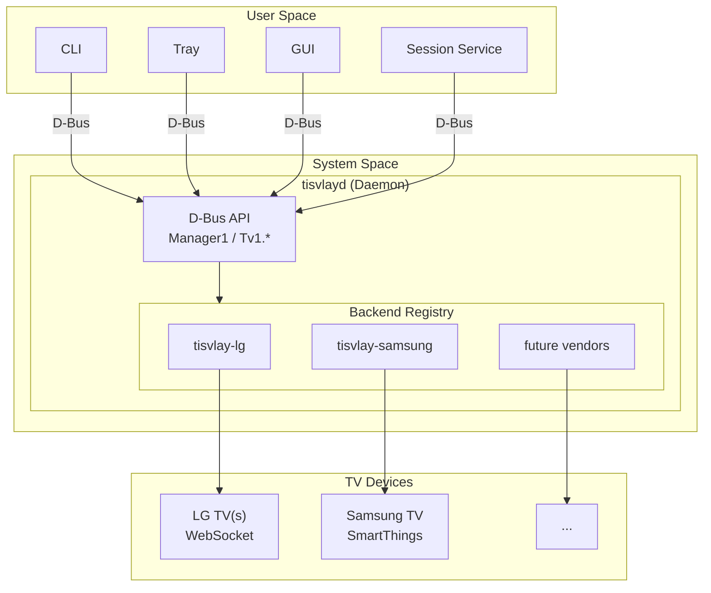

# tisvlay Multi-Vendor TV Support Design

This document describes the architecture for refactoring tisvlay from an LG WebOS-specific implementation to a vendor-agnostic architecture supporting multiple TV manufacturers.

## Executive Summary

Refactor tisvlay from an LG WebOS-specific implementation to a vendor-agnostic architecture supporting multiple TV manufacturers. This involves:

1. Extracting LG-specific code into a separate `tisvlay-lg` crate
2. Defining core traits and capability system in `tisvlay-core`
3. Redesigning D-Bus interface with per-TV object paths
4. Implementing profile-based configuration for multi-TV setups
5. Creating unified discovery and pairing abstractions

**Scope**: Full trait-based architecture with LG as the only initial implementation.

---

## Architecture Overview

### New Crate Structure

```
tisvlay/
├── Cargo.toml                      # Workspace root
├── crates/
│   ├── tisvlay-core/               # Core traits, types, D-Bus interface
│   │   └── src/
│   │       ├── lib.rs              # Public API
│   │       ├── traits.rs           # TvBackend, TvConnection traits
│   │       ├── capabilities.rs     # Capability enum and detection
│   │       ├── discovery.rs        # Discovery trait and types
│   │       ├── pairing.rs          # Pairing state machine
│   │       ├── config.rs           # Vendor-agnostic config with profiles
│   │       ├── state.rs            # TvState (generic)
│   │       ├── error.rs            # Error types
│   │       └── wol.rs              # Wake-on-LAN (unchanged, already generic)
│   │
│   ├── tisvlay-lg/                 # LG WebOS implementation (NEW)
│   │   └── src/
│   │       ├── lib.rs              # LgBackend registration
│   │       ├── backend.rs          # impl TvBackend for LgBackend
│   │       ├── client.rs           # WebOsClient (moved from core)
│   │       ├── connection.rs       # WebSocket connection (moved)
│   │       ├── protocol.rs         # SSAP messages (moved)
│   │       ├── endpoints.rs        # ssap:// URIs (moved)
│   │       ├── discovery.rs        # LG SSDP discovery
│   │       └── config.rs           # LgConfig struct
│   │
│   ├── tisvlayd/                   # System daemon (refactored)
│   │   └── src/
│   │       ├── main.rs
│   │       ├── dbus/
│   │       │   ├── mod.rs
│   │       │   ├── manager.rs      # org.tisvlay.Manager1
│   │       │   └── tv.rs           # org.tisvlay.Tv1.* interfaces
│   │       ├── tv_manager.rs       # Backend-agnostic TV management
│   │       └── registry.rs         # Backend registration
│   │
│   ├── tisvlay-cli/                # CLI (minor updates)
│   ├── tisvlay-session/            # Session service (minor updates)
│   ├── tisvlay-tray/               # Tray app (future)
│   └── tisvlay-gui/                # GUI app (future)
```

### Component Diagram



---

## Core Traits

### tisvlay-core/src/traits.rs

```rust
use async_trait::async_trait;
use crate::{Capabilities, TvState, PairingSession, DiscoveredTv, Error, Result};

/// Core trait that all TV backends must implement.
#[async_trait]
pub trait TvBackend: Send + Sync + 'static {
    /// Unique identifier for this backend (e.g., "lg", "samsung").
    fn vendor_id(&self) -> &'static str;

    /// Human-readable vendor name.
    fn vendor_name(&self) -> &'static str;

    /// Capabilities this backend supports.
    fn capabilities(&self) -> Capabilities;
}

/// Connection to a specific TV instance.
#[async_trait]
pub trait TvConnection: Send + Sync {
    /// Get the backend this connection belongs to.
    fn backend(&self) -> &dyn TvBackend;

    /// Check if the connection is active.
    fn is_connected(&self) -> bool;

    /// Get current TV state.
    async fn get_state(&mut self) -> Result<TvState>;

    /// Close the connection.
    async fn close(self: Box<Self>) -> Result<()>;
}

/// Power control capability.
#[async_trait]
pub trait PowerControl: TvConnection {
    async fn power_on(&mut self) -> Result<()>;
    async fn power_off(&mut self) -> Result<()>;
    async fn get_power_state(&mut self) -> Result<PowerState>;
}

/// Screen blanking capability (OLED-safe).
#[async_trait]
pub trait ScreenControl: TvConnection {
    async fn screen_on(&mut self) -> Result<()>;
    async fn screen_off(&mut self) -> Result<()>;
    async fn is_screen_on(&mut self) -> Result<bool>;
}

/// Volume control capability.
#[async_trait]
pub trait VolumeControl: TvConnection {
    async fn set_volume(&mut self, level: u8) -> Result<()>;
    async fn get_volume(&mut self) -> Result<u8>;
    async fn set_mute(&mut self, mute: bool) -> Result<()>;
    async fn is_muted(&mut self) -> Result<bool>;
}

/// Input switching capability.
#[async_trait]
pub trait InputControl: TvConnection {
    async fn switch_input(&mut self, input_id: &str) -> Result<()>;
    async fn get_current_input(&mut self) -> Result<Option<String>>;
    async fn list_inputs(&mut self) -> Result<Vec<InputInfo>>;
}

/// Backlight/brightness control (OLED pixel brightness).
#[async_trait]
pub trait BacklightControl: TvConnection {
    async fn set_backlight(&mut self, level: u8) -> Result<()>;
    async fn get_backlight(&mut self) -> Result<u8>;
}

/// Factory for creating connections to TVs.
#[async_trait]
pub trait TvConnector: Send + Sync {
    /// Connect to a TV with existing credentials.
    async fn connect(
        &self,
        config: &TvConfig,
        vendor_config: &dyn std::any::Any,
    ) -> Result<Box<dyn TvConnection>>;

    /// Start pairing with a new TV.
    fn start_pairing(&self, ip: &str) -> PairingSession;
}

/// Discovery of TVs on the network.
#[async_trait]
pub trait TvDiscovery: Send + Sync {
    /// Discover TVs on the local network.
    async fn discover(&self, timeout: std::time::Duration) -> Result<Vec<DiscoveredTv>>;
}
```

### tisvlay-core/src/capabilities.rs

```rust
use bitflags::bitflags;

bitflags! {
    /// Capabilities a TV backend may support.
    #[derive(Debug, Clone, Copy, PartialEq, Eq)]
    pub struct Capabilities: u32 {
        const POWER        = 0b0000_0001;  // Power on/off
        const SCREEN       = 0b0000_0010;  // Screen blank (OLED-safe)
        const VOLUME       = 0b0000_0100;  // Volume control
        const MUTE         = 0b0000_1000;  // Mute control
        const INPUT        = 0b0001_0000;  // Input switching
        const BACKLIGHT    = 0b0010_0000;  // Backlight/brightness
        const WOL          = 0b0100_0000;  // Wake-on-LAN support
        const DISCOVERY    = 0b1000_0000;  // Network discovery
    }
}

impl Capabilities {
    /// Convert to D-Bus-friendly string array.
    pub fn to_strings(&self) -> Vec<&'static str> {
        let mut caps = Vec::new();
        if self.contains(Self::POWER) { caps.push("power"); }
        if self.contains(Self::SCREEN) { caps.push("screen"); }
        if self.contains(Self::VOLUME) { caps.push("volume"); }
        if self.contains(Self::MUTE) { caps.push("mute"); }
        if self.contains(Self::INPUT) { caps.push("input"); }
        if self.contains(Self::BACKLIGHT) { caps.push("backlight"); }
        if self.contains(Self::WOL) { caps.push("wol"); }
        if self.contains(Self::DISCOVERY) { caps.push("discovery"); }
        caps
    }
}
```

---

## D-Bus Interface Specification

### Object Paths

```
/org/tisvlay/Manager              # Manager interface
/org/tisvlay/Tv/{tv_id}           # Per-TV objects (e.g., /org/tisvlay/Tv/living_room)
```

### org.tisvlay.Manager1

```xml
<interface name="org.tisvlay.Manager1">
  <!-- Discovery -->
  <method name="DiscoverTvs">
    <arg name="timeout_ms" type="u" direction="in"/>
    <arg name="tvs" type="a(sssss)" direction="out"/>
    <!-- Returns: [(id, name, ip, mac, vendor)] -->
  </method>

  <!-- TV Management -->
  <method name="AddTv">
    <arg name="ip" type="s" direction="in"/>
    <arg name="name" type="s" direction="in"/>
    <arg name="vendor" type="s" direction="in"/>
    <arg name="tv_path" type="o" direction="out"/>
  </method>

  <method name="GetTvs">
    <arg name="tv_paths" type="ao" direction="out"/>
  </method>

  <method name="GetSupportedVendors">
    <arg name="vendors" type="a(ss)" direction="out"/>
    <!-- Returns: [(vendor_id, vendor_name)] e.g., [("lg", "LG WebOS")] -->
  </method>

  <method name="ReloadConfig"/>

  <!-- Signals -->
  <signal name="TvAdded">
    <arg name="tv_path" type="o"/>
  </signal>

  <signal name="TvRemoved">
    <arg name="tv_path" type="o"/>
  </signal>
</interface>
```

### org.tisvlay.Tv1 (Base Interface)

```xml
<interface name="org.tisvlay.Tv1">
  <!-- Properties -->
  <property name="Id" type="s" access="read"/>
  <property name="Name" type="s" access="read"/>
  <property name="Vendor" type="s" access="read"/>
  <property name="Ip" type="s" access="read"/>
  <property name="Connected" type="b" access="read"/>
  <property name="Capabilities" type="as" access="read"/>

  <!-- Methods -->
  <method name="Remove"/>
  <method name="Reconnect"/>

  <!-- Pairing -->
  <method name="StartPairing"/>
  <method name="SubmitPairingInput">
    <arg name="input" type="s" direction="in"/>
  </method>
  <method name="CancelPairing"/>

  <!-- Pairing Signals -->
  <signal name="PairingStateChanged">
    <arg name="state" type="s"/>       <!-- "awaiting_tv", "awaiting_input", "complete", "failed" -->
    <arg name="message" type="s"/>     <!-- Human-readable prompt -->
    <arg name="input_type" type="s"/>  <!-- "none", "pin", "password" -->
  </signal>
</interface>
```

### Feature Interfaces (Implemented If Capability Present)

```xml
<!-- org.tisvlay.Tv1.Power -->
<interface name="org.tisvlay.Tv1.Power">
  <property name="PowerState" type="s" access="read"/>  <!-- "on", "off", "standby" -->
  <method name="PowerOn"/>
  <method name="PowerOff"/>
</interface>

<!-- org.tisvlay.Tv1.Screen -->
<interface name="org.tisvlay.Tv1.Screen">
  <property name="ScreenOn" type="b" access="read"/>
  <method name="ScreenOn"/>
  <method name="ScreenOff"/>
</interface>

<!-- org.tisvlay.Tv1.Volume -->
<interface name="org.tisvlay.Tv1.Volume">
  <property name="Volume" type="y" access="read"/>
  <property name="Muted" type="b" access="read"/>
  <method name="SetVolume">
    <arg name="level" type="y" direction="in"/>
  </method>
  <method name="SetMute">
    <arg name="mute" type="b" direction="in"/>
  </method>
</interface>

<!-- org.tisvlay.Tv1.Input -->
<interface name="org.tisvlay.Tv1.Input">
  <property name="CurrentInput" type="s" access="read"/>
  <property name="AvailableInputs" type="a(ss)" access="read"/>  <!-- [(id, label)] -->
  <method name="SwitchInput">
    <arg name="input_id" type="s" direction="in"/>
  </method>
</interface>

<!-- org.tisvlay.Tv1.Backlight -->
<interface name="org.tisvlay.Tv1.Backlight">
  <property name="Backlight" type="y" access="read"/>
  <method name="SetBacklight">
    <arg name="level" type="y" direction="in"/>
  </method>
</interface>
```

---

## Configuration Schema

### config.toml

```toml
# =============================================================================
# Profiles (session behavior presets)
# =============================================================================

# Default profile - fallback for any unspecified settings
[profiles.default]
on_screen_lock = "screen_off"
on_screen_unlock = "screen_on"
on_greeter_wake = "screen_on"
on_sleep = "power_off"
on_wake = "power_on"
idle_timeout_seconds = 0
on_idle_timeout = "none"

# Desk profile - for office/work setups
[profiles.desk]
idle_timeout_seconds = 300
on_idle_timeout = "screen_off"

# Gaming profile - don't interrupt gameplay
[profiles.gaming]
on_screen_lock = "none"
idle_timeout_seconds = 0

# =============================================================================
# Daemon settings
# =============================================================================

[daemon]
wake_on_boot = true
wake_delay_ms = 3000
connect_timeout_ms = 5000
reconnect_interval_ms = 10000

# =============================================================================
# TV definitions
# =============================================================================

[[tv]]
id = "living-room"
name = "Living Room G4"
ip = "192.168.1.100"
mac = "AA:BB:CC:DD:EE:FF"         # Optional - for WoL
vendor = "lg"
profile = "gaming"                 # Optional - defaults to "default"

# Display-aware settings
hdmi_input = "HDMI_1"              # Which input this PC uses
only_when_active = true            # Only control when TV is on this input

# Vendor-specific configuration
[tv.lg]
client_key = "abc123..."
default_input = "HDMI_1"

[[tv]]
id = "office-left"
name = "Office Left C3"
ip = "192.168.1.101"
mac = "AA:BB:CC:DD:EE:01"
vendor = "lg"
profile = "desk"
hdmi_input = "HDMI_2"
only_when_active = false           # Control regardless of current input

[tv.lg]
client_key = "def456..."
default_input = "HDMI_2"
```

### Rust Config Structures

```rust
// tisvlay-core/src/config.rs

#[derive(Debug, Clone, Serialize, Deserialize)]
pub struct Config {
    #[serde(default)]
    pub profiles: HashMap<String, ProfileConfig>,

    #[serde(default)]
    pub daemon: DaemonConfig,

    #[serde(default)]
    pub tv: Vec<TvConfig>,
}

#[derive(Debug, Clone, Serialize, Deserialize)]
pub struct ProfileConfig {
    #[serde(default)]
    pub on_screen_lock: SessionAction,
    #[serde(default)]
    pub on_screen_unlock: SessionAction,
    #[serde(default)]
    pub on_greeter_wake: SessionAction,
    #[serde(default)]
    pub on_sleep: SessionAction,
    #[serde(default)]
    pub on_wake: SessionAction,
    #[serde(default)]
    pub idle_timeout_seconds: u64,
    #[serde(default)]
    pub on_idle_timeout: SessionAction,
}

#[derive(Debug, Clone, Serialize, Deserialize)]
pub struct TvConfig {
    pub id: String,
    pub name: String,
    pub ip: String,
    #[serde(default)]
    pub mac: Option<String>,
    pub vendor: String,

    #[serde(default = "default_profile")]
    pub profile: String,

    // Display-aware settings
    #[serde(default)]
    pub hdmi_input: Option<String>,
    #[serde(default)]
    pub only_when_active: bool,

    // Vendor-specific config (only one will be present)
    #[serde(default)]
    pub lg: Option<LgConfig>,
    // Future: samsung, sony, roku, etc.
}

fn default_profile() -> String {
    "default".to_string()
}

// tisvlay-lg/src/config.rs
#[derive(Debug, Clone, Serialize, Deserialize)]
pub struct LgConfig {
    pub client_key: Option<String>,
    pub default_input: Option<String>,
}
```

---

## Migration Notes

### Breaking Changes
- D-Bus interface completely redesigned (per-TV objects)
- Config file format changed (profiles, nested vendor config)
- CLI output format may change

### Migration Path
1. Old configs will not parse - users need to migrate manually
2. Provide migration script or clear upgrade instructions
3. Session service config moves from `[session]` to `[profiles.default]`

### Backwards Compatibility
Not a concern - project is in prototyping stage.
