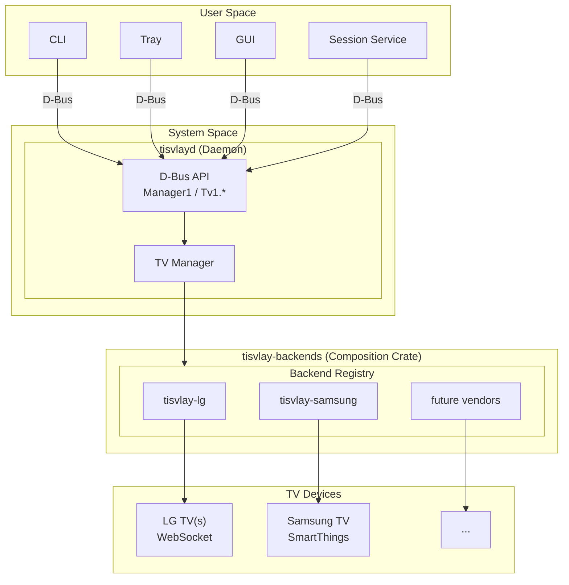

# tisvlay Multi-Vendor TV Support Design

This document describes the architecture for refactoring tisvlay from an LG WebOS-specific implementation to a vendor-agnostic architecture supporting multiple TV manufacturers.

> **Implementation Status**: Phases 1-4.5 complete. See [multi-vendor-implementation-plan.md](multi-vendor-implementation-plan.md) for details.

## Executive Summary

Refactor tisvlay from an LG WebOS-specific implementation to a vendor-agnostic architecture supporting multiple TV manufacturers. This involves:

1. Extracting LG-specific code into a separate `tisvlay-lg` crate
2. Defining core traits and capability system in `tisvlay-core`
3. Redesigning D-Bus interface with per-TV object paths
4. Implementing profile-based configuration for multi-TV setups
5. Creating unified discovery and pairing abstractions

**Scope**: Full trait-based architecture with LG as the only initial implementation.

---

## Architecture Overview

### New Crate Structure

```
tisvlay/
├── Cargo.toml                      # Workspace root
├── crates/
│   ├── tisvlay-core/               # Core traits, types, D-Bus interface
│   │   └── src/
│   │       ├── lib.rs              # Public API
│   │       ├── traits.rs           # TvBackend, TvConnection traits
│   │       ├── capabilities.rs     # Capability enum and detection
│   │       ├── discovery.rs        # Discovery trait and types
│   │       ├── pairing.rs          # Pairing state machine
│   │       ├── config.rs           # Vendor-agnostic config with profiles
│   │       ├── state.rs            # TvState (generic)
│   │       ├── error.rs            # Error types
│   │       └── wol.rs              # Wake-on-LAN (unchanged, already generic)
│   │
│   ├── tisvlay-lg/                 # LG WebOS implementation
│   │   └── src/
│   │       ├── lib.rs              # LgBackend registration
│   │       ├── backend.rs          # impl TvBackend for LgBackend
│   │       ├── client.rs           # WebOsClient (moved from core)
│   │       ├── connection.rs       # WebSocket connection (moved)
│   │       ├── protocol.rs         # SSAP messages (moved)
│   │       ├── endpoints.rs        # ssap:// URIs (moved)
│   │       ├── discovery.rs        # LG SSDP discovery
│   │       └── config.rs           # LgConfig struct
│   │
│   ├── tisvlay-backends/           # Composition crate (imports all vendors)
│   │   └── src/
│   │       └── lib.rs              # create_registry() with all vendors
│   │
│   ├── tisvlayd/                   # System daemon (vendor-agnostic)
│   │   └── src/
│   │       ├── main.rs
│   │       ├── dbus/
│   │       │   ├── mod.rs
│   │       │   ├── manager.rs      # org.tisvlay.Manager1
│   │       │   └── tv.rs           # org.tisvlay.Tv1.* interfaces
│   │       └── tv_manager.rs       # Backend-agnostic TV management
│   │
│   ├── tisvlay-cli/                # CLI (vendor-agnostic)
│   ├── tisvlay-session/            # Session service (vendor-agnostic)
│   ├── tisvlay-tray/               # Tray app (future, vendor-agnostic)
│   └── tisvlay-gui/                # GUI app (future, vendor-agnostic)
```

### Dependency Graph

```
tisvlay-core (traits, types, D-Bus client)
      ↑
tisvlay-lg, tisvlay-samsung, ... (vendor implementations)
      ↑
tisvlay-backends (composition - ONLY crate that imports vendors)
      ↑
tisvlayd, tisvlay-cli, tisvlay-session, tisvlay-gui, tisvlay-tray
```

**Key principle**: Only `tisvlay-backends` knows about vendor crates. All binaries are vendor-agnostic.

### Component Diagram



### Abstraction Boundaries

**Critical rule**: Only `tisvlay-backends` imports vendor crates. All binaries are vendor-agnostic.

```
┌─────────────────────────────────────────────────────────────────┐
│                       All binaries                              │
│  tisvlayd, tisvlay-cli, tisvlay-session, tisvlay-tray, etc.     │
│                                                                 │
│  May import: tisvlay-core, tisvlay-backends                     │
│  Must NOT import: tisvlay-lg, tisvlay-samsung, etc. directly    │
└─────────────────────────────────────────────────────────────────┘
                              │
                              │ uses create_registry()
                              ▼
┌─────────────────────────────────────────────────────────────────┐
│                    tisvlay-backends                             │
│                    (Composition Crate)                          │
│                                                                 │
│  Imports: tisvlay-core, tisvlay-lg, tisvlay-samsung, etc.       │
│  Exports: create_registry() → BackendRegistry with all vendors  │
│  ONLY place that knows about vendor implementations             │
└─────────────────────────────────────────────────────────────────┘
                              │
                              │ implements traits from
                              ▼
┌─────────────────────────────────────────────────────────────────┐
│                       tisvlay-core                              │
│                                                                 │
│  Defines: TvBackend, TvConnection, feature traits               │
│  No vendor knowledge                                            │
└─────────────────────────────────────────────────────────────────┘
```

This ensures:
- Adding a new vendor only requires updating `tisvlay-backends`
- All binaries (daemon, CLI, GUI, session) remain vendor-agnostic
- No `if vendor == "lg"` checks or downcasts in any binary code

---

## Core Traits

### Trait Hierarchy

```text
TvBackend (metadata: vendor_id, vendor_name, capabilities)
    |
    +-- TvConnector (factory: connect, wake, pair, display_address)
    |
    +-- TvDiscovery (network discovery)

TvConnection (base + feature methods with default not-supported impls)
    +-- power_off, get_power_state
    +-- screen_on, screen_off, is_screen_on
    +-- set_volume, get_volume, set_mute, is_muted
    +-- switch_input, get_current_input, list_inputs
    +-- set_backlight, get_backlight
```

### Transport Agnosticism

The connector interface is fully transport-agnostic. All transport details (IP addresses, serial ports, CEC addresses, etc.) are encapsulated in the vendor config (`toml::Value`), which only the vendor crate knows how to interpret. The daemon and CLI never see transport-specific types.

### tisvlay-core/src/traits.rs

```rust
use async_trait::async_trait;
use crate::{Capabilities, TvState, PairingSession, DiscoveredTv, Error, Result};

/// Core trait that all TV backends must implement.
pub trait TvBackend: Send + Sync + 'static {
    fn vendor_id(&self) -> &'static str;
    fn vendor_name(&self) -> &'static str;
    fn capabilities(&self) -> Capabilities;
}

/// Connection to a specific TV instance.
///
/// Feature methods have default implementations that return Error::NotSupported,
/// so backends only need to override the methods they support. Use capabilities()
/// to check which features are available before calling feature methods.
#[async_trait]
pub trait TvConnection: Send + Sync {
    fn vendor_id(&self) -> &'static str;
    fn is_connected(&self) -> bool;
    async fn get_state(&mut self) -> Result<TvState>;
    async fn close(&mut self) -> Result<()>;
    fn capabilities(&self) -> Capabilities;

    // Power control (default: not supported)
    async fn power_off(&mut self) -> Result<()> { Err(Error::not_supported("power_off", Capabilities::POWER)) }
    async fn get_power_state(&mut self) -> Result<PowerState> { Err(Error::not_supported("get_power_state", Capabilities::POWER)) }

    // Screen control (default: not supported)
    async fn screen_on(&mut self) -> Result<()> { Err(Error::not_supported("screen_on", Capabilities::SCREEN)) }
    async fn screen_off(&mut self) -> Result<()> { Err(Error::not_supported("screen_off", Capabilities::SCREEN)) }
    async fn is_screen_on(&mut self) -> Result<bool> { Err(Error::not_supported("is_screen_on", Capabilities::SCREEN)) }

    // Volume control (default: not supported)
    async fn set_volume(&mut self, _level: u8) -> Result<()> { Err(Error::not_supported("set_volume", Capabilities::VOLUME)) }
    async fn get_volume(&mut self) -> Result<u8> { Err(Error::not_supported("get_volume", Capabilities::VOLUME)) }
    async fn set_mute(&mut self, _mute: bool) -> Result<()> { Err(Error::not_supported("set_mute", Capabilities::MUTE)) }
    async fn is_muted(&mut self) -> Result<bool> { Err(Error::not_supported("is_muted", Capabilities::MUTE)) }

    // Input control (default: not supported)
    async fn switch_input(&mut self, _input_id: &str) -> Result<()> { Err(Error::not_supported("switch_input", Capabilities::INPUT)) }
    async fn get_current_input(&mut self) -> Result<Option<String>> { Err(Error::not_supported("get_current_input", Capabilities::INPUT)) }
    async fn list_inputs(&mut self) -> Result<Vec<InputInfo>> { Err(Error::not_supported("list_inputs", Capabilities::INPUT)) }

    // Backlight control (default: not supported)
    async fn set_backlight(&mut self, _level: u8) -> Result<()> { Err(Error::not_supported("set_backlight", Capabilities::BACKLIGHT)) }
    async fn get_backlight(&mut self) -> Result<u8> { Err(Error::not_supported("get_backlight", Capabilities::BACKLIGHT)) }
}

/// Factory for creating connections to TVs.
///
/// All transport details are encapsulated in vendor_config (toml::Value).
/// The connector deserializes it into its own config type internally.
#[async_trait]
pub trait TvConnector: Send + Sync {
    /// Connect to a TV using vendor-specific config.
    async fn connect(&self, vendor_config: &toml::Value) -> Result<Box<dyn TvConnection>>;

    /// Human-readable address for logging and UI (e.g., IP, serial port, CEC address).
    fn display_address(&self, vendor_config: &toml::Value) -> String;

    /// Whether this transport supports waking the device from standby.
    fn supports_wake(&self, vendor_config: &toml::Value) -> bool;

    /// Wake the device from standby (e.g., WoL, CEC power-on).
    async fn wake(&self, vendor_config: &toml::Value) -> Result<()>;

    /// Start pairing with a new device.
    fn start_pairing(&self, vendor_config: &toml::Value) -> Result<PairingSession>;

    /// Build vendor config from pairing results for persistence.
    fn build_config_from_pairing(
        &self,
        pairing_params: &toml::Value,
        credentials: &Credentials,
    ) -> Result<toml::Value>;
}

/// Discovery of TVs on the network.
#[async_trait]
pub trait TvDiscovery: Send + Sync {
    async fn discover(&self, timeout: std::time::Duration) -> Result<Vec<DiscoveredTv>>;
}
```

Separate feature traits (`PowerControl`, `ScreenControl`, `VolumeControl`, `InputControl`, `BacklightControl`) still exist for use as trait bounds in generic code, but `TvConnection` is the primary interface used by the daemon and CLI.

### tisvlay-core/src/capabilities.rs

```rust
use bitflags::bitflags;

bitflags! {
    /// Capabilities a TV backend may support.
    #[derive(Debug, Clone, Copy, PartialEq, Eq)]
    pub struct Capabilities: u32 {
        const POWER        = 0b0000_0001;
        const SCREEN       = 0b0000_0010;
        const VOLUME       = 0b0000_0100;
        const MUTE         = 0b0000_1000;
        const INPUT        = 0b0001_0000;
        const BACKLIGHT    = 0b0010_0000;
        const WOL          = 0b0100_0000;
        const DISCOVERY    = 0b1000_0000;
        const ALL          = Self::POWER.bits() | Self::SCREEN.bits()
                           | Self::VOLUME.bits() | Self::MUTE.bits()
                           | Self::INPUT.bits() | Self::BACKLIGHT.bits()
                           | Self::WOL.bits() | Self::DISCOVERY.bits();
    }
}
```

---

## D-Bus Interface Specification

### Object Paths

```
/org/tisvlay/Manager              # Manager interface
/org/tisvlay/Tv/{tv_id}           # Per-TV objects (e.g., /org/tisvlay/Tv/living_room)
```

### org.tisvlay.Manager1

```xml
<interface name="org.tisvlay.Manager1">
  <!-- Discovery -->
  <method name="DiscoverTvs">
    <arg name="timeout_ms" type="u" direction="in"/>
    <arg name="tvs" type="a(sssss)" direction="out"/>
    <!-- Returns: [(id, name, address, hardware_id, vendor)] -->
  </method>

  <!-- TV Management -->
  <method name="AddTv">
    <arg name="name" type="s" direction="in"/>
    <arg name="vendor" type="s" direction="in"/>
    <arg name="config_json" type="s" direction="in"/>
    <!-- config_json: vendor-specific connection params as JSON -->
    <!-- e.g., {"ip": "192.168.1.100", "mac": "AA:BB:CC:DD:EE:FF"} for LG -->
    <arg name="tv_path" type="o" direction="out"/>
  </method>

  <method name="GetTvs">
    <arg name="tv_paths" type="ao" direction="out"/>
  </method>

  <method name="GetSupportedVendors">
    <arg name="vendors" type="a(ss)" direction="out"/>
    <!-- Returns: [(vendor_id, vendor_name)] e.g., [("lg", "LG WebOS")] -->
  </method>

  <method name="ReloadConfig"/>

  <!-- Signals -->
  <signal name="TvAdded">
    <arg name="tv_path" type="o"/>
  </signal>

  <signal name="TvRemoved">
    <arg name="tv_path" type="o"/>
  </signal>
</interface>
```

### org.tisvlay.Tv1 (Base Interface)

```xml
<interface name="org.tisvlay.Tv1">
  <!-- Properties -->
  <property name="Id" type="s" access="read"/>
  <property name="Name" type="s" access="read"/>
  <property name="Vendor" type="s" access="read"/>
  <property name="Address" type="s" access="read"/>  <!-- transport-agnostic display address -->
  <property name="Connected" type="b" access="read"/>
  <property name="Capabilities" type="as" access="read"/>

  <!-- Methods -->
  <method name="Remove"/>
  <method name="Reconnect"/>

  <!-- Pairing -->
  <method name="StartPairing"/>
  <method name="SubmitPairingInput">
    <arg name="input" type="s" direction="in"/>
  </method>
  <method name="CancelPairing"/>

  <!-- Pairing Signals -->
  <signal name="PairingStateChanged">
    <arg name="state" type="s"/>       <!-- "awaiting_tv", "awaiting_input", "complete", "failed" -->
    <arg name="message" type="s"/>     <!-- Human-readable prompt -->
    <arg name="input_type" type="s"/>  <!-- "none", "pin", "password" -->
  </signal>
</interface>
```

### Feature Interfaces (Implemented If Capability Present)

```xml
<!-- org.tisvlay.Tv1.Power -->
<interface name="org.tisvlay.Tv1.Power">
  <property name="PowerState" type="s" access="read"/>  <!-- "on", "off", "standby" -->
  <method name="PowerOn"/>
  <method name="PowerOff"/>
</interface>

<!-- org.tisvlay.Tv1.Screen -->
<interface name="org.tisvlay.Tv1.Screen">
  <property name="ScreenOn" type="b" access="read"/>
  <method name="ScreenOn"/>
  <method name="ScreenOff"/>
</interface>

<!-- org.tisvlay.Tv1.Volume -->
<interface name="org.tisvlay.Tv1.Volume">
  <property name="Volume" type="y" access="read"/>
  <property name="Muted" type="b" access="read"/>
  <method name="SetVolume">
    <arg name="level" type="y" direction="in"/>
  </method>
  <method name="SetMute">
    <arg name="mute" type="b" direction="in"/>
  </method>
</interface>

<!-- org.tisvlay.Tv1.Input -->
<interface name="org.tisvlay.Tv1.Input">
  <property name="CurrentInput" type="s" access="read"/>
  <property name="AvailableInputs" type="a(ss)" access="read"/>  <!-- [(id, label)] -->
  <method name="SwitchInput">
    <arg name="input_id" type="s" direction="in"/>
  </method>
</interface>

<!-- org.tisvlay.Tv1.Backlight -->
<interface name="org.tisvlay.Tv1.Backlight">
  <property name="Backlight" type="y" access="read"/>
  <method name="SetBacklight">
    <arg name="level" type="y" direction="in"/>
  </method>
</interface>
```

---

## Configuration Schema

### config.toml

```toml
# =============================================================================
# Profiles (session behavior presets)
# =============================================================================

# Default profile - fallback for any unspecified settings
[profiles.default]
on_screen_lock = "screen_off"
on_screen_unlock = "screen_on"
on_greeter_wake = "screen_on"
on_sleep = "power_off"
on_wake = "power_on"
idle_timeout_seconds = 0
on_idle_timeout = "none"

# Desk profile - for office/work setups
[profiles.desk]
idle_timeout_seconds = 300
on_idle_timeout = "screen_off"

# Gaming profile - don't interrupt gameplay
[profiles.gaming]
on_screen_lock = "none"
idle_timeout_seconds = 0

# =============================================================================
# Daemon settings
# =============================================================================

[daemon]
wake_on_boot = true
wake_delay_ms = 3000
connect_timeout_ms = 5000
reconnect_interval_ms = 10000

# =============================================================================
# TV definitions
# =============================================================================

[[tv]]
id = "living-room"
name = "Living Room G4"
vendor = "lg"
profile = "gaming"                 # Optional - defaults to "default"

# Display-aware settings
hdmi_input = "HDMI_1"              # Which input this PC uses
only_when_active = true            # Only control when TV is on this input

# Vendor-specific configuration (includes connection parameters)
[tv.lg]
ip = "192.168.1.100"               # LG-specific: WebSocket connection
mac = "AA:BB:CC:DD:EE:FF"          # LG-specific: Wake-on-LAN (optional)
client_key = "abc123..."
default_input = "HDMI_1"

[[tv]]
id = "office-left"
name = "Office Left C3"
vendor = "lg"
profile = "desk"
hdmi_input = "HDMI_2"
only_when_active = false           # Control regardless of current input

[tv.lg]
ip = "192.168.1.101"
mac = "AA:BB:CC:DD:EE:01"
client_key = "def456..."
default_input = "HDMI_2"
```

### Rust Config Structures

```rust
// tisvlay-core/src/config.rs

#[derive(Debug, Clone, Serialize, Deserialize)]
pub struct Config {
    #[serde(default)]
    pub daemon: DaemonConfig,
    #[serde(default)]
    pub profiles: HashMap<String, ProfileConfig>,
    #[serde(default)]
    pub tv: Vec<TvConfig>,
}

/// TV configuration - vendor-agnostic identity and behavior settings.
/// Connection parameters (ip, mac, etc.) are in vendor-specific sections.
#[derive(Debug, Clone, Serialize, Deserialize)]
pub struct TvConfig {
    pub id: String,
    pub name: String,
    #[serde(default = "default_vendor")]
    pub vendor: String,
    #[serde(default = "default_profile")]
    pub profile: String,
    #[serde(skip_serializing_if = "Option::is_none")]
    pub hdmi_input: Option<String>,
    #[serde(default)]
    pub only_when_active: bool,

    /// Vendor-specific configuration (flattened).
    /// Captures vendor-specific fields (e.g., `lg = { ip = "...", client_key = "..." }`).
    /// Use `get_vendor_config::<T>()` to deserialize, or `get_raw_vendor_value()`
    /// to pass the raw toml::Value to a TvConnector.
    #[serde(flatten)]
    pub vendor_config: HashMap<String, toml::Value>,
}
```

Key design: `TvConfig` does not contain any typed vendor config (no `Option<LgVendorConfig>`). Instead, vendor configs are captured as raw `toml::Value` via `#[serde(flatten)]`. This means `tisvlay-core` has zero knowledge of vendor-specific types. Vendor crates define their own config structs (e.g., `LgVendorConfig` in `tisvlay-lg/src/config.rs`) and deserialize from the `toml::Value` internally.

---

## Migration Notes

### Breaking Changes
- D-Bus interface completely redesigned (per-TV objects at `/org/tisvlay/Tv/{id}`)
- D-Bus `Tv1.Ip` property renamed to `Tv1.Address` (transport-agnostic)
- D-Bus `Manager1.AddTv` signature changed: `(ip, name, vendor, mac)` -> `(name, vendor, config_json)`
- Config file format changed (profiles, nested vendor config)
- `ip` and `mac` moved from root `[[tv]]` to vendor-specific `[tv.lg]` section
- CLI `pair` command: positional arg changed from `ip` to `address`, `--mac` to `--wake-id`, added `--vendor`
- `DiscoveredTv` fields renamed: `ip` -> `address`, `mac` -> `hardware_id`
- `Capabilities::LG_ALL` renamed to `Capabilities::ALL`

### Migration Path
1. Old configs will not parse - users need to migrate manually
2. Move `ip` and `mac` from `[[tv]]` section to `[tv.lg]` section
3. Provide migration script or clear upgrade instructions
4. Session service config moves from `[session]` to `[profiles.default]`

### Backwards Compatibility
Not a concern - project is in prototyping stage.
