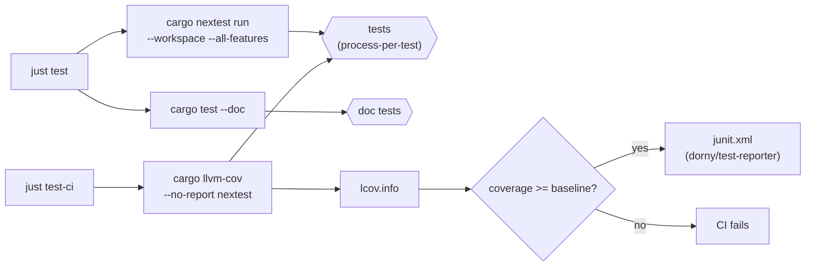
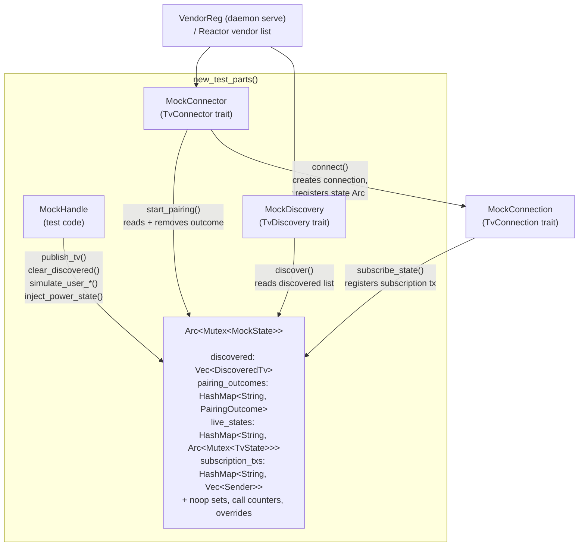
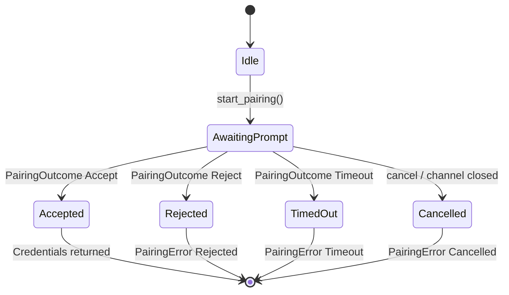
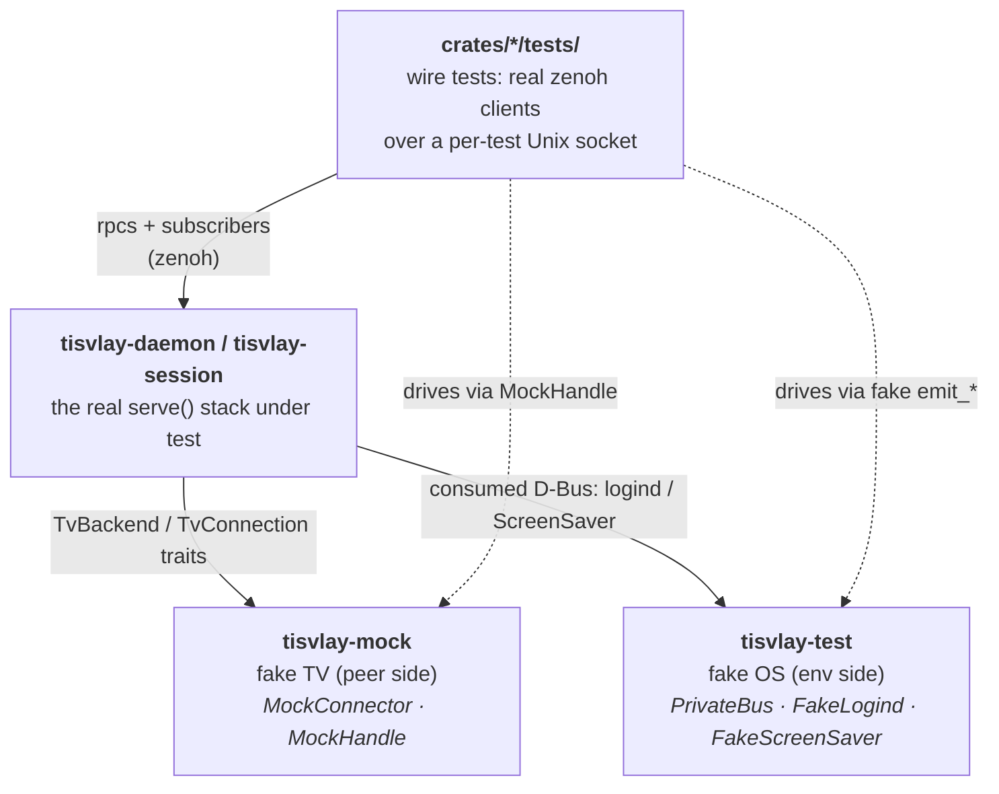
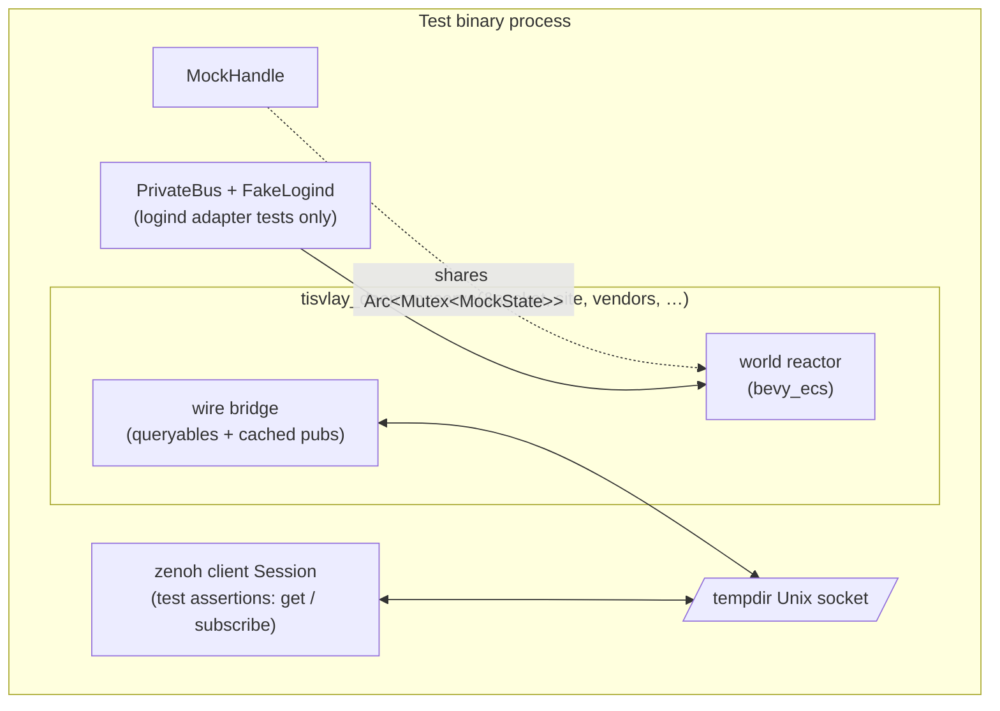

# Testing

This is the single source of truth for how testing works in tisvlay. For quick-reference commands, see the `Tasks & Commands` section in [CLAUDE.md](../.claude/CLAUDE.md). For the architecture (two-socket topology, key space, persistence), see [architecture.md](architecture.md).

## Overview

The testing framework is designed around six principles:

1. **Low friction** — adding a test should be cheap so more tests get written
2. **Regression safety** — catch bugs before they hit production
3. **Coverage as a ratchet** — new code must not lower the baseline
4. **LLM-friendly conventions** — predictable layout, fast feedback, structured output
5. **CI visibility** — results inline on every PR
6. **No real hardware required** — the mock backend enables testing pairing, discovery, profiles, and UX without a TV on the network

## Test runner: cargo-nextest

All compiled tests run through [cargo-nextest](https://nexte.st/). Doc tests use `cargo test --doc` (nextest doesn't support them yet).

```bash
just test         # nextest + doc tests
just test-ci      # nextest with 'ci' profile + coverage + ratchet
```

Configuration: `.config/nextest.toml` with two profiles:

| Profile | Retries | Slow warning | Output |
|---------|---------|--------------|--------|
| `default` | 0 | 60s | terminal |
| `ci` | 0 | 30s | JUnit XML at `target/nextest/ci/junit.xml` |

**Process-per-test isolation** is nextest's default and the canonical runner, since wire tests each boot a full daemon (or daemon + session service) stack — a zenoh runtime on a per-test temp Unix socket, netlink sockets, and for the consumed-D-Bus adapters a private `dbus-daemon`. The suite doesn't *depend* on it, though: plain `cargo test --workspace --all-features` passes too, with each binary's tests concurrent in one process. That holds because every rig binds its own sockets, and tests that own well-known D-Bus names take a [`PrivateBus::isolated`](#privatebus) bus of their own. Keep it that way: a test that only passes alone in its process is relying on an accident.

### One integration-test binary per crate

Each crate compiles its integration tests into a single binary. Where a crate has several suites, they are modules of `tests/it/main.rs` (`tests/it/wire.rs`, `tests/it/profiles.rs`, …). A crate with one suite keeps a single `tests/<name>.rs`.

- **Why:** every `tests/*.rs` file is a separate crate, and each one compiles and links the whole stack again. Folding the daemon's seven suites into one binary took its test binaries from 791 MB to about 125 MB, and the rebuild after a daemon edit from 2.4 s to 1.8 s. Across the workspace, 46 test binaries became 33.
- **Shared helpers are plain modules** (`tests/it/support/mod.rs`, declared once in `main.rs` and imported with `use crate::support;`). Dead code in them is evaluated once, so they need no `dead_code` allow.
- **Filtering:** a multi-suite crate's binary is named `it`; a single-suite crate's takes its file's name (`tisvlay-session::session`). Select one suite with a nextest filter such as `cargo nextest run --workspace --all-features -E 'binary_id(tisvlay-daemon::it) & test(/^wire::/)'`. Use `--workspace`, not `-p`: tokio's `test-util` only unifies across the workspace build.
- **Add a new suite** as a module beside the others, not as a new `tests/*.rs` file.

### Flaky tests are quarantined, never retried

Both nextest profiles run with `retries = 0`; a retry hides a flaky test and lets it rot. When a test turns out to be flaky:

1. File an issue with the failure output.
2. Mark the test `#[ignore = "flaky: #N"]`, so the reason and the tracking issue sit on the test.
3. Fix it or delete it. A quarantined test has no permanent home.

### Test execution pipeline



## Test types

| Type | Location | Tool | When |
|------|----------|------|------|
| Unit | `#[cfg(test)] mod tests` in source | built-in | every change |
| Integration | `crates/*/tests/` (one binary per crate; `tests/it/` when there are several suites) | built-in | every change |
| Doc | `///` examples in `pub` items | `cargo test --doc` | every change |
| Parameterized | unit/integration | `rstest` | every change |
| Property | unit/integration | `proptest` | every change |
| Mock backend | `tisvlay-world/tests/`, `tisvlay-daemon/tests/`, other binary crates' `tests/` | mock crate | every change |

### Parameterized tests (rstest)

One test function, many inputs. Each case reported individually by nextest.

```rust
use rstest::rstest;

#[rstest]
#[case::colons("AA:BB:CC:DD:EE:FF")]
#[case::dashes("AA-BB-CC-DD-EE-FF")]
#[case::plain("AABBCCDDEEFF")]
fn mac_parse_accepts_separator_styles(#[case] input: &str) {
    assert!(MacAddress::parse(input).is_ok());
}
```

### Property tests (proptest)

Discovers unknown failures via random inputs, shrinks to minimal repro.

```rust
use proptest::prelude::*;

proptest! {
    #[test]
    fn mac_parse_display_roundtrip(bytes in any::<[u8; 6]>()) {
        let original = MacAddress(bytes);
        let parsed = MacAddress::parse(&original.to_string()).unwrap();
        prop_assert_eq!(parsed, original);
    }
}
```

When a proptest fails, it writes a `.proptest-regressions` file. **Commit these files** — they replay the failing seed on future runs. Don't commit one produced by a deliberate mutation check: it records a bug that was never real.

**Every parser of outside input has a "never panics" property.** Each feeds arbitrary input, shaped toward what the parser reads where that helps, and asserts only that it returns: the SSDP decoder, the EDID probe, the LG power-state payload, CEC input ids and OSD-name clamping, and MAC parsing. A sharper invariant goes in where one exists: the clamped OSD name always fits CEC's 14-byte operand. See `docs/build.md` § Lint policy, "Parsers of outside input".

## LG backend testing

The `tisvlay-lg` crate has its own fake SSAP server for testing without a real TV. See [docs/lg/testing.md](lg/testing.md) for details.

### On-hardware triage tooling

Two Python scripts under `scripts/` complement the in-process LG tests by talking to a real TV. Both open their own SSAP WebSocket using the daemon's stored client key — stop the daemon (or stop the tray/GUI/session, leaving the daemon alone is OK too if it isn't holding the only registration) before running, so two clients don't fight over the same key.

- [`scripts/probe_power_state_timing.py`](../scripts/probe_power_state_timing.py) — wide-net probe of the SSAP power/screen subscription endpoints. Discovers what the firmware exposes (`getServiceList`), subscribes to a candidate set, fires SSAP `turnOff`, and prints every subscription push with elapsed time from the trigger. Used to characterize the `processing` / `onOff` discriminator behavior in the `getPowerState` payload — see [docs/lg/firmware-quirks.md](lg/firmware-quirks.md) for the captured payloads that motivated the parser changes.
- [`scripts/triage_dispatch_perf.py`](../scripts/triage_dispatch_perf.py) — autonomous cold-start latency measurement. Induces a bad state (SSAP `turnOff` or a manual prompt for kernel-level packet drops), watches the daemon's published power state, requests screen-on — the user-facing entry point — and times the transition to `"active"`. Useful for benchmarking changes to the dispatch hot path without driving the desktop lock/unlock flow by hand. The 10 s `REQUEST_MS` "with_retry knock" finding in firmware-quirks.md was characterized with this script.

## Coverage

Measured with `cargo-llvm-cov`, ratcheted in CI.

```bash
just cov          # text summary
just cov-html     # HTML report in browser
just cov-lcov     # lcov.info for VS Code Coverage Gutters
just cov-ratchet  # fails if below baseline (CI uses this)
```

The baseline lives in `justfile` as `cov_baseline_lines`. Bump it on PRs that improve coverage; never lower it. Run `just cov` to see the current number.

A failing test doesn't hide the report: the local `cov*` recipes run every test (`--no-fail-fast`), render the coverage of what ran, then exit with the test status ("tests failed … coverage reflects a failing run"). `cov-ratchet` checks that status first and fails before comparing, so partial coverage never passes or moves the baseline; `test-ci` stays fail-fast.

CI runs the full check pipeline (`clippy` + `nextest` + doc tests + coverage report) under a single coverage-instrumented build via `cargo llvm-cov show-env --sh`, so all four stages share `target/llvm-cov-target/` instead of recompiling the workspace twice. Every stage runs `--all-features`, same as local `just test`. Dev-only code is excluded from the coverage denominator via the `cov_exclude` regex in the justfile — `(tisvlay-(test|mock)/|test_server)` — so test infrastructure doesn't count against the ratchet. See [docs/build.md](build.md) "Build pipeline" for design rationale and upstream tracking.

## Mock backend (tisvlay-mock)

Implements the full `TvBackend` / `TvConnector` / `TvConnection` / `TvDiscovery` trait surface with an in-memory state machine. The mock is always compiled into the daemon — no feature gate. Two constructors split test and production use:

- `new_test_parts()` → `(MockConnector, MockDiscovery, MockHandle)` sharing a fresh state — tests drive discovery and pairing via the handle.
- `new_production_parts()` → `(MockConnector, MockDiscovery)` with no handle — the daemon's production vendor list registers this pair, so production code cannot reach the test hooks. Discovery returns an empty list; pairing falls back to the config shorthand.

Key properties:
- Reports `Transport::Network` and `survives_source_ip_change() -> false` (same paths as LG)
- `subscribe_state()` returns a real `mpsc::UnboundedReceiver<TvState>` pushing cumulative snapshots on every mutation (mirrors LG's SSAP model)
- Pairing state machine matches LG's two-phase flow

### Shared state architecture

The mock's three consumers share a single `Arc<Mutex<MockState>>`. The handle is the test's control surface; the connector and discovery are the trait implementations the world reactor calls.



### Pairing state machine

The mock mirrors LG's two-phase pairing flow. `PairingOutcome` is seeded by the test (via handle or config shorthand) before `start_pairing()` consumes it.



### MockHandle — test-driven control surface

Tests drive discovery and pairing via `MockHandle`:

```rust
let (connector, discovery, mock) = tisvlay_mock::new_test_parts();

mock.publish_tv(DiscoveredTv::new("lr", "Living Room", "mock://lr", "mock"));
mock.simulate_user_accept("mock://lr");

// Register the parts with the daemon (VendorReg) or the world reactor,
// then start a discovery session / pairing — it auto-accepts.
```

**Methods:**
- `publish_tv(DiscoveredTv)` / `clear_discovered()` / `discovered_count()` — populate/inspect the "network"
- `simulate_user_accept(tv_id)` / `simulate_user_reject(tv_id)` / `simulate_pairing_timeout(tv_id)` — drive pairing
- `set_hardware_id(tv_id, HardwareId)` / `clear_hardware_id(tv_id)` — seed the identity reported by a future connection (applied on every connect, not consumed)
- `set_connect_delay(Duration)` / `clear_connect_delay()` — simulate a slow/unreachable TV
- `inject_power_state(address, PowerState)` — push a power-state change onto a live mock connection. Mutates the in-flight `TvState` and pushes the snapshot through every active subscription for that address, so the world publishes the new state on the wire the same way it would for a real backend-initiated change.
- `inject_power_state_silent(address, PowerState)` — same mutation, no subscription push — simulates a TV whose state drifted without telling us
- `set_screen_on_noop(address, bool)` / `set_screen_off_noop(address, bool)` — make screen commands accept-but-do-nothing, for the retry/escalation dispatch tests
- `set_initial_power_state_override(address, PowerState)` — power state the next connect reports (e.g., connect straight into standby, CEC-style)
- `screen_on_call_count(address)` / `screen_off_call_count(address)` / `connect_call_count(address)` — assert how many times the backend was actually driven

**Config shorthand:** tests (and dev configs) that don't need fine-grained control can set `pairing = "accept" | "reject" | "timeout"` in the mock vendor config. If both shorthand and handle are set, **the handle wins**.

Each test gets its own `(connector, discovery, handle)` triple from `new_test_parts()` — parallel by construction.

### Running the mock in development

The production daemon registers the mock vendor alongside LG and CEC, so a mock TV can be seeded declaratively via the seed config (see [docs/configs/seed.toml](configs/seed.toml)):

```toml
[[tv]]
name = "Den"
vendor = "mock"
config = { address = "mock://den" }
```

```bash
cargo run --bin tisvlay-daemon -- --seed docs/configs/seed.toml
# or, with the dev defaults (socket, site, state dir):
just daemon-start
```

Boot-config entries are additive seeds; TVs already in the daemon's writable state file win, and anything paired at runtime (e.g., `tisvlay pair` with vendor `mock` and `pairing = "accept"`) persists to the state file regardless.

## Hermetic tests: no host state

A test's outcome must not depend on the machine it runs on: what's running (a dev box with Sunshine or Moonshine), the network (a Nix build sandbox or container with no multicast route, IPv6 off), the session bus, or `TMPDIR`. Production code that reads the host takes its source through a seam, and tests hand in a fake:

| Host dependency | Seam | Test fake |
|---|---|---|
| Sunshine process + `/serverinfo` on loopback | `SessionOptions.sunshine: Arc<dyn SunshineProbe>` | `StaticProbe` (scripted observation) |
| SSDP multicast send | `SearchOptions.destination`, `SharedSearcher::with_destination` | a loopback UDP stand-in |
| Desktop notifications (session bus) | `Notifier::capturing` | the returned toast receiver |
| LG reconnect's fixed SSAP ports | `LgConnection` test-only `reconnect_url` | `FakeSsapServer` |
| TV network-state replies | `FakeSsapServer::set_command_payload` | scripted payloads |
| Consumed D-Bus services | `PrivateBus` + `tisvlay-test` fakes | `FakeLogind`, … |

Supporting rules:

- **Unix sockets** go in `tisvlay_test::socket_tempdir()`, not `tempfile::tempdir()`: a long `TMPDIR` would push socket paths past `sun_path`'s 108 bytes. Other temp files get a private `tempfile::tempdir()`, never a fixed name in the shared temp dir.
- **Tests whose point is the real kernel** (the netlink route lookup, the ACL xattr round trip) don't get a seam, which would test nothing. They derive their expectation from the host's capability (is `::1` bindable?) or skip an environment that refuses the operation outright (`ENOTSUP` / `EPERM` from a sandbox), and stay exact otherwise.
- To check a change really is hermetic, run the test binary in a namespace with no network: `unshare -rn sh -c 'ip link set lo up; target/debug/deps/<test-binary>'`.

## Test infrastructure: two crates

Test-only crates are `publish = false` and split by what they fake:

| Crate | Fakes | Example |
|---|---|---|
| `tisvlay-test` | OS environment (the system tisvlay runs on) | `PrivateBus`, `FakeLogind`, `FakeScreenSaver` |
| `tisvlay-mock` | TV protocol peer (fake vendor backend) | `MockConnector`, `MockHandle` |

There is no separate orchestration crate: integration tests live in each binary crate's own `tests/` directory and boot the real `serve()` entry points — the same functions the production binaries call — on per-test temp sockets. See [Wire-level integration tests](#wire-level-integration-tests).

### How the pieces relate

Each fake sits in a different *direction* relative to the code under test. The test file sits above (drives the daemon through the wire, exactly like a real client), the mock sits across (the TV on the other side of the protocol), and the test crate sits below (the OS environment the daemon runs inside).



### Rules for deciding where new test code lives

1. **Does it implement a `tisvlay-core` trait?** → `tisvlay-mock`. It's a backend, just a fake one — same tier as `tisvlay-lg`, not test scaffolding.
2. **Does it fake a system service we don't own (dbus-daemon, logind, ScreenSaver, etc.)?** → `tisvlay-test`.
3. **Does it exercise a binary end to end?** → that binary crate's own `tests/` directory, booting the crate's public `serve()` and asserting over the wire.

### Why these boundaries

**`tisvlay-test` is separate from `tisvlay-mock`** because they answer different questions. A backend-trait-contract test needs `tisvlay-mock` but no `dbus-daemon`; a consumed-D-Bus adapter test needs `PrivateBus` + `FakeLogind` but no TV protocol stack. Split crates let each test pull in only what it needs.

## Test utilities: tisvlay-test

Dev-only crate providing shared infrastructure for the consumed-D-Bus adapters. Never shipped in release.

### PrivateBus

`PrivateBus::shared()` is one private `dbus-daemon` per test process (via `LazyLock`): one per test under nextest, one shared by a binary's tests under plain `cargo test`. Tests that own a well-known name (a `FakeLogind`, a fake ScreenSaver) use `PrivateBus::isolated()` instead — a bus of their own, ended when dropped — because name ownership is bus-wide.

```rust
let bus = PrivateBus::shared();
let conn = bus.connect().await?;
```

Key design:
- `PR_SET_PDEATHSIG = SIGKILL` — kernel kills daemon on test crash. The kernel ties it to the *thread* that forked the child, so the fork runs on a dedicated thread that lives as long as the process; forking from the first test's thread would kill the daemon when that test ends under `cargo test`
- Env scrubbing (`DBUS_SESSION_BUS_ADDRESS`, `DBUS_SYSTEM_BUS_ADDRESS`, `DBUS_STARTER_*`) — isolates from user session
- `Builder::address(...)` — bypasses zbus's `OnceCell` connection cache
- Needs `dbus-daemon` on `PATH` (the Nix dev shell provides it) and says so plainly when it's missing

### Fake D-Bus services

Hand-rolled stubs for the system services tisvlay consumes over D-Bus:

| Fake | Real service | Consumed by | Key capability |
|------|-------------|-------------|----------------|
| `FakeLogind` | `org.freedesktop.login1.Manager` | daemon's logind watcher (`watch_logind`) | `Inhibit` method + `PrepareForSleep` signal |
| `FakeScreenSaver` | `org.freedesktop.ScreenSaver` | session service's ScreenSaver adapter | `GetSessionIdleTime` + `ActiveChanged` signal |

Register on any bus connection:

```rust
let logind = FakeLogind::register(&conn).await?;
logind.emit_prepare_for_sleep(true).await?;

let ss = FakeScreenSaver::register(&conn).await?;
ss.emit_active_changed(true).await?;  // simulate lock
```

### Tracing re-exports

`tisvlay-test` re-exports `tracing_test::traced_test` and `tracing_mock` so consumers don't need separate dep entries.

## Wire-level integration tests

Each binary crate's `tests/` directory boots the real stack and drives it exactly like a production client: `tisvlay_daemon::serve()` (and `tisvlay_session::serve()` where the user subtree is involved) on a Unix socket inside a per-test `tempfile::tempdir()`, the mock backend registered via `VendorReg`, and one or more real zenoh client sessions opened against the socket. **The wire is the observable contract** — tests assert on published samples and rpc replies, never on world internals.

### Wiring



The shared setup helper in `tisvlay-daemon/tests/it/wire.rs` is the template:

```rust
async fn wire() -> Wire {
    let dir = tempfile::tempdir().unwrap();
    let socket = dir.path().join("w.sock");
    let (connector, discovery, handle) = new_test_parts();
    let stack = tisvlay_daemon::serve(
        &socket,
        "t",
        vec![
            tisvlay_daemon::VendorReg::new("mock", "Mock", Arc::new(connector))
                .with_discovery(Arc::new(discovery)),
        ],
        None,
    )
    .await
    .unwrap();
    let client = zenoh::open(bootstrap::client_config(&socket).unwrap())
        .await
        .unwrap();
    Wire { _dir: dir, socket, stack, handle, client, site: "t".into() }
}
```

### Test inventory

- `tisvlay-world/tests/it/` (`world.rs`, `dispatch.rs`, `carrier.rs`, `pairing_profiles.rs`) — **headless world tests**, one level below the wire: drive the `Reactor` with commands and the mock handle, assert on the `WireEffect` tap (`spawn_reactor()` in `tests/it/support/mod.rs`). No zenoh at all — connect/backoff, dispatch escalation, carrier scoping, and pairing/profile logic without socket ceremony.
- `tisvlay-daemon/tests/it/wire.rs` — the core wire contract: add-tv + late-client hydration via history, typed rpc errors, volume/input/backlight/screen round-trips, store-backed restart, settings rpcs, re-pair, streamed discovery replies, DPMS-driven profile actions, remove + delete samples, pairing progress liveliness + cancel.
- `tisvlay-daemon/tests/it/profiles.rs` — system-profile CRUD with reference guarding, per-TV profile resolution, discovery sessions, vendor catalog queryables.
- `tisvlay-daemon/tests/it/cec.rs` — CEC parity over the wire, driven by the real `CecConnector` against `FakeCecLink` (the `test-link` seam): Connected ≠ power, wake-in-place, no link flap through a power cycle. See [docs/cec/testing.md](cec/testing.md).
- `tisvlay-daemon/tests/it/greeter.rs` — the greeter contract (timeout key + idle puts driving system-profile actions) and the `automate_when` gate.
- `tisvlay-daemon/tests/it/logind.rs` — consumed-D-Bus adapter: `FakeLogind` on a `PrivateBus` drives sleep/resume end to end (signal → system event → stock profile → mock backend → state publish on the wire).
- `tisvlay-daemon/tests/it/liveliness.rs` — a client session over the daemon's socket sees the daemon's liveliness token.
- `tisvlay-daemon/tests/it/access.rs` — socket-permission flips against a live daemon: granting or revoking access mid-run, the kernel-level path a seat ACL change takes.
- `tisvlay-session/tests/session.rs` — the two-socket gateway: a `Rig` boots daemon + session service and holds both client sessions a real user client holds. Covers gateway isolation (`user/**` never transits the system peer), lock/unlock/idle dispatch through user profiles, the ScreenSaver adapter (via `FakeScreenSaver`), user-store persistence, and the idle-timeout watch.
- `tisvlay-tray/tests/it/mirror.rs` — the tray's state mirror against the real wire, `Mirror::apply_*` fed by plain subscribers. No ksni (the SNI bus needs a desktop); the mirror is the part with logic.
- `tisvlay-tray/tests/it/settings.rs` — the tray settings service end to end: SDK `TrayClient` ↔ headless `serve_settings` through the session service's user-socket peer, including the supervised client-mode serve link.
- `tisvlay/tests/client.rs` — the GUI-facing SDK against a live daemon + session service: mirror hydration into `TvInfo`, watcher events, rpcs, profile bodies, and connect-before-daemon resilience.

### Zenoh testing gotchas

- **Multi-threaded runtime required.** zenoh's runtime layer rejects Tokio's current-thread scheduler, so every test that opens a zenoh session must be `#[tokio::test(flavor = "multi_thread")]`.
- **No cross-key sample ordering.** Per-key publishers give no ordering guarantees across keys — e.g., the enrollment dial's `link{connected:false}` can land after the first power reading. Tests drain **one subscriber** with a combined predicate (`recv_until(&sub, |sample| ...)` tracking all the conditions in closure state) instead of waiting on multiple subscribers sequentially.
- **A get matching zero queryables completes instantly with no reply.** The bridge may still be declaring its queryables right after `serve()` returns, so the shared `call()` helpers retry the no-reply case under a deadline. Only the first rpc after boot needs this; a reply (even an error reply) proves the queryable is up.
- **Hydration is subscriber-history-only.** The daemon's cached publications replay to late joiners only through an `AdvancedSubscriber` with history enabled (`.history(HistoryConfig::default().detect_late_publishers())`). A plain subscriber sees only live samples; a `get` does not serve the cache.
- **Deadline-bounded drains, not sleeps.** `recv_until` / `assert_no_sample` helpers time out against a deadline and panic with everything they saw, so a hang produces a diagnosable failure instead of a silent stall.

## GUI testing (i-slint-backend-testing)

`tisvlay-gui-app/tests/` instantiates an `AppWindow` against synthetic models and queries the element tree via `i_slint_backend_testing::ElementHandle`. Uses `init_no_event_loop()` — multiple `#[test]` functions per binary; no daemon, no wire, no event loop. Best for "does the UI render the right thing for this state?" assertions.

```rust
use slint::{ModelRc, SharedString, VecModel};
use tisvlay_gui::{AboutComponentRow, AppWindow, Pane};

#[test]
fn diagnostics_button_announces_its_label() {
    i_slint_backend_testing::init_no_event_loop();
    let app = AppWindow::new().unwrap();
    app.set_about_components(ModelRc::new(VecModel::from(vec![/* synthetic rows */])));
    app.set_active_pane(Pane::About);

    let elem = ElementHandle::find_by_accessible_label(&app, "Diagnostics").next().unwrap();
    assert!(elem.is_valid());
}
```

### Required build env

Slint's compiler embeds element-id metadata only when `SLINT_EMIT_DEBUG_INFO=1` is set **at build time** (when `slint_build::compile` runs in `build.rs`). Without it, `find_by_element_id` / `accessible_id()` silently return nothing and tests look like they "found no elements."

The repo sets this once in `.cargo/config.toml [env]`, which Cargo reads from the workspace root for every invocation — `just build`, bare `cargo test`, rust-analyzer, IDE check-on-save, CI workflow steps. The justfile deliberately doesn't carry it because that would only apply to cargo invocations made via `just` (and would silently break direct `cargo` calls during local dev).

### Naming conventions

- `accessible-label` (translated via `@tr(...)`) — the screen-reader announcement; defaults to the visible text on button primitives. Tests query via `ElementHandle::find_by_accessible_label`.
- `accessible-id` (literal, untranslated, `<pane>-<element>`) — the stable test selector. Tests query via `ElementQuery::match_predicate(|e| e.accessible_id() == ...)` until upstream adds a direct finder ([slint-ui/slint#9940](https://github.com/slint-ui/slint/pull/9940) shipped the property; finder remains TBD).

Slint propagates accessibility properties to descendants, so an `accessible-id` query returns one hit per descendant of the target widget — see `tisvlay-gui-app/tests/it/about_pane.rs` for `find_by_accessible_id` (returns the first match) and `count_by_id` (renders-or-not check).

### What we deliberately don't do

- **No pixel-snapshot tests.** Slint upstream ships none in `i-slint-backend-testing`, ecosystem research consistently flags pixel diffs as the most flake-prone test type, and the alternative (software renderer + bundled fonts + tolerance threshold) is heavy maintenance for low signal. Tabled in `docs/ideas.md` if a real need surfaces.
- **No MCP-driven CI tests.** Slint's MCP server is a dev-time introspection surface; `.claude/slint.md` documents the reliability quirks. Tests use the in-process testing backend exclusively.

### Pin

`i-slint-backend-testing` is pinned `=1.17.0` in `tisvlay-gui`'s Cargo.toml because the crate's README warns "preliminary API, no semver" — it moves test helpers between modules across minors (e.g. [slint-ui/slint#11516](https://github.com/slint-ui/slint/pull/11516)), so upstream bumps are treated as breaking and re-pinned deliberately.

## Test observability

### #[traced_test] — per-test log capture

Installs a subscriber that captures all `tracing` events. On failure, dumps them to stderr. On success, discards.

```rust
use tisvlay_test::traced_test;

#[traced_test]
#[tokio::test]
async fn my_test() {
    // ... test code ...
    assert!(logs_contain("expected log message"));
}
```

The `no-env-filter` feature is pinned so events from dependency crates (tisvlay-mock, tisvlay-test, the daemon) are captured — the upstream default only captures the test binary's own crate.

### tracing-mock — observability regression tests

Assert that production code emits specific spans/events with the right fields. Catches refactors that silently remove instrumentation.

```rust
use tisvlay_test::tracing_mock::{expect, subscriber};
use tracing::subscriber::set_default;

#[test]
fn publish_tv_emits_instrumented_debug_event() {
    let (sub, handle) = subscriber::mock()
        .new_span(expect::span().named("publish_tv").with_fields(
            expect::field("tv_id").with_value(&tracing::field::display("lr")),
        ))
        .enter(expect::span().named("publish_tv"))
        .event(expect::event().at_level(tracing::Level::DEBUG))
        .exit(expect::span().named("publish_tv"))
        .drop_span(expect::span().named("publish_tv"))
        .run_with_handle();

    let _guard = set_default(sub);
    // ... drive code that emits the span ...
    handle.assert_finished();
}
```

## Deterministic time

`tokio::time::pause()` + `advance()` enables tests to control the clock without real sleeps. Validated by the clock spike test (`tisvlay-test/tests/it/clock_spike.rs`).

Use `#[tokio::test(start_paused = true)]` — no explicit `pause()` needed.

**Caveat:** zenoh and zbus both run internal timers that don't cooperate with Tokio's paused clock, so wire tests and consumed-D-Bus tests run in real time. The mitigation is deadline-bounded drains (`recv_until` and friends) rather than fixed sleeps, so waits end as soon as the expected sample arrives.

## Known constraints

### D-Bus name ownership is bus-global

Each fake D-Bus service (`FakeLogind`, `FakeScreenSaver`) claims a well-known name, and only one owner can exist per bus. Plain `cargo test` runs a binary's tests concurrently in one process, so two tests registering the same fake on `PrivateBus::shared()` would claim each other's name. Any test that owns a name therefore takes `PrivateBus::isolated()`; `shared()` is for tests that only connect or use unique object paths.

### Real-time waits in wire tests

Deterministic time doesn't apply to zenoh or zbus round-trips, so wire tests wait on real time. Every wait is a bounded drain with a deadline and a diagnostic panic — no bare `sleep`-then-assert.

## Architecture decisions

These document **why** the framework is shaped this way:

1. **Private dbus-daemon per test binary** (not per test, not shared across binaries). Avoids zbus's `OnceCell` connection cache; amortizes 15-40ms spawn cost via `LazyLock`.

2. **`parking_lot::Mutex` for MockState** (not `tokio::sync::Mutex`, not `std::sync::Mutex`). Brief critical sections never held across `.await` — async mutex overhead unnecessary. `parking_lot` over `std` because it has no poison state, which eliminates `.expect("…poisoned")` boilerplate at every call site. Migration applies workspace-wide for short non-async critical sections.

3. **Rust-native fakes** (not Python dbusmock). Keeps toolchain Rust-only; zbus `ObjectServer` is expressive enough for the few services we mock.

4. **The wire is the contract.** Integration tests boot the real `serve()` and assert on zenoh samples and rpc replies — never on world internals. This keeps tests honest about what clients can actually observe, and lets the world's internals refactor freely. The headless world tests get one privileged tap (`WireEffect`), which is itself the world's output boundary.

5. **Handle wins over shorthand.** When both `MockHandle::simulate_user_*` and the config `pairing = "..."` shorthand are set, the handle takes precedence — it's the authoritative state machine input.

6. **`no-env-filter` on tracing-test.** Without it, events from dependency crates are invisible in test output. This is a non-obvious default that caused a test failure before being pinned.

## Future work

Deferred until the framework matures or a specific need arises:

- **Codecov upload** — pre-written in `.github/workflows/ci.yml`, commented out. Uncomment when the repo goes public (one-line change).
- **Mutation testing** (`cargo-mutants`) — worth running once coverage stabilizes; would surface tests that pass but don't actually assert meaningful properties.
- **Fuzzing** (`cargo-fuzz`) — needs clear input-parsing entry points; defer until something obvious emerges (e.g., SSAP message parsing).
- **Benchmark infrastructure** (`criterion`, `bencher`) — ad-hoc measurement is script-driven today (`scripts/bench_network.py`, the triage scripts); a maintained benchmark suite waits for a recurring performance question.
