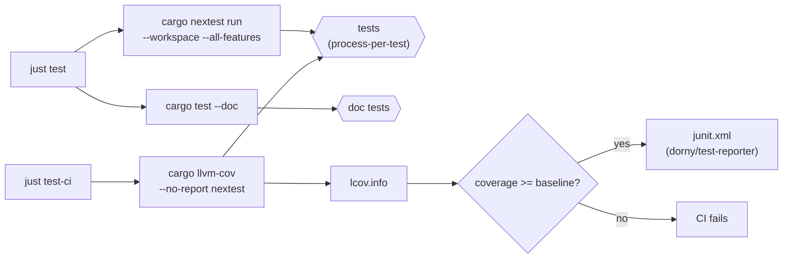
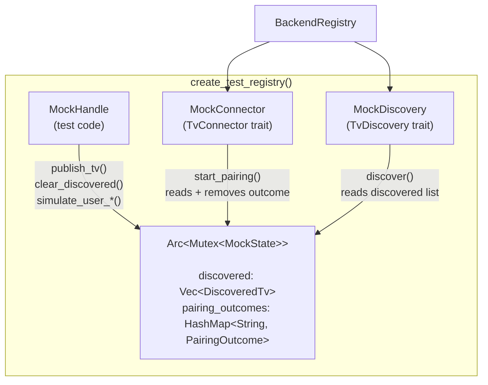
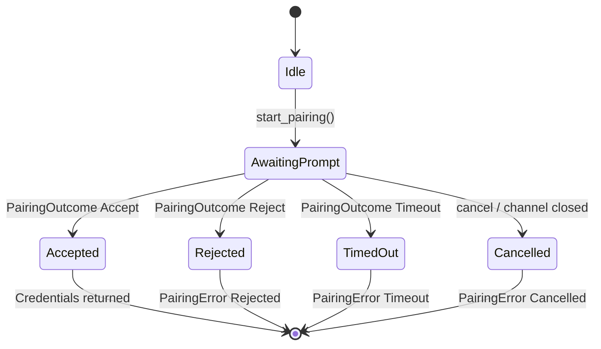
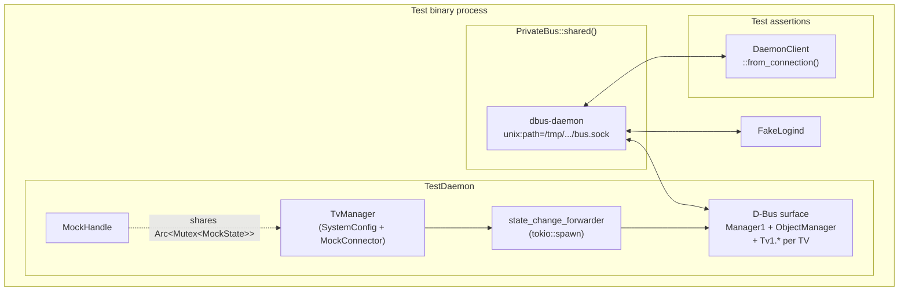
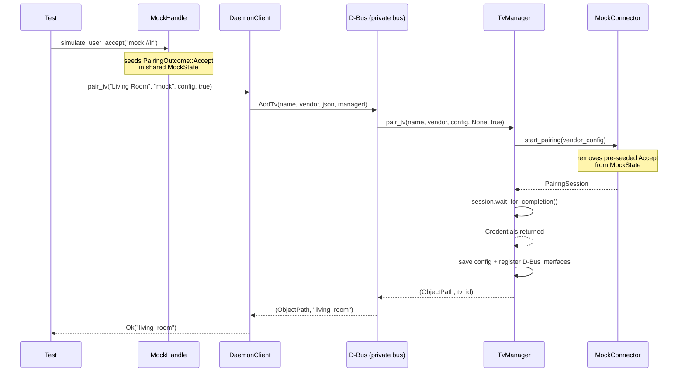
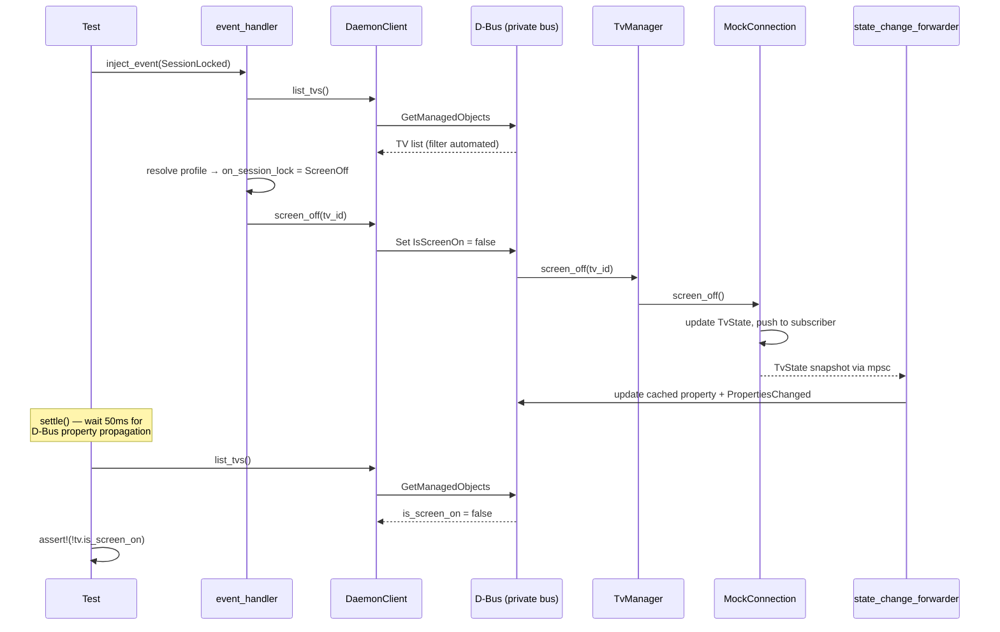

# Testing

This is the single source of truth for how testing works in tisvlay. For quick-reference commands, see the `Tasks & Commands` section in [CLAUDE.md](../.claude/CLAUDE.md). For architecture and D-Bus interface specs, see [design.md](design.md).

## Overview

The testing framework is designed around six principles:

1. **Low friction** — adding a test should be cheap so more tests get written
2. **Regression safety** — catch bugs before they hit production
3. **Coverage as a ratchet** — new code must not lower the baseline
4. **LLM-friendly conventions** — predictable layout, fast feedback, structured output
5. **CI visibility** — results inline on every PR
6. **No real hardware required** — the mock backend enables testing pairing, discovery, profiles, and UX without a TV on the network

## Test runner: cargo-nextest

All compiled tests run through [cargo-nextest](https://nexte.st/). Doc tests use `cargo test --doc` (nextest doesn't support them yet).

```bash
just test         # nextest + doc tests
just test-ci      # nextest with 'ci' profile + coverage + ratchet
```

Configuration: `.config/nextest.toml` with two profiles:

| Profile | Retries | Slow warning | Output |
|---------|---------|--------------|--------|
| `default` | 0 | 60s | terminal |
| `ci` | 1 | 30s | JUnit XML at `target/nextest/ci/junit.xml` |

**Process-per-test isolation** matters because daemon code uses global state (D-Bus well-known names, netlink sockets, config file paths). `cargo test`'s shared-process model would have tests stepping on each other.

### Test execution pipeline



## Test types

| Type | Location | Tool | When |
|------|----------|------|------|
| Unit | `#[cfg(test)] mod tests` in source | built-in | every change |
| Integration | `crates/*/tests/*.rs` | built-in | every change |
| Doc | `///` examples in `pub` items | `cargo test --doc` | every change |
| Parameterized | unit/integration | `rstest` | every change |
| Property | unit/integration | `proptest` | every change |
| Snapshot | `crates/*/tests/snapshots/` | `insta` | every change |
| Mock backend | `tisvlay-backends/tests/`, `tisvlayd/tests/` | mock crate | every change |

### Parameterized tests (rstest)

One test function, many inputs. Each case reported individually by nextest.

```rust
use rstest::rstest;

#[rstest]
#[case::simple("living_room", "/org/tisvlay/Tv/living_room")]
#[case::with_dash("living-room", "/org/tisvlay/Tv/living_room")]
#[case::with_space("living room", "/org/tisvlay/Tv/living_room")]
fn tv_path_sanitization(#[case] tv_id: &str, #[case] expected: &str) {
    assert_eq!(tv_path(tv_id), expected);
}
```

### Property tests (proptest)

Discovers unknown failures via random inputs, shrinks to minimal repro.

```rust
use proptest::prelude::*;

proptest! {
    #[test]
    fn tv_path_suffix_is_valid(tv_id in ".*") {
        let path = tv_path(&tv_id);
        let suffix = path.strip_prefix(&format!("{}/", TV_BASE_PATH)).unwrap();
        prop_assert!(suffix.chars().all(|c| c.is_alphanumeric() || c == '_'));
    }
}
```

When a proptest fails, it writes a `.proptest-regressions` file. **Commit these files** — they replay the failing seed on future runs.

### Snapshot tests (insta)

Compare generated output against saved reference files. Workflow:

1. Write test: `insta::assert_json_snapshot!(value)`
2. `just test` — new/changed snapshots fail, write `.snap.new`
3. `just test-snapshot-review` — interactive diff TUI
4. Commit updated `.snap` files

Snapshots live in `crates/*/tests/snapshots/`.

### CLI snapshot tests (insta-cmd)

`crates/tisvlay-cli/tests/pair_snapshot.rs` snapshots the `tisvlay pair` and `tisvlay list` CLI output. A `TestDaemon` runs in-process on the private bus; the CLI binary is spawned as a subprocess with `DBUS_SESSION_BUS_ADDRESS` pointing at the test bus.

```rust
assert_cmd_snapshot!(Command::new(cli_bin())
    .env("DBUS_SESSION_BUS_ADDRESS", &bus_addr)
    .arg("--user")
    .arg("pair")
    .arg("mock://living_room")
    .arg("--vendor")
    .arg("mock")
    .arg("--name")
    .arg("Living Room"));
```

These tests use `#[tokio::test(flavor = "multi_thread")]` because `assert_cmd_snapshot!` blocks the current thread with `std::process::Command::output()` — the TestDaemon's D-Bus server tasks need other threads to handle incoming calls from the subprocess.

## Coverage

Measured with `cargo-llvm-cov`, ratcheted in CI.

```bash
just cov          # text summary
just cov-html     # HTML report in browser
just cov-lcov     # lcov.info for VS Code Coverage Gutters
just cov-ratchet  # fails if below baseline (CI uses this)
```

The baseline lives in `justfile` as `cov_baseline_lines`. Bump it on PRs that improve coverage; never lower it. Run `just cov` to see the current number.

## Mock backend (tisvlay-mock)

Implements the full `TvBackend` / `TvConnector` / `TvConnection` / `TvDiscovery` trait surface with an in-memory state machine. Feature-gated behind `mock` on `tisvlay-backends` (default-off in release, default-on in workspace dev/test builds).

Key properties:
- Reports `Transport::Network` and `survives_source_ip_change() -> false` (same paths as LG)
- `subscribe_state()` returns a real `mpsc::UnboundedReceiver<TvState>` pushing cumulative snapshots on every mutation (mirrors LG's SSAP model)
- Pairing state machine matches LG's two-phase flow

### Shared state architecture

The mock's three consumers share a single `Arc<Mutex<MockState>>`. The handle is the test's control surface; the connector and discovery are the trait implementations the daemon calls.



### Pairing state machine

The mock mirrors LG's two-phase pairing flow. `PairingOutcome` is seeded by the test (via handle or config shorthand) before `start_pairing()` consumes it.



### MockHandle — test-driven control surface

Tests drive discovery and pairing via `MockHandle`:

```rust
let (registry, mock) = create_test_registry();

mock.publish_tv(DiscoveredTv::new("lr", "Living Room", "mock://lr", "mock"));
mock.simulate_user_accept("mock://lr");

let tvs = registry.discover_tvs("mock", Duration::from_secs(1)).await?;
// ... start pairing — it auto-accepts ...
```

**Methods:**
- `publish_tv(DiscoveredTv)` / `clear_discovered()` — populate/clear the "network"
- `simulate_user_accept(tv_id)` / `simulate_user_reject(tv_id)` / `simulate_pairing_timeout(tv_id)` — drive pairing

**Config shorthand:** tests that don't need fine-grained control can set `[tv.mock] pairing = "accept"|"reject"|"timeout"`. If both shorthand and handle are set, **the handle wins**.

Each test gets its own `(registry, handle)` pair — parallel by construction.

### Running the mock in development

```toml
[[tv]]
id = "dev_mock"
name = "Mock Living Room"
vendor = "mock"
managed = true

[tv.mock]
address = "mock://living_room"
initial_volume = 30
initial_input = "HDMI_1"
inputs = [["HDMI_1", "HDMI 1"], ["HDMI_2", "HDMI 2"]]
```

```bash
cargo run --bin tisvlayd --features mock -- --session
```

## Test harness: tisvlay-test-support

Dev-only crate providing shared infrastructure. Never shipped in release.

### PrivateBus

Spawns one private `dbus-daemon` per test binary via `LazyLock`.

```rust
let bus = PrivateBus::shared();
let conn = bus.connect().await?;
```

Key design:
- `PR_SET_PDEATHSIG = SIGKILL` — kernel kills daemon on test crash
- Env scrubbing (`DBUS_SESSION_BUS_ADDRESS`, `DBUS_SYSTEM_BUS_ADDRESS`, `DBUS_STARTER_*`) — isolates from user session
- `Builder::address(...)` — bypasses zbus's `OnceCell` connection cache
- Binary-level isolation via nextest's process-per-binary model

### Fake D-Bus services

Hand-rolled stubs for system services the daemon depends on:

| Fake | Real service | Key capability |
|------|-------------|----------------|
| `FakeLogind` | `org.freedesktop.login1.Manager` | `Inhibit` method + `PrepareForSleep` signal |
| `FakeScreenSaver` | `org.freedesktop.ScreenSaver` | `GetSessionIdleTime` + `ActiveChanged` signal |

Register on any bus connection:

```rust
let logind = FakeLogind::register(&conn).await?;
logind.emit_prepare_for_sleep(true).await?;

let ss = FakeScreenSaver::register(&conn).await?;
ss.emit_active_changed(true).await?;  // simulate lock
```

### Tracing re-exports

`tisvlay-test-support` re-exports `tracing_test::traced_test` and `tracing_mock` so consumers don't need separate dep entries.

## Daemon testing (TestDaemon)

`tisvlayd::test_harness::TestDaemon` builds a fully wired daemon on the shared private bus. Feature-gated on `mock`.

### Test harness wiring



```rust
use tisvlayd::test_harness::TestDaemon;
use tisvlay_core::DaemonClient;

#[tokio::test]
async fn my_test() {
    let daemon = TestDaemon::with_one_mock_tv("my_tv").await.unwrap();
    let client = DaemonClient::from_connection(
        tisvlay_test_support::PrivateBus::shared().connect().await.unwrap(),
    ).await.unwrap();

    daemon.manager().reconnect("my_tv").await.unwrap();
    // ... assert via client.list_tvs(), daemon.handle(), etc.
}
```

**Constructors:**
- `with_one_mock_tv(tv_id)` — one managed mock TV, default profile
- `with_config(SystemConfig)` — fully custom config
- `mock_tv_config(tv_id, managed, primary_input)` — helper for SystemConfig

**Holds:** `MockHandle`, `Arc<TvManager>`, `zbus::Connection`. Forwarder task aborted on drop; connection release unregisters the name.

**Integration tests:**
- `tests/test_harness_smoke.rs` — basic wiring
- `tests/profile_dispatch.rs` — system event dispatch
- `tests/automated_gate.rs` — managed x automate_when gate
- `tests/concurrent_tvs.rs` — multi-TV independence
- `tests/dbus_contract.rs` — property cache + command round-trips
- `tests/pair_round_trip.rs` — full pairing flow through D-Bus

### Pairing round-trip flow

This is the full code path exercised by `pair_round_trip.rs` — the test that discovered the TV ID bug.



### BusKind and from_connection constructors

`tisvlay_core::BusKind` enum (`Session | System | Address(&str)`) is shared by both services. Tests use `BusKind::Address(bus.address())` to point at the private bus.

`DaemonClient::from_connection(conn)` and `StateWatcher::from_connections(daemon_conn, session_conn, config)` bypass the zbus `OnceCell` cache so each test gets an isolated connection.

## Session testing (TestSession)

`tisvlay_session::test_harness::TestSession` wires a `TestDaemon` + `DaemonClient` + `SessionState` + `FakeScreenSaver` + event handler on the shared private bus. Feature-gated on `mock`.

```rust
use tisvlay_session::test_harness::TestSession;
use tisvlay_session::session_monitor::SessionEvent;

#[tokio::test]
async fn session_lock_dispatches_screen_off() {
    let session = TestSession::new("my_tv").await.unwrap();
    session.inject_event(SessionEvent::SessionLocked);
    tokio::time::sleep(Duration::from_millis(50)).await;

    let tvs = session.client().list_tvs().await.unwrap();
    assert!(!tvs[0].is_screen_on);
}
```

**Methods:**
- `inject_event(SessionEvent)` — push directly into event handler (deterministic)
- `screensaver()` — access FakeScreenSaver for round-trip signal tests
- `client()` / `daemon()` / `state()` — access internals for assertions

**Integration tests:**
- `tests/session_events.rs` — lock/unlock/idle/greeter dispatch
- `tests/session_dbus_contract.rs` — Session1 interface methods + signals

### Session event dispatch flow

This is the round-trip exercised by `session_events.rs` when a `SessionLocked` event is injected.



## Test observability

### #[traced_test] — per-test log capture

Installs a subscriber that captures all `tracing` events. On failure, dumps them to stderr. On success, discards.

```rust
use tisvlay_test_support::traced_test;

#[traced_test]
#[tokio::test]
async fn my_test() {
    // ... test code ...
    assert!(logs_contain("expected log message"));
}
```

The `no-env-filter` feature is pinned so events from dependency crates (tisvlay-mock, tisvlay-test-support, the daemon) are captured — the upstream default only captures the test binary's own crate.

### tracing-mock — observability regression tests

Assert that production code emits specific spans/events with the right fields. Catches refactors that silently remove instrumentation.

```rust
use tisvlay_test_support::tracing_mock::{expect, subscriber};
use tracing::subscriber::set_default;

#[test]
fn publish_tv_emits_instrumented_debug_event() {
    let (sub, handle) = subscriber::mock()
        .new_span(expect::span().named("publish_tv").with_fields(
            expect::field("tv_id").with_value(&tracing::field::display("lr")),
        ))
        .enter(expect::span().named("publish_tv"))
        .event(expect::event().at_level(tracing::Level::DEBUG))
        .exit(expect::span().named("publish_tv"))
        .drop_span(expect::span().named("publish_tv"))
        .run_with_handle();

    let _guard = set_default(sub);
    // ... drive code that emits the span ...
    handle.assert_finished();
}
```

## Deterministic time

`tokio::time::pause()` + `advance()` enables tests to control the clock without real sleeps. Validated by the clock spike test (`tisvlay-test-support/tests/clock_spike.rs`).

Use `#[tokio::test(start_paused = true)]` — no explicit `pause()` needed.

**Caveat:** zbus uses internal timers that don't cooperate with Tokio's paused clock. Tests involving real D-Bus round-trips (e.g., session event tests) must use real-time sleeps. See [docs/todo.md](todo.md#session-event-tests-use-real-time-sleeps).

## TV ID rules

TV IDs must match `[A-Za-z0-9_]+` — validated at config load time. This ensures the ID can be used directly as a D-Bus object path component without lossy sanitization.

- `is_valid_tv_id(id)` — validation
- `tv_id_from_name(name)` — generation (lowercases, `_` for spaces, strips rest)
- Config load rejects invalid IDs with a suggested fix
- Duplicate IDs rejected at load time

Background: see [docs/bugs.md](bugs.md#tv-id--d-bus-path-inconsistency).

## Known constraints

### Name ownership is bus-global

`TestDaemon` and `TestSession` each register a well-known D-Bus name. Only one can exist per bus. Nextest's process-per-test model means this works today, but tests within a single binary that both create a `TestDaemon` would collide.

### Real-time sleeps in D-Bus tests

Session event tests use `sleep(50ms)` after injecting events. This is a pragmatic trade-off — deterministic time doesn't work with zbus. See [docs/todo.md](todo.md) for mitigation options (poll-with-timeout recommended for future improvement).

## Architecture decisions

These document **why** the framework is shaped this way:

1. **Private dbus-daemon per test binary** (not per test, not shared across binaries). Avoids zbus's `OnceCell` connection cache; amortizes 15-40ms spawn cost via `LazyLock`.

2. **`std::sync::Mutex` for MockState** (not tokio). Brief critical sections never held across `.await` — async mutex overhead unnecessary.

3. **Rust-native fakes** (not Python dbusmock). Keeps toolchain Rust-only; zbus `ObjectServer` is expressive enough for the few services we mock.

4. **`from_connection` constructors** (not feature flags or doc(hidden)). General-purpose, useful outside tests. No dead code risk.

5. **ID → path allowed, path → ID never.** The D-Bus path is a derived artifact. `AddTv` returns the canonical ID; `DaemonClient::pair_tv` uses it directly.

6. **Handle wins over shorthand.** When both `MockHandle::simulate_user_*` and the config `pairing = "..."` shorthand are set, the handle takes precedence — it's the authoritative state machine input.

7. **`no-env-filter` on tracing-test.** Without it, events from dependency crates are invisible in test output. This is a non-obvious default that caused a test failure before being pinned.

## Future work

Deferred until the framework matures or a specific need arises:

- **Codecov upload** — pre-written in `.github/workflows/ci.yml`, commented out. Uncomment when the repo goes public (one-line change).
- **Mutation testing** (`cargo-mutants`) — worth running once coverage stabilizes; would surface tests that pass but don't actually assert meaningful properties.
- **Fuzzing** (`cargo-fuzz`) — needs clear input-parsing entry points; defer until something obvious emerges (e.g., SSAP message parsing).
- **Benchmark infrastructure** (`criterion`, `bencher`) — performance is not a current concern for tisvlay.
- **`cargo-deny` / `cargo-audit`** — supply chain security; separate concern from testing, tracked elsewhere.
